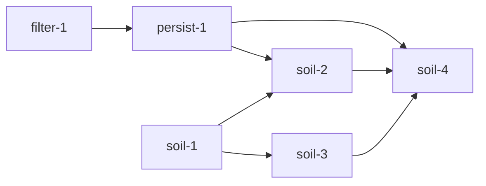

# Soil layer plan

You want each soil polygon stored as its own geography, with its own id, so a later map can paint that polygon and ask which parcels it touches. This plan does not paint the map. It sets the tables, the upsert, and the overlap acres.

Union County is the first adapter. It reads MapServer layer 197. A polygon is not keyed by a parcel. The join table stores a polygon UUID, `parcels.id`, and the overlap acres. A second run upserts and keeps those UUIDs.

Stored map geometry stays `GEOMETRY(Geometry, 3857)`. Overlap acres are computed in EPSG:2264. Soil never inserts a parcel. The PRs are filter-1, soil-1, persist-1, soil-2, soil-3, and soil-4. The operator lands each one.

The county ingest uses one HTTP client at one request per second. It sends the vacant filter on the parcel query, pages 2000 rows, and writes each page in that loop. The overlap insert is one SQL statement.

## How to read this

One box is one unit of work. Every box names the evidence that checks it. A nested box is a sub-step of the box above it. Check a box only when its evidence exists, a file, a log line, a screenshot, a test run, or a SHA. The body is a how-to. The appendices explain and record.

The program runs `pstack/skills/poteto-mode/playbooks/autopilot-stack.md`. Implementers stop at merge-ready. The operator lands filter-1, soil-1, persist-1, soil-2, soil-3, and soil-4. Nobody merges from the checklist.

Tests alone are not sufficient verification. A PR is verified only when its unit, live, and perf boxes are all checked.

## Program checklist

### Arm the program

- [ ] State the protocol and this plan to the operator, then stop. Start execution only on the operator's explicit go.
- [ ] Read these from trunk at program start. Re-read them at every tick.
  - [ ] `git show origin/main:pstack/skills/poteto-mode/playbooks/autopilot-stack.md`
  - [ ] `git show origin/main:pstack/skills/swarm/SKILL.md`
  - [ ] `git show origin/main:pstack/skills/poteto-mode/playbooks/opening-a-pr.md`
  - [ ] `git show origin/main:pstack/skills/control-cli/SKILL.md`
  - [ ] `git show origin/main:plans/soil-layer.md`
  - [ ] `git show origin/main:plans/county-id-package.md`
  - [ ] `git show origin/main:plans/scraper-enrichment.md`
  - [ ] `git show origin/plan/parcel-sales-uuid-ids:plans/parcel-sales-uuid-ids.md`
- [ ] When a `git show origin/main:pstack/` path fails, read the installed poteto-mode copy of that playbook. Do not add a `pstack/` tree in this program. Appendix C records the missing `control-cli` skill.
- [ ] On the operator's go, arm the audit tick as `/loop 1h` with the tick prompt below. Never leave the cadence to memory.
- [ ] Use this tick prompt, verbatim. "Re-read the execution playbook from trunk. Audit the operation against it and fix drift in this tick. Probe every active lane and judge progress by side effects only. Stand down a stuck lane and dispatch its replacement now. Then post a short status message to the operator in chat only when the audit found a tracked change that no earlier status message reported, such as a PR opened, a code-ready head, a round launched or closed, a verdict, a merge, a stuck agent and the action taken, a blocker added or cleared, or a decision only the operator can make. Name every such change and nothing else. Do not repeat a table, the merged list, or an unchanged blocker. If the audit found none, end the turn with no reply text. Either way, log this tick's row in your decision trail. The row names the items reported, or none."
- [ ] On the operator's hold or stand-down, send every owner a zero-writes order at once.

### Spawn owners

- [ ] Spawn one owner per PR with the full lifecycle the execution playbook names.
- [ ] Follow this dependency graph. Start dependent work only after its parent merges, or base it on the parent branch when the execution playbook stacks.



  - [ ] filter-1 and soil-1 are independent and first. Both branch from `main`. county-1 is already on trunk, so soil-1 does not wait. If `internal/county` is missing at program start, stop soil-1 and wait for county-1. Do not declare a second county type in this program.
  - [ ] persist-1 after filter-1. It is the PR that pages vacant parcels at 2000 rows.
  - [ ] soil-3 after soil-1. It does not edit `gis.go`.
  - [ ] soil-2 after soil-1 and persist-1. persist-1 and soil-2 both edit `gis.go` and `gis_test.go`, so soil-2 waits. Soil pages use the client persist-1 already rate limits.
  - [ ] soil-4 after persist-1, soil-2, and soil-3.
- [ ] Hold the file boundaries. filter-1 touches only `internal/connector/union/vacant_filter.go` and `internal/connector/union/vacant_filter_test.go`. soil-1 touches only `internal/soil/polygon.go`, `internal/soil/mapunit.go`, `internal/soil/overlap.go`, `internal/connector/union/soil_translate.go`, `internal/connector/union/soil_translate_test.go`, and `internal/connector/union/testdata/soil/`. persist-1 touches only `internal/service/parcel_id_importer.go`, `internal/service/parcel_id_importer_test.go`, `internal/parcelstore/parcels.go`, `internal/parcelstore/parcels_test.go`, `internal/connector/union/gis.go`, `internal/connector/union/gis_test.go`, and `main.go`. If uuid-2 already created other files in `internal/parcelstore/`, persist-1 does not edit them. soil-2 touches only `internal/connector/union/gis.go`, `internal/connector/union/gis_test.go`, `internal/connector/union/soil_fetch.go`, and `internal/connector/union/testdata/soil/layer197-page.json`. soil-3 touches only the one new `db/migrations/<prefix>_soil.sql` file named in its Files box. soil-4 touches only `internal/soil/join.go`, `internal/soil/join_test.go`, `internal/soil/names.go`, `internal/soil/names_test.go`, and `main.go`. No PR adds a join worker pool.
- [ ] Hold the review gate. No PR in this program changes an interaction. None wait for screenshots in chat before the operator decides to land them.

### PR mechanics, for every PR

- [ ] Resolve the forge once. Default to `gh`. If `command -v origin` succeeds and Origin can resolve the repository, use `origin pr` for every PR operation. Record any fallback to `gh`. Never require `gt`.
- [ ] Open the PR ready, never draft, per **Opening a PR**. Use the run's built-in PR tool when it has one, else `origin pr create --status open --base <base-branch>` or `gh pr create --base <base-branch>` according to the resolved forge. A stack child targets its parent branch.
- [ ] Run the repo's lint and typecheck once before the PR-facing push. Push with hooks on.
- [ ] Run `/deslop` before each commit and `/no-comments` before review.
- [ ] Triage every Bugbot and security-reviewer comment per `pstack/skills/poteto-mode/references/bugbot-triage.md`.
- [ ] Rebase onto current trunk before the code-ready report and babysit. Keep that merge base in fix rounds. Rebase again only at merge prep, on a `git merge-tree` conflict with trunk, on a CI failure that comes from a change on trunk, or when a known concurrent change to the same files lands. persist-1 rebases onto filter-1. soil-3 rebases onto soil-1. soil-2 rebases onto soil-1 and persist-1. soil-4 rebases onto persist-1, soil-2, and soil-3 after those parents are stacked.

### Verdict and merge, for every PR

- [ ] A full swarm runs once, at the code-ready head. Another full swarm runs only for new behavior, a redesign, or a large new diff. A rebase, a merge-conflict resolution, or a minor fix gets a single verifier at the new head, and a wording-only change gets none. Run each full swarm per `pstack/skills/swarm/SKILL.md`. One gates lane. The ten live lanes from the PR's **Verify, live** block. The perf lane from its **Verify, perf** block. Two or more audit lanes, each with its own focus, that read the diff and the receipts and distrust the PR body. The root audits the receipts in the merge-ready report before the verdict.
- [ ] Judge every finding by the execution playbook's blocking rule. The verdict is clean when none blocks. A failure on trunk behavior in a lane marked `Regression lane against trunk.` is recorded against trunk and does not block the PR. A new head gets a fresh verdict, except for results that stay valid under the patch-id rule in `playbooks/shipping.md`.
- [ ] Stop when the PR is verified and green at its current head, then hand it to the operator. Do not merge. A restack that leaves `git patch-id` unchanged keeps the verdict. After the handoff, nobody pushes without the operator's go.

### Boot recipe, for every live lane

Each live lane runs on its own cloud VM at the PR head. This repo has no map UI for soil. There is no `control-cli` skill on trunk. Appendix C records that gap. Drive the Go test binary and, where a lane says so, `curl` and `psql`.

- [ ] `git fetch origin <head-branch> && git checkout <head SHA>`.
- [ ] Run `go test -race ./... -count=1`. For a lane that queries Postgres, start PostGIS the way `make migrate-up` does, apply migrations, and wait until `psql` accepts a query.
- [ ] Deliver input only through those commands. Read-only diagnostics are the test output, the `curl` body, and the `psql` result rows.
- [ ] Save every screenshot to `/tmp/swarm-<pr-id>/worker-<n>/<slug>.png` and return the paths with the report. A lane with no display saves a text render of the command output at that path.

## Drop the dead vacant clauses (filter-1)

**Depends on.** None.

**Files.**

- [ ] Edit `internal/connector/union/vacant_filter.go`.
- [ ] Edit `internal/connector/union/vacant_filter_test.go`.

**Build.**

- [ ] Keep a parcel when `YEARBLT` or `SQFT` is numeric 0. Appendix A measured that set at 25,884 layer 215 features.
- [ ] Delete the `FMV_IMPRV` currency-string clause and the `RURAL ACREAGE TRACT` clause. Neither matches a live row. Do not add numeric `FMV_IMPRV = 0`. Do not add unconditional `LAND_TYPE = 'RURAL ACRES'`. Appendix A records why both would mark houses vacant.
- [ ] Add table rows for numeric `FMV_IMPRV` 0 with `YEARBLT` 2025, for `RURAL ACRES` with `YEARBLT` 1997 and `SQFT` greater than 0, and for `RURAL ACRES` with `YEARBLT` 0. The first two are false. The third is true because the year is 0.

**You see.**

- [ ] `go test -race ./internal/connector/union/ -count=1 -run TestIsLikelyVacantGISRecord` prints `PASS`, and the 2025 house case is false.

**Verify, unit.** Tests alone are not sufficient verification. A PR is verified only when its unit, live, and perf boxes are all checked.

- [ ] `vacant_filter_test.go` gains the three rows above and drops the expectation that `"$0"` or `"Rural acreage tract"` alone is vacant. Those two cases are `want: true` today, at lines 38 to 57. Run `go test -race ./internal/connector/union/ -count=1 -run TestIsLikelyVacantGISRecord`.

**Verify, live.** Tests alone are not sufficient verification. A PR is verified only when its unit, live, and perf boxes are all checked. Ten lanes on `grok-4.7-xhigh-fast` at the PR head, per the boot recipe.

- [ ] Lane 1. Regression lane against trunk. Run `go test -race ./internal/connector/union/ -count=1 -run TestIsLikelyVacantGISRecord` at trunk and at head. Trunk still treats `"$0"` as vacant. Record that, and gate the head cases in Appendix A. Save `/tmp/swarm-filter-1/worker-1/regression.png`. Pass when trunk's old test passes and head's new cases pass.
- [ ] Lane 2. Numeric `FMV_IMPRV` 0, `YEARBLT` 2025, `SQFT` 3391. Save `/tmp/swarm-filter-1/worker-2/fmv-house.png`. Pass when the function returns false.
- [ ] Lane 3. `LAND_TYPE` `RURAL ACRES`, `YEARBLT` 1997, `SQFT` 22797. Save `/tmp/swarm-filter-1/worker-3/rural-house.png`. Pass when the function returns false.
- [ ] Lane 4. `LAND_TYPE` `RURAL ACRES`, `YEARBLT` 0, `SQFT` 0. Save `/tmp/swarm-filter-1/worker-4/rural-zero.png`. Pass when the function returns true.
- [ ] Lane 5. `FMV_IMPRV` string `$0` and no other vacant field. Save `/tmp/swarm-filter-1/worker-5/currency.png`. Pass when the function returns false.
- [ ] Lane 6. `LAND_TYPE` `Rural acreage tract` and no zero year or sqft. Save `/tmp/swarm-filter-1/worker-6/old-phrase.png`. Pass when the function returns false.
- [ ] Lane 7. `YEARBLT` 0 as float64. Save `/tmp/swarm-filter-1/worker-7/float-year.png`. Pass when the function returns true.
- [ ] Lane 8. Empty attributes. Save `/tmp/swarm-filter-1/worker-8/empty.png`. Pass when the function returns false.
- [ ] Lane 9. Re-query layer 215 for `YEARBLT = 0 OR SQFT = 0`, `FMV_IMPRV = 0`, and `LAND_TYPE = 'RURAL ACRES'`. Save `/tmp/swarm-filter-1/worker-9/live-counts.png`. Pass when the three counts are still 25884, 116241, and 30861, or the lane records the new counts and does not change the rule in this PR.
- [ ] Lane 10. Run the package tests twice. Save `/tmp/swarm-filter-1/worker-10/twice.png`. Pass when both runs pass and the function has no map of seen parcels.

**Verify, perf.** Tests alone are not sufficient verification. A PR is verified only when its unit, live, and perf boxes are all checked.

- [ ] Metric. Wall time of the vacant filter test at trunk and at head. Trunk already has the test. The end state is the same live kept count of parcels with numeric year or sqft 0.
- [ ] Probe. `go test -race ./internal/connector/union/ -count=1 -run TestIsLikelyVacantGISRecord` at trunk, then head, then trunk.
- [ ] Baseline. Record the trunk duration first.
- [ ] Rule. Fail if the head test takes 30 seconds or longer. Do not report a ratio against trunk. The live kept count is not a test timer.

**Review gate.** None. filter-1 is not review-gated.

**Merge.**

- [ ] Root's clean verdict at the exact head SHA.
- [ ] Bugbot triage done.
- [ ] Rebased onto current trunk after the verdict, with `git patch-id` unchanged.
- [ ] The owner does not merge. The operator lands filter-1 before persist-1.

## Add the shared soil types (soil-1)

**Depends on.** None. `internal/county` is already on trunk. If that package is absent at program start, wait for county-1 instead of declaring the type here.

**Files.**

- [ ] Create `internal/soil/polygon.go`.
- [ ] Create `internal/soil/mapunit.go`.
- [ ] Create `internal/soil/overlap.go`.
- [ ] Create `internal/connector/union/soil_translate.go`.
- [ ] Create `internal/connector/union/soil_translate_test.go`.
- [ ] Create `internal/connector/union/testdata/soil/layer197-feature.json` from a live layer 197 feature response. Do not point the test at `docs/examples/`.

**Build.**

- [ ] Import `github.com/JustinMonty20/landman/internal/county`. `Polygon.County` is `county.ID`. Use `county.Union` for Union County. Do not declare `CountyID`, `CountyUnion`, or `Valid` in package `soil`. Do not add a second county constant in this PR.
- [ ] Add `Polygon`, `MapUnit`, and `Overlap` in package `soil`. `Polygon` has `County`, `SourceName`, `ObjectID`, `MapUnitKey`, optional `SpatialVersion`, optional `SurveySavedOn`, and `Shape` at SRID 3857. `ObjectID` is the text form of the county feature id, used later as the upsert key. It is not the application id. Leave the database UUID off this struct. The insert in soil-4 omits `id` so Postgres assigns it. `MapUnit` has `MapUnitKey`, `MapUnitSymbol`, `AreaSymbol`, and optional `MapUnitName` and `AreaName`. `Overlap` has `SoilPolygonID`, `ParcelID`, and `OverlapAcres`. It has no map-unit key and no minimum share.
- [ ] Add `ParseSoilFeature` in package `union`. It returns `soil.Polygon` and `soil.MapUnit`. Set `County` to `county.Union` and `SourceName` to `union_county_gis`. Map `OBJECTID_1` to `ObjectID`, `MUKEY` to `MapUnitKey`, `MUSYM` to `MapUnitSymbol`, `AREASYMBOL` to `AreaSymbol`, and `SPATIALVER` to `SpatialVersion`. Leave `SurveySavedOn` nil. Ignore `HydrcRatng`. Reject a missing `MUKEY`, a missing `MUSYM`, and a geometry with no rings.
- [ ] Set the polygon SRID to 3857, the same constant `unionGISSourceSRID` in `translator.go` line 15. Parse rings the way `geometryShape` does at `translator.go` lines 313 to 337.
- [ ] Do not put these types in `internal/models`. Do not import `internal/service`. Package `soil` does not import `union`.

**You see.**

- [ ] `go test -race ./internal/soil/ ./internal/connector/union/ -count=1 -run TestParseSoilFeature` prints `PASS` and names the ChA fixture.

**Verify, unit.** Tests alone are not sufficient verification. A PR is verified only when its unit, live, and perf boxes are all checked.

- [ ] `soil_translate_test.go` gains a table for the captured ChA feature, a missing `MUKEY`, an empty `features` list, and a geometry with no rings. Do not add `internal/soil/county_test.go`. County id tests stay in `internal/county`. Run `go test -race ./internal/soil/ ./internal/connector/union/ -count=1 -run TestParseSoilFeature`.

**Verify, live.** Tests alone are not sufficient verification. A PR is verified only when its unit, live, and perf boxes are all checked. Ten lanes on `grok-4.7-xhigh-fast` at the PR head, per the boot recipe.

- [ ] Lane 1. Regression lane against trunk. Run `go test -race ./internal/connector/union/ -count=1` at trunk and at head. Trunk has no `ParseSoilFeature`. Record that, and gate the new parser tests plus a green `go test -race ./internal/connector/union/ -count=1` at head. Save `/tmp/swarm-soil-1/worker-1/regression.png`. Pass when trunk's existing union tests pass and head's new parser tests pass.
- [ ] Lane 2. Parse `testdata/soil/layer197-feature.json`. Save `/tmp/swarm-soil-1/worker-2/parse-cha.png`. Pass when `MapUnitSymbol` is `ChA`, `MapUnitKey` is `115341`, `AreaSymbol` is `NC179`, `SpatialVersion` is 5, `County` is `union`, and `HydrcRatng` is not a field on the struct.
- [ ] Lane 3. Feed a feature with no `MUKEY`. Save `/tmp/swarm-soil-1/worker-3/missing-mukey.png`. Pass when `ParseSoilFeature` returns an error and no polygon.
- [ ] Lane 4. Read the fixture rings. Save `/tmp/swarm-soil-1/worker-4/rings.png`. Pass when the stored polygon SRID is 3857 and the first coordinate equals the fixture.
- [ ] Lane 5. Feed an ArcGIS `error` object instead of a feature. Save `/tmp/swarm-soil-1/worker-5/arcgis-error.png`. Pass when the parser returns an error.
- [ ] Lane 6. Feed `{"features":[]}`. Save `/tmp/swarm-soil-1/worker-6/empty-features.png`. Pass when the list result is empty and the error is nil.
- [ ] Lane 7. Feed `OBJECTID` as JSON null and `OBJECTID_1` as 1. Save `/tmp/swarm-soil-1/worker-7/null-objectid.png`. Pass when `ObjectID` is the text `1`.
- [ ] Lane 8. Feed an extra attribute the struct does not name. Save `/tmp/swarm-soil-1/worker-8/extra-field.png`. Pass when the known fields still match the fixture and the extra attribute is not stored.
- [ ] Lane 9. Feed a geometry with an empty `rings` array. Save `/tmp/swarm-soil-1/worker-9/no-rings.png`. Pass when the parser returns an error.
- [ ] Lane 10. Call `ParseSoilFeature` twice on the same fixture bytes. Save `/tmp/swarm-soil-1/worker-10/parse-twice.png`. Pass when the two structs are equal and `SurveySavedOn` is nil both times.

**Verify, perf.** Tests alone are not sufficient verification. A PR is verified only when its unit, live, and perf boxes are all checked.

- [ ] Metric. Wall time of `go test -race ./internal/soil/ ./internal/connector/union/ -count=1` at trunk and at head, plus a count of dials to `atlas.unioncountync.gov`. Trunk has no soil parser, so also record that the new work is the parser test and the end state is a parsed `soil.Polygon`.
- [ ] Probe. Run the test command at trunk, then at head, then at trunk again. Wrap the head run so a dial to `atlas.unioncountync.gov` fails the process.
- [ ] Baseline. Record the trunk duration first. Record trunk soil-parser dials as 0 because the parser does not exist.
- [ ] Rule. Fail the head if it dials `atlas.unioncountync.gov` once, or if the head package test takes 60 seconds or longer. Do not report a ratio against trunk. Trunk does not parse soil.

**Review gate.** None. soil-1 is not review-gated.

**Merge.**

- [ ] Root's clean verdict at the exact head SHA.
- [ ] Bugbot triage done.
- [ ] Rebased onto current trunk after the verdict, with `git patch-id` unchanged.
- [ ] The owner does not merge. The operator lands soil-1 beside filter-1. Neither waits on the other.

## Persist kept parcel shapes (persist-1)

**Depends on.** filter-1.

**Files.**

- [ ] Edit `internal/service/parcel_id_importer.go`.
- [ ] Edit `internal/service/parcel_id_importer_test.go`.
- [ ] Edit `internal/connector/union/gis.go`.
- [ ] Edit `internal/connector/union/gis_test.go`.
- [ ] Create `internal/parcelstore/parcels.go` when the file is absent. Edit it when uuid-2 has already created it.
- [ ] Create `internal/parcelstore/parcels_test.go` when the file is absent. Edit it when it already exists.
- [ ] Edit `main.go`.
- [ ] Do not edit `internal/parcelstore/sales.go` or any other uuid-2 file. Do not write `parcel_sales` from this PR. Do not add `SoilQueryURL` or `FetchSoilPolygons`. soil-2 adds those after this PR.

**Build.**

- [ ] Add an optional kept-record hook on `ParcelIDImportService`. Call it with the filtered `[]connector.RawRecord`, geometry included, before `extractParcelIDs` drops `RawData`. `internal/service` does not import `union` or `parcelstore`.
- [ ] Send the parcel query as `where=YEARBLT = 0 OR SQFT = 0`, `orderByFields=OBJECTID`, and `resultRecordCount=2000`. `FetchBatches` currently hardcodes `where=1=1` and `ResultRecordCount: s.batchSize`. `gis.go` lines 123 to 129. `ArcGISParams` has no order field. `gis.go` lines 40 to 49. Add `orderByFields` and let the import pass the where and the page size. `DefaultGISSourceConfig.BatchSize` stays 50 so the existing default test still locks it. The import must not pass 50. `maxRecordCount` on layer 215 is 2000, and the OID field is `OBJECTID`. Appendix A.
- [ ] Keep `IsLikelyVacantGISRecord` as a guard on each returned record. A row the server should not have sent, such as `YEARBLT` 1998, is not staged. Do not treat a null as numeric zero. Appendix A measured 1,961 rows where both fields are null, and those rows are outside the server count of 25,884. Two rows have null `YEARBLT` and `SQFT` 0. They stay, because `SQFT` is 0, and the Go guard keeps them too.
- [ ] After the pages, if the number of features does not equal the count query, return an error. A body with no numeric `count` is already an error. `gis.go` lines 172 to 175. The page loop today returns nil even when the totals differ. `gis.go` lines 132 to 158. Change that. Stop early when a page is shorter than 2000, then still check the sum.
- [ ] Write each page inside the existing page loop. `FetchBatches` calls `onBatch`, and only then requests the next page. `gis.go` lines 148 to 154. Keep that order. `onBatch` inserts that page's part rows before it returns. Do not collect every page in memory and write once at the end. Do not start the next request before `onBatch` returns. Do not add a prefetch goroutine or a pipeline type.
- [ ] Put the part rows in a `TEMP` table on the import connection. Columns are `source_parcel_id` and `shape`. No migration. After the last page, `ST_Multi(ST_Union(shape))` grouped by `source_parcel_id` upserts `parcels`. The part inserts and that union share one transaction. A cancel rolls it back. Parts of one PID that arrive on different pages meet in the temp table. 109 kept PIDs have more than one feature.
- [ ] Add `parcelstore.SaveParcel` for the final upsert. Insert the parcel and omit `id`. On conflict on `(county_id, source_name, source_parcel_id)`, update the mapped columns, including `shape`, and do not set `id`. Return the stored `parcels.id`. Do not delete a parcel that this run did not see. A second run replaces `shape` with this run's union and keeps `parcels.id`.
- [ ] Return an error when a kept record has no rings. Do not insert a null `shape`. If the union fails, return that error and commit nothing.
- [ ] `main` builds one `GISSource`, leaves `RateLimit` at 1, and passes the vacant where and page size 2000. Do not call `NewRateLimitedClient` a second time. Do not raise the limiter. `main` still cancels after 10 minutes. Appendix A shows the new HTTP budget fits in that cancel, so this PR does not change the deadline.
- [ ] Return a save error from the hook. Do not log it and return nil. Do not write `soil_polygon_parcels`, `soil_polygons`, or `soil_map_units` from this PR.
- [ ] The constructor takes a connection string argument. The package does not read the environment. There is no other plan file for the shape writer. uuid-2 may already own sale rows in the same package. This section is the parcel-shape writer.

**You see.**

- [ ] A fixture whose count is 4500 sends `where=YEARBLT = 0 OR SQFT = 0`, `orderByFields=OBJECTID`, and `resultRecordCount=2000`, then three feature pages and one count query. Two kept features with the same PID become one `parcels` row at SRID 3857, and a second save keeps `parcels.id`.

**Verify, unit.** Tests alone are not sufficient verification. A PR is verified only when its unit, live, and perf boxes are all checked.

- [ ] `parcel_id_importer_test.go` gains a case that the kept-record hook receives geometry and the id hook still receives only strings. It also gains a case that a kept record with no rings returns an error and inserts nothing. `gis_test.go` gains the vacant where, `OBJECTID`, and page size 2000 on the import path. Run `go test -race ./internal/service/ ./internal/parcelstore/ ./internal/connector/union/ -count=1`.

**Verify, live.** Tests alone are not sufficient verification. A PR is verified only when its unit, live, and perf boxes are all checked. Ten lanes on `grok-4.7-xhigh-fast` at the PR head, per the boot recipe.

- [ ] Lane 1. Regression lane against trunk. Run `go test -race ./internal/service/ ./internal/connector/union/ -count=1` at trunk and at head. Trunk has no kept-record hook and pages `where=1=1` at batch size 50. Record that, and gate the new hook plus the old id-hook tests. Save `/tmp/swarm-persist-1/worker-1/regression.png`. Pass when trunk's importer and union tests pass and head's new hook test passes.
- [ ] Lane 2. Save one kept parcel whose rings match the translator fixture. Omit `id` on the insert. Save `/tmp/swarm-persist-1/worker-2/insert-shape.png`. Pass when `ST_SRID(shape)` is 3857, `source_parcel_id` is the PID, and `id` is a UUID.
- [ ] Lane 3. Save the same PID again with a different `mapped_acres`. Do not set `id`. Save `/tmp/swarm-persist-1/worker-3/upsert.png`. Pass when the table still has one row, `id` is unchanged, and `mapped_acres` matches the second save.
- [ ] Lane 4. Save two kept features with the same PID and disjoint squares, on two pages. Save `/tmp/swarm-persist-1/worker-4/two-parts.png`. Pass when one row exists and `ST_Area` of the stored shape equals the sum of the two squares.
- [ ] Lane 5. Serve a count of 4500 and three pages of 2000, 2000, and 500. Save `/tmp/swarm-persist-1/worker-5/page-budget.png`. Pass when the log shows one count query and three feature pages, every feature URL contains `where=YEARBLT = 0 OR SQFT = 0`, `orderByFields=OBJECTID`, and `resultRecordCount=2000`, and none send `resultRecordCount=50`.
- [ ] Lane 6. Return a count of 10 and pages whose features sum to 9. Also serve a count body with no `count` field. Save `/tmp/swarm-persist-1/worker-6/short-count.png`. Pass when both cases return an error and the table gains no row.
- [ ] Lane 7. Serve two pages. Save `/tmp/swarm-persist-1/worker-7/page-loop.png`. Pass when the part insert for page 1 has finished before page 2's request is sent, and the import does not start a second request while that insert is still running.
- [ ] Lane 8. Put one `YEARBLT` 1998 record on a page the server returned. Save `/tmp/swarm-persist-1/worker-8/go-guard.png`. Pass when that PID is not staged and a `SQFT` 0 record on the same page is staged.
- [ ] Lane 9. Save two PIDs, then save only the first PID again. Save `/tmp/swarm-persist-1/worker-9/no-delete.png`. Pass when the omitted PID is still present and its `id` is unchanged.
- [ ] Lane 10. Cancel the context after page 1 is parsed and before the commit. Save `/tmp/swarm-persist-1/worker-10/cancel.png`. Pass when no `parcels` row is committed.

**Verify, perf.** Tests alone are not sufficient verification. A PR is verified only when its unit, live, and perf boxes are all checked.

- [ ] Metric. Feature-page count for a fixture whose server count is 4500, the `resultRecordCount` on those URLs, the one-parcel upsert time, and whether `parcels.id` changed. Trunk pages `where=1=1` at batch size 50 and has no writer. The end state is a vacant import at page size 2000 and one stable parcel row.
- [ ] Probe. The httptest counter around the import, at head, after a trunk run that records `where=1=1` and batch size 50. Then time the one-parcel upsert at head and run it a second time. Do not download the county inside this probe. The county arithmetic is in Appendix A.
- [ ] Baseline. Record trunk as batch size 50, `where=1=1`, and no writer.
- [ ] Rule. Fail if the 4500 fixture issues more than 4 HTTP calls, if any feature URL sends `resultRecordCount` other than 2000, or if any import URL sends `where=1=1`. Fail if the one-parcel upsert takes 5 seconds or longer, if the second upsert leaves a row count other than 1, or if `parcels.id` changes. Do not report a ratio against trunk. The 10 minute cancel stays. Appendix A shows 21 county HTTP calls fit inside it.

**Review gate.** None. persist-1 is not review-gated.

**Merge.**

- [ ] Root's clean verdict at the exact head SHA.
- [ ] Bugbot triage done.
- [ ] Rebased onto filter-1 after the verdict, with `git patch-id` unchanged.
- [ ] The owner does not merge. The operator lands persist-1 after filter-1 and before soil-2 and soil-4.

## Page the soil layer on the GIS rate limiter (soil-2)

**Depends on.** soil-1 and persist-1. persist-1 adds `orderByFields` and is the other editor of `gis.go`.

**Files.**

- [ ] Edit `internal/connector/union/gis.go`.
- [ ] Edit `internal/connector/union/gis_test.go`.
- [ ] Create `internal/connector/union/soil_fetch.go`.
- [ ] Create `internal/connector/union/testdata/soil/layer197-page.json` from a live paged response that includes `exceededTransferLimit`.

**Build.**

- [ ] Add `SoilQueryURL` to `GISSourceConfig`, set in `DefaultGISSourceConfig` to `https://atlas.unioncountync.gov/server/rest/services/OperationalLayers/MapServer/197/query`. Leave `BaseURL` as the layer 215 query URL. `TestDefaultGISSourceConfig` already locks that parcel URL.
- [ ] Add `FetchSoilPolygons(ctx) ([]soil.Polygon, []soil.MapUnit, error)` on `GISSource`. Each polygon uses `county.Union`. Build the request with the existing `s.httpClient`. Do not call `NewRateLimitedClient` again.
- [ ] Page with `resultOffset`, `resultRecordCount` 2000, and `orderByFields=OBJECTID_1`. Use the `orderByFields` field persist-1 added. Do not add a second copy of it. Do not page without the order. Do not use `GISSource.batchSize`. That value is 50 and would turn this pull into hundreds of requests.
- [ ] Stop when a page returns fewer than 2000 features. If the pages do not add up to the count query, return an error. A body with no numeric `count` is an error. persist-1 makes the parcel pager fail that check. Use the same failure for soil pages. Do not restore the old nil return from `gis.go` lines 132 to 158. `queryTotalParcels` already returns an error when `count` is missing. `gis.go` lines 172 to 175. Keep that check.
- [ ] Soil pages and parcel pages share `s.httpClient`. Run the soil loop, then the parcel loop, on that one client. Do not construct another rate limited client for layer 197, and do not raise `RateLimit`. Do not fetch the two layers from two goroutines. Appendix A adds the 6 soil feature pages and the soil count query to the 13 vacant feature pages and the parcel count query. The combined budget is 21 HTTP calls.
- [ ] Treat HTTP status outside 200 to 299 as an error that includes the status. `get` already does this at `gis.go` lines 226 to 228. Treat an ArcGIS `error` object as an error. `fetchBatch` does not. `gis.go` lines 190 to 210. Do not copy that silence. Send `User-Agent` `ParcelDataCollection/0.0.1`, the same header as `get` at `gis.go` line 219.
- [ ] Before each page, if `ctx.Err()` is set, return `ctx.Err()` and do not start the request. Pass that `ctx` into `http.NewRequestWithContext` and into `RateLimitedClient.Do`.
- [ ] Out fields are `OBJECTID_1,AREASYMBOL,SPATIALVER,MUSYM,MUKEY`. `returnGeometry` is true. `where` is `1=1`. `f` is `json`. Do not request `HydrcRatng`.
- [ ] Keep this commit after a separate commit that only adds `SoilQueryURL` and its test, if that URL field lands without the fetch loop. Do not redesign `BaseURL` into a MapServer root in this PR.

**You see.**

- [ ] The httptest log shows two soil page URLs, the second with `resultOffset=2000`, and then the function returns. A 500 from the fixture server fails the test with the status in the error string.

**Verify, unit.** Tests alone are not sufficient verification. A PR is verified only when its unit, live, and perf boxes are all checked.

- [ ] `gis_test.go` gains a default `SoilQueryURL` assertion and an httptest that pages two responses, one with `exceededTransferLimit` true. Run `go test -race ./internal/connector/union/ -count=1 -run 'TestFetchSoilPolygons|TestDefaultGISSourceConfig'`.

**Verify, live.** Tests alone are not sufficient verification. A PR is verified only when its unit, live, and perf boxes are all checked. Ten lanes on `grok-4.7-xhigh-fast` at the PR head, per the boot recipe.

- [ ] Lane 1. Regression lane against trunk. Run `go test -race ./internal/connector/union/ -count=1` at trunk and at head. Trunk has no `FetchSoilPolygons`. Record that, and gate the new paging tests plus the existing GIS tests still passing. Save `/tmp/swarm-soil-2/worker-1/regression.png`. Pass when trunk's union tests pass and head's paging tests pass.
- [ ] Lane 2. Serve two pages from httptest, the first with 2000 features and `exceededTransferLimit` true, the second with 1250. Save `/tmp/swarm-soil-2/worker-2/two-pages.png`. Pass when both URLs contain `orderByFields=OBJECTID_1`, the offsets are 0 and 2000, and the client returns 3250 polygons.
- [ ] Lane 3. Ask the fixture to ignore a client `resultRecordCount` above 2000 and still return 2000. Save `/tmp/swarm-soil-2/worker-3/cap.png`. Pass when the client never sends `resultRecordCount` greater than 2000.
- [ ] Lane 4. Return HTTP 500 on the first page. Save `/tmp/swarm-soil-2/worker-4/http-500.png`. Pass when the error text contains 500 and the function does not return a polygon slice with a nil error.
- [ ] Lane 5. Return HTTP 200 and an ArcGIS `error` object. Save `/tmp/swarm-soil-2/worker-5/arcgis-error.png`. Pass when the function returns an error.
- [ ] Lane 6. Cancel the context after the first page is read and before the second `Do`. Save `/tmp/swarm-soil-2/worker-6/cancel.png`. Pass when the second request is absent from the httptest log and the error is `context.Canceled`.
- [ ] Lane 7. Count `RateLimitedClient.Do` calls on the source's existing client. Save `/tmp/swarm-soil-2/worker-7/one-limiter.png`. Pass when soil paging and a parcel page both call that same client, and `FetchSoilPolygons` does not construct another limiter.
- [ ] Lane 8. Count query returns 11250 and the pages return 11249 features. Also serve a count body with no `count` field. Save `/tmp/swarm-soil-2/worker-8/short-count.png`. Pass when both cases return an error.
- [ ] Lane 9. Read `DefaultGISSourceConfig`. Save `/tmp/swarm-soil-2/worker-9/urls.png`. Pass when `BaseURL` still ends in `/MapServer/215/query` and `SoilQueryURL` ends in `/MapServer/197/query`.
- [ ] Lane 10. Call `FetchSoilPolygons` twice against a fixture whose second response has a different `MUKEY` on object 1. Save `/tmp/swarm-soil-2/worker-10/second-fetch.png`. Pass when the second return value replaces the first in the caller's hands and does not append to a package-level slice.

**Verify, perf.** Tests alone are not sufficient verification. A PR is verified only when its unit, live, and perf boxes are all checked.

- [ ] Metric. Requests issued to pull a layer whose count is 11250 at page size 2000. Trunk issues no soil requests. The end state is one full in-memory copy of the polygons.
- [ ] Probe. The httptest counter in `TestFetchSoilPolygons`, run at head. Trunk has no test to run. Record trunk soil requests as 0 before the head run. Separately, and not inside `go test`, `curl` the live count URL in Appendix A and confirm the cap with `resultRecordCount=5000`.
- [ ] Baseline. Record trunk soil requests as 0 first.
- [ ] Rule. Fail if the fixture does not issue exactly 6 feature-page requests for a count of 11250 and a page size of 2000. A separate count query may add a 7th HTTP call. Fail if any feature page asks for more than 2000 rows. Fail if `FetchSoilPolygons` constructs its own limiter or issues a request while a parcel request on the same source is still in flight. Fail if the live re-measure shows `maxRecordCount` above 2000 and the client still assumes 2000 without reading it. Do not report a ratio against trunk. The combined 21 call budget is in Appendix A.

**Review gate.** None. soil-2 is not review-gated.

**Merge.**

- [ ] Root's clean verdict at the exact head SHA.
- [ ] Bugbot triage done.
- [ ] Rebased onto soil-1 and persist-1 after the verdict, with `git patch-id` unchanged.
- [ ] The owner does not merge. The operator lands soil-2 after soil-1 and persist-1. soil-2 and soil-3 can land in either order once those parents have landed.

## Add the shared soil tables (soil-3)

**Depends on.** soil-1.

**Files.**

- [ ] Create the soil migration by hand. `make migrate-create` runs `goose create` with no sequential flag (`Makefile` lines 82 to 88), so the name it emits is a timestamp. At implementation time, list `db/migrations/*.sql`, take the highest six-digit prefix, add 1, and zero-pad to six digits. Name the file `db/migrations/<prefix>_soil.sql`. On main at `d4654f6` the highest prefix is `000003`. Do not assume `000004` is free. uuid-1 on `plans/parcel-sales-uuid-ids.md` plans `db/migrations/000004_parcel_sales_uuid_id.sql`. If that file exists, use the next integer. Do not edit uuid-1's file.
- [ ] Do not edit `db/migrations/000001_init_schema.sql`, `db/migrations/000002_parcels_storage_srid.sql`, or `db/migrations/000003_parcels_county_check.sql`. Do not create a PostgreSQL enum.

**Build.**

- [ ] Add `soil_map_units`, `soil_polygons`, and `soil_polygon_parcels` with the columns in the sketch below. Goose `Up` and `Down`. `Down` drops `soil_polygon_parcels`, then `soil_polygons`, then `soil_map_units`.
- [ ] `soil_polygon_parcels.parcel_id` references `parcels(id)` with `ON DELETE CASCADE`. `soil_polygon_parcels.soil_polygon_id` references `soil_polygons(id)` with `ON DELETE CASCADE`. Deleting a parcel does not delete a soil polygon. Deleting a soil polygon does not delete a parcel. Both deletes remove the join row. This program does not issue those deletes. The cascade is there for the later parcel diff.
- [ ] `soil_polygons.id` and `soil_polygon_parcels.id` are `UUID PRIMARY KEY DEFAULT gen_random_uuid()`. Do not add `pgcrypto`. `000001` already creates it. The application id is that UUID. The upsert key for a polygon is `(county_id, source_name, object_id)`. The upsert key for a join row is `(soil_polygon_id, parcel_id)`.
- [ ] `county_id` on `soil_polygons` is `TEXT NOT NULL`, the same type as `parcels.county_id`. The `CHECK` list is the `String` values of `county.All`, in that order. On trunk that list is `('union')`. A later county PR drops and re-adds the check. This PR does not add a county.
- [ ] `soil_map_units` is keyed only by `map_unit_key`. It has no county column. `MUKEY` is national.
- [ ] `soil_polygons.shape` is `GEOMETRY(Geometry, 3857) NOT NULL`, with a SRID check and a GiST index. The GiST index is what a later map uses to find polygons in a view. Do not add tiles in this PR.
- [ ] `overlap_acres` is `NUMERIC(14, 6) NOT NULL` with `CHECK (overlap_acres > 0)`. Do not add `area_share`, `intersection_area_sq_m`, `source_parcel_id`, or a unique key on `(parcel_id, map_unit_key)`.
- [ ] Do not add a JSON document column. Do not write these rows into `parcels.source_extras`. Do not name any table with a `union_` prefix. Do not create `parcel_soils`.

```sql
CREATE TABLE soil_map_units (
    map_unit_key TEXT PRIMARY KEY,
    map_unit_symbol TEXT,
    map_unit_name TEXT,
    area_symbol TEXT,
    area_name TEXT,
    fetched_at TIMESTAMPTZ,
    CONSTRAINT soil_map_units_key_nonempty CHECK (map_unit_key <> '')
);

CREATE TABLE soil_polygons (
    id UUID PRIMARY KEY DEFAULT gen_random_uuid(),
    county_id TEXT NOT NULL,
    source_name TEXT NOT NULL,
    object_id TEXT NOT NULL,
    map_unit_key TEXT NOT NULL REFERENCES soil_map_units (map_unit_key),
    spatial_version DOUBLE PRECISION,
    survey_saved_on DATE,
    shape GEOMETRY(Geometry, 3857) NOT NULL,
    fetched_at TIMESTAMPTZ NOT NULL,
    CONSTRAINT soil_polygons_source_unique UNIQUE (county_id, source_name, object_id),
    CONSTRAINT soil_polygons_county_check CHECK (county_id IN ('union')),
    CONSTRAINT soil_polygons_srid_check CHECK (ST_SRID(shape) = 3857)
);

CREATE TABLE soil_polygon_parcels (
    id UUID PRIMARY KEY DEFAULT gen_random_uuid(),
    soil_polygon_id UUID NOT NULL REFERENCES soil_polygons (id) ON DELETE CASCADE,
    parcel_id UUID NOT NULL REFERENCES parcels (id) ON DELETE CASCADE,
    overlap_acres NUMERIC(14, 6) NOT NULL,
    created_at TIMESTAMPTZ NOT NULL DEFAULT now(),
    updated_at TIMESTAMPTZ NOT NULL DEFAULT now(),
    CONSTRAINT soil_polygon_parcels_pair_unique UNIQUE (soil_polygon_id, parcel_id),
    CONSTRAINT soil_polygon_parcels_acres_check CHECK (overlap_acres > 0)
);

CREATE INDEX soil_polygons_shape_gist_idx ON soil_polygons USING GIST (shape);
CREATE INDEX soil_polygons_map_unit_key_idx ON soil_polygons (map_unit_key);
CREATE INDEX soil_polygon_parcels_parcel_id_idx ON soil_polygon_parcels (parcel_id);
```

**You see.**

- [ ] `make migrate-up` on a database that already has `000001` through `000003` prints success. `\d soil_polygons` shows a UUID primary key, a unique key on `(county_id, source_name, object_id)`, and `soil_polygons_shape_gist_idx`. `soil_polygon_parcels` has no `source_parcel_id` column.

**Verify, unit.** Tests alone are not sufficient verification. A PR is verified only when its unit, live, and perf boxes are all checked.

- [ ] No new Go test. `go test -race ./...` still passes with no database running. Run `rg -n "source_extras|union_soil|CREATE TYPE|parcel_soils|source_parcel_id|area_share" db/migrations/<prefix>_soil.sql` and require no matches. Run `rg -n "soil_map_units|gen_random_uuid|GIST" db/migrations/<prefix>_soil.sql` and require a match for each. Run `rg -n "CHECK \\(county_id IN"` on that file and require the quoted list to equal `county.All` as strings, in order.

**Verify, live.** Tests alone are not sufficient verification. A PR is verified only when its unit, live, and perf boxes are all checked. Ten lanes on `grok-4.7-xhigh-fast` at the PR head, per the boot recipe.

- [ ] Lane 1. Regression lane against trunk. Run `make migrate-up` at trunk and at head. Trunk has no soil tables. Trunk does have `parcels_county_id_check` from `000003`. Record that, and gate the three new tables at head plus a successful migrate of the trunk migrations. Save `/tmp/swarm-soil-3/worker-1/regression.png`. Pass when trunk `\dt` has no `soil_polygons` and head `\dt` lists `soil_map_units`, `soil_polygons`, and `soil_polygon_parcels`.
- [ ] Lane 2. Insert one soil polygon and omit `id`. Insert the same `(county_id, source_name, object_id)` again with a new `spatial_version`, and omit `id` again. Save `/tmp/swarm-soil-3/worker-2/stable-polygon-id.png`. Pass when one row exists, `id` is unchanged, and `spatial_version` matches the second insert.
- [ ] Lane 3. Insert two soil polygons with the same `map_unit_key` and different `object_id` values. Save `/tmp/swarm-soil-3/worker-3/same-mukey.png`. Pass when both rows exist. A unique key on `(parcel_id, map_unit_key)` must not exist.
- [ ] Lane 4. Insert one join row and omit `id`. Upsert the same `(soil_polygon_id, parcel_id)` with a new `overlap_acres`, and omit `id`. Save `/tmp/swarm-soil-3/worker-4/stable-join-id.png`. Pass when one join row exists, `id` is unchanged, and `overlap_acres` matches the second write.
- [ ] Lane 5. Insert `overlap_acres` 0, then insert `overlap_acres` 0.001. Save `/tmp/swarm-soil-3/worker-5/sliver.png`. Pass when 0 is rejected and 0.001 is stored.
- [ ] Lane 6. Insert a soil polygon with SRID 4326, and insert `county_id` `wake`. Save `/tmp/swarm-soil-3/worker-6/bad-srid.png`. Pass when the SRID check rejects the first insert and the county check rejects the second.
- [ ] Lane 7. Delete the fixture parcel, then, in a second setup, delete the fixture polygon. Save `/tmp/swarm-soil-3/worker-7/cascade.png`. Pass when each delete removes the join row, the first delete leaves the soil polygon, and the second delete leaves the parcel.
- [ ] Lane 8. Read `information_schema.columns` for `soil_polygon_parcels` and `soil_map_units`. Save `/tmp/swarm-soil-3/worker-8/no-source-pid.png`. Pass when `soil_polygon_parcels` has no `source_parcel_id` column and `soil_map_units` has no `county_id` column.
- [ ] Lane 9. Build the half-square fixture from Appendix A in EPSG:2264, transform both squares to SRID 3857, and run the overlap expression from that appendix. Save `/tmp/swarm-soil-3/worker-9/half-acre.png`. Pass when `overlap_acres` is between 0.4545 and 0.4637.
- [ ] Lane 10. After a successful soil insert, select `parcels.source_extras` for the fixture parcel. Then run goose down for this migration. Save `/tmp/swarm-soil-3/worker-10/extras-unchanged.png`. Pass when `source_extras` is still `{}` and down drops the three soil tables.

**Verify, perf.** Tests alone are not sufficient verification. A PR is verified only when its unit, live, and perf boxes are all checked.

- [ ] Metric. Wall time of the half-square overlap statement, and `overlap_acres`. Trunk has no soil tables. The end state is one join row whose acres match the state-plane half square.
- [ ] Probe. `EXPLAIN ANALYZE` of the Appendix A statement on the fixture, at head, after `make migrate-up`. Trunk has no statement to run. Record that before the head timing.
- [ ] Baseline. Record trunk as no statement and no elapsed time.
- [ ] Rule. Fail if the fixture statement takes 5 seconds or longer, or if `overlap_acres` is outside 0.4545 to 0.4637. Do not report a ratio against trunk.

**Review gate.** None. soil-3 is not review-gated.

**Merge.**

- [ ] Root's clean verdict at the exact head SHA.
- [ ] Bugbot triage done.
- [ ] Rebased onto soil-1 after the verdict, with `git patch-id` unchanged.
- [ ] The owner does not merge. The operator lands soil-3 after soil-1. Order against soil-2 does not matter.

## Join kept parcels in the shared soil package (soil-4)

**Depends on.** persist-1, soil-2, and soil-3.

**Files.**

- [ ] Create `internal/soil/join.go`.
- [ ] Create `internal/soil/join_test.go`.
- [ ] Create `internal/soil/names.go`.
- [ ] Create `internal/soil/names_test.go`.
- [ ] Edit `main.go`.
- [ ] Do not edit `internal/connector/union/scrape/`. Do not insert into `parcels` from this package. persist-1 owns that write.

**Build.**

- [ ] Put the statement in Appendix A in package `soil`. One result row is one soil polygon and one parcel. Do not group by `map_unit_key`. Keep a row only when the state-plane area is greater than 0, including a sliver. An edge that only touches is area 0 and is not a row. Skip parcels whose `shape` is null. Return an error if a kept id has no shape. Do not insert the missing parcel.
- [ ] Look up `parcels.id` inside that statement with `(county_id, source_name, source_parcel_id)`. Insert `soil_polygons.id` and `parcels.id` only. Do not insert `source_parcel_id`. Pass every kept parcel id in `$3` on one call. Do not split the list. Do not add a worker pool, a chunk size, or a goroutine per chunk.
- [ ] Call `FetchSoilPolygons` once per import, on the `GISSource` that `main` already builds, before `ParcelIDImportService.Run`. That call and the parcel pages inside `Run` share the one rate limited client. They run one after the other. persist-1 writes shapes during `Run`. After `Run` returns nil, upsert polygons and run the one join statement inside one transaction. Omit `id` on every insert. On conflict, update the mapped columns and do not set `id`. A cancelled context commits nothing.
- [ ] Time that one statement in the perf lane. The wall-time budget is 540 seconds. Appendix A derives it from the 10 minute cancel minus the 21 second request floor. If a measured county run of this statement takes 540 seconds or longer, a later change may chunk the insert. That later change is what picks a worker count. This PR does not add the chunks.
- [ ] Do not delete polygon rows. Do not delete join rows. A second run that no longer overlaps a pair leaves that join row in place. Deleting retired parcels, retired polygons, and stale join rows waits for the later intelligent parcel diff. Do not add that delete here.
- [ ] Before the polygon upsert, insert a `soil_map_units` row for each distinct `MUKEY` that does not have one. If `map_unit_name` is null, POST one query to Soil Data Access for the missing keys and fill `map_unit_name`, `map_unit_symbol`, `area_symbol`, and `area_name`. Read `sacatalog.saverest` for `NC179` in that same import and set `survey_saved_on` to the calendar date. A name-service error still upserts the stub row with a null name, leaves `survey_saved_on` unchanged, and does not fail the geometry upsert. The next import retries names that are still null. Do not call Soil Data Access once per parcel. Do not put this client on the Union GIS limiter.
- [ ] If `Run` returns an error, do not start the join. If the soil fetch returns an error, return it from `main` and do not log it and continue. `main.go` already returns the importer error. There is no Spatialist swallow left in `main.go`.
- [ ] Do not call the scraper. Do not write `source_extras`. Package `soil` does not import `union`. The spatial work stays in the SQL statement. Do not add a Go polygon clipper.

**You see.**

- [ ] A httptest import with one kept PID and one rejected PID writes a join row only for the kept PID, from one `INSERT ... SELECT`. A second run keeps the polygon UUID and the join UUID. An HTTP 500 from the soil page makes the run return a non-nil error.

**Verify, unit.** Tests alone are not sufficient verification. A PR is verified only when its unit, live, and perf boxes are all checked.

- [ ] `join_test.go` gains a test that the join SQL text names `ST_Transform`, `2264`, `soil_polygons`, and `soil_polygon_parcels`, and that the insert column list does not name `id` or `source_parcel_id`. It also gains a test that an empty kept-id list upserts polygons, writes zero join rows, and returns nil. `names_test.go` gains an httptest that one POST fills two `MUKEY`s and a survey date. Run `go test -race ./internal/soil/ -count=1 -run 'TestSoilJoin|TestSoilNames'`. The acre number is not claimed by this test. Lane 2 measures it.

**Verify, live.** Tests alone are not sufficient verification. A PR is verified only when its unit, live, and perf boxes are all checked. Ten lanes on `grok-4.7-xhigh-fast` at the PR head, per the boot recipe.

- [ ] Lane 1. Regression lane against trunk. Run `go test -race ./... -count=1` at trunk and at head. Trunk does not load layer 197. Record that, and gate a head run that loads the fixture soil layer and still passes the existing union tests. Save `/tmp/swarm-soil-4/worker-1/regression.png`. Pass when trunk tests pass and head tests pass.
- [ ] Lane 2. Half-square fixture from Appendix A through the soil-4 function. Save `/tmp/swarm-soil-4/worker-2/half-acre.png`. Pass when `overlap_acres` is between 0.4545 and 0.4637 and the row's `soil_polygon_id` equals the inserted polygon.
- [ ] Lane 3. Two soil polygons with the same `MUKEY` both overlap one parcel, and a third polygon shares only an edge. Also overlap a 1 foot by 200 foot sliver. Save `/tmp/swarm-soil-4/worker-3/two-polygons.png`. Pass when the same map unit has two join rows, the edge writes no row, and the sliver's `overlap_acres` is between 0.0045 and 0.0047.
- [ ] Lane 4. One batch contains PID `01060017` marked vacant and a second PID with `YEARBLT` 1998. Save `/tmp/swarm-soil-4/worker-4/kept-only.png`. Pass when the join parameter list contains only `01060017` and the rejected PID has no join row.
- [ ] Lane 5. Soil page returns HTTP 500. Save `/tmp/swarm-soil-4/worker-5/fail-run.png`. Pass when the exported run function returns an error and the test fails if that error is nil.
- [ ] Lane 6. Cancel after the count query and before the first geometry page. Save `/tmp/swarm-soil-4/worker-6/cancel.png`. Pass when no row is committed to `soil_polygons`.
- [ ] Lane 7. Run the import twice. On the second run, change the overlap acres and drop one polygon from the snapshot. Save `/tmp/swarm-soil-4/worker-7/second-run.png`. Pass when the surviving polygon UUID and the surviving join UUID are unchanged, the acres match the second run, and both the dropped polygon row and its join row are still present.
- [ ] Lane 8. Call the id hook and the soil loader. Save `/tmp/swarm-soil-4/worker-8/hook-ids.png`. Pass when the hook argument type is still `[]string` and the soil loader is not invoked from inside `extractParcelIDs`.
- [ ] Lane 9. `rg -n "source_extras|INSERT INTO parcels|parcel_soils" internal/soil/` and a package import list. Save `/tmp/swarm-soil-4/worker-9/boundaries.png`. Pass when none of those patterns match and package `soil` does not import `union`.
- [ ] Lane 10. Join three kept ids. Save `/tmp/swarm-soil-4/worker-10/one-statement.png`. Pass when the log shows one `INSERT ... SELECT`, `$3` contains all three ids, and the package starts no extra goroutine for the join.

**Verify, perf.** Tests alone are not sufficient verification. A PR is verified only when its unit, live, and perf boxes are all checked.

- [ ] Metric. Wall time of the one `INSERT ... SELECT` on the half-square fixture, the number of times that statement runs, soil HTTP calls for a fixture whose count is 11250, and whether a second run keeps the same polygon id. Trunk makes no soil calls and has no join. The end state the user waits on is soil rows for the kept ids from that one statement, or a returned error when the fetch fails.
- [ ] Probe. Time the statement at head around the half-square fixture, after a trunk run that records zero soil calls. Count executions of the statement in the same probe. Then run the import twice and compare polygon ids. Do not split the fixture ids to manufacture a worker pool.
- [ ] Baseline. Record trunk soil HTTP calls as 0 and trunk join-statement executions as 0 first.
- [ ] Rule. Fail if the fixture import issues more than 7 soil HTTP calls for count 11250 and page size 2000. Fail if a soil HTTP 500 still returns nil. Fail if the second run's polygon id differs from the first. Fail if the join statement runs more than once for one import, or if the half-square statement takes 30 seconds or longer. Do not report a ratio against trunk. The county budget for this same statement is 540 seconds. A measured county run at or over that budget is the trigger for a later chunked join. This lane does not add the chunks, and it does not pick a worker count. Appendix A.

**Review gate.** None. soil-4 is not review-gated.

**Merge.**

- [ ] Root's clean verdict at the exact head SHA.
- [ ] Bugbot triage done.
- [ ] Rebased onto the stacked persist-1, soil-2, and soil-3 heads after the verdict, with `git patch-id` unchanged.
- [ ] The owner does not merge. The operator lands soil-4 last.

## Close the program

- [ ] Every box above is checked with its evidence.
- [ ] Reply to the operator with each PR id, its verdict, and the head SHA. Do not claim a merge.

## Appendix A. Prototype evidence and layer findings

No prototype branch and no prototype SHA. The operator locked the data shape and barred product-code edits, so the open facts were measured with live HTTP and a throwaway script at `/tmp/soil-measure/measure.py`. That script is not part of the repo. The responses below were captured on 2026-11-09.

The cardinality number was not allowed to choose collapse-by-map-unit. The operator already forbade that. The number replaces the single-parcel figure of 84 with the kept-set distribution. The CRS number was allowed to choose EPSG:2264 or geography. The gate, written before the run, was 1 percent. If state-plane acres and geodesic acres differed by 1 percent or more on the samples, the plan would have stored geography acres.

The engine was shapely 2.2.0 and pyproj 3.8.0, not PostGIS. Fifteen soil polygons and 20 kept features failed shapely's validity check and were repaired with `make_valid` before the county totals. The two PIDs that were also counted by the ArcGIS intersect call matched that call exactly, so the repair did not change those two counts. Integer counts from one pass have no run-to-run spread. The clock on that pass is not a PostGIS budget and is not reported here.

### Service and layer

**Measured.** `GET https://atlas.unioncountync.gov/server/rest/services/OperationalLayers/MapServer?f=json` returned HTTP 200. `mapName` is `OperationalLayersNew`. `maxRecordCount` is 2000. The layer list has 72 entries. The only name that matched soil, SSURGO, or hydric is layer id 197, name `Soils`, type Feature Layer, geometry `esriGeometryPolygon`, parent group `Natural` id 196. Layer 215 is `Parcels`, the same geometry type.

**Measured.** The same host's service list at `https://atlas.unioncountync.gov/server/rest/services?f=json` includes `OperationalLayers` and `OperationalLayersTest123`. This plan reads `OperationalLayers` only.

**Read.** `DefaultGISSourceConfig` sets `BaseURL` to `https://atlas.unioncountync.gov/server/rest/services/OperationalLayers/MapServer/215/query`, `RateLimit` 1, and `BatchSize` 50. `internal/connector/union/gis.go` lines 24 to 30.

**Measured.** `GET https://atlas.unioncountync.gov/server/rest/services/OperationalLayers/MapServer/197?f=json` returned HTTP 200 and 24,523 bytes. Layer id 197. Name `Soils`. Type Feature Layer. Geometry `esriGeometryPolygon`. `maxRecordCount` 2000. Capabilities include `Query`. Extent spatial reference `wkid` 102100 and `latestWkid` 3857. `geometryProperties.units` is `esriMeters`. Display field `AREASYMBOL`.

**Measured.** Fields on layer 197, in service order.

| Name | Type | Nullable | Length |
| --- | --- | --- | --- |
| OBJECTID_1 | esriFieldTypeOID | false |  |
| OBJECTID | esriFieldTypeInteger | true |  |
| AREASYMBOL | esriFieldTypeString | true | 20 |
| SPATIALVER | esriFieldTypeDouble | true |  |
| MUSYM | esriFieldTypeString | true | 6 |
| MUKEY | esriFieldTypeString | true | 30 |
| HydrcRatng | esriFieldTypeString | true | 254 |
| Shape_Leng | esriFieldTypeDouble | true |  |
| Shape | esriFieldTypeGeometry | true |  |
| Shape.STArea() | esriFieldTypeDouble | true |  |
| Shape.STLength() | esriFieldTypeDouble | true |  |

**Measured.** No field is a parcel id, a PID, an account number, or a parcel address. The link cannot be an attribute match.

**Measured.** `where=1=1` and `returnCountOnly=true` on layer 197 returned `{"count":11250}`. The same query on layer 215 returned `{"count":118202}`.

**Measured.** Distinct `AREASYMBOL` is only `NC179`. Min and max `SPATIALVER` are both 5. Grouped `HydrcRatng` is `Not Hydric` on 10,790 polygons and `Partially Hydric` on 460. 10,790 plus 460 is 11,250. Distinct `MUKEY` is 48. Each `MUKEY` has one `MUSYM`, one `HydrcRatng`, one `AREASYMBOL`, and one `SPATIALVER`. `OBJECTID_1` is unique across the 11,250 polygons. The first feature is `OBJECTID_1` 1, `OBJECTID` 1, `AREASYMBOL` `NC179`, `SPATIALVER` 5, `MUSYM` `ChA`, `MUKEY` `115341`, `HydrcRatng` `Partially Hydric`, one ring, 238 points.

**Measured.** Soil Data Access `SELECT mukey, musym, muname FROM mapunit WHERE mukey IN (...)` returned all 48 keys. Zero `MUSYM` mismatches against the layer. `115341` is `ChA`, `Chewacla silt loam, 0 to 2 percent slopes, frequently flooded`. `115333` is `BaB`, `Badin channery silt loam, 2 to 8 percent slopes`. `115328` is `AeB`, `Ailey-Appling complex, 2 to 8 percent slopes`. `SELECT areasymbol, areaname, saverest FROM sacatalog WHERE areasymbol = 'NC179'` returned `NC179`, `Union County, North Carolina`, and `9/3/2026 1:43:46 PM`. That string has no timezone. The plan stores the calendar date 2026-09-03 and drops the clock time.

**Measured.** A request with `resultRecordCount=5000`, `returnGeometry=false`, and `orderByFields=OBJECTID_1` returned 2000 features and `exceededTransferLimit` true. GeoJSON pages ordered by `OBJECTID_1` at offsets 0, 2000, 4000, 6000, 8000, and 10000 returned 2000, 2000, 2000, 2000, 2000, and 1250 features. The sum is 11,250. Those six responses were 9,543,421 bytes, 10,260,352 bytes, 7,089,655 bytes, 7,114,525 bytes, 6,748,480 bytes, and 4,060,565 bytes. The sum is 44,816,998 bytes of GeoJSON. The Go client uses Esri JSON, so that sum is not its payload. The page count is the budget.

### How a parcel meets a soil polygon

**Measured.** `PID` `01060017` has `YEARBLT` 0, `SQFT` 0, `LAND_TYPE` `RURAL ACRES`, `mapped_acres` 10, one ring, and 15 points. An ArcGIS `esriSpatialRelIntersects` query returned 3 features and 3 distinct `MUKEY` values. The local area filter also counted 3 polygons and 3 map units, and 0 zero-area touches. The response has no overlap-area field.

**Measured.** `PID` `04213010` has `YEARBLT` 0, `SQFT` 0, `LAND_TYPE` `RURAL ACRES`, `mapped_acres` 1592.464, 5 rings, and 472 points. The ArcGIS intersect call returned 84 features and 17 distinct `MUKEY` values in 0.136 seconds and 6,007 bytes, with no `exceededTransferLimit`. `BaB` accounted for 14 of those 84. The local area filter also counted 84 polygons, 17 map units, and 0 zero-area touches. This PID is one layer feature, not a multi-part PID.

**Measured.** Across the 25,884 kept features, the area filter found 59,169 polygon overlaps and 0 zero-area touches. 234 of those overlaps were under 1 square meter in Web Mercator and still had positive area in EPSG:2264. They stay. Per feature, the polygon count is minimum 0, median 2, 90th percentile 4, 95th percentile 6, 99th percentile 10, maximum 84, and mean 2.286. Grouping those same overlaps by `MUKEY` would store 53,761 rows. That drop of 5,408 is the polygons a collapsed join would hide. On PID `04213010` the collapsed join would store 17 rows and hide 67 polygons.

**Measured.** 109 kept PIDs are more than one layer 215 feature. 87 have 2 features, 17 have 3, 4 have 4, and 1 has 5. No kept PID is null. Distinct kept PIDs are 25,747. `PID` `05174005` has 5 polygons and `mapped_acres` 280.82 on each feature. `PID` `07063257M` has 4 polygons and `mapped_acres` 0.873 on each. The parts are separate polygons. After one dissolved geometry per PID, the area filter finds 58,944 join rows across 25,747 parcels. Median 2, 90th percentile 4, 95th percentile 6, 99th percentile 10, maximum 84, mean 2.289. The dissolve removes 225 links that were the same soil polygon on two features of one PID. Four single-feature PIDs have no positive overlap. They are `04162008`, `05180003B`, `06240001B`, and `04189007`. The join stores no row for them.

### Acres and the CRS choice

**Measured.** The soil-polygon extent, transformed from SRID 3857 to longitude and latitude, runs from latitude 34.81401 to 35.20845 and from longitude -80.84032 to -80.27736. The centroid is latitude 35.01147 and longitude -80.55884.

**Read.** pyproj names EPSG:2264 `NAD83 / North Carolina (ftUS)`. The axis unit is the US survey foot. The Lambert standard parallels are 34.333333 degrees and 36.166667 degrees. The measured centroid sits between those parallels.

**Measured.** On three soil polygons spread from the south of the layer to the north, state-plane acres divided by WGS84 geodesic acres were 0.99980, 0.99976, and 0.99974. On 83 overlaps of PID `04213010` whose geodesic area was at least 0.1 acres, that ratio ran from 0.99979 to 0.99980. The largest absolute gap was 0.000239, which is 0.024 percent. Web Mercator acres divided by geodesic acres on the same samples ran from 1.487 to 1.501.

**Inferred.** The gate was 1 percent, set before the run. The measured state-plane gap is under that gate, so overlap acres use EPSG:2264. Divide square US survey feet by 43,560. Geography lost only because the gap was under the gate. Web Mercator lost because the measured ratios are 1.487 to 1.501, which is 49 to 50 percent high.

The half-square fixture is defined in EPSG:2264 at the soil centroid, rounded to the nearest US survey foot, easting 1,533,265 and northing 462,768. The parcel is a square 200 US survey feet on a side from that corner. The soil polygon is the west half, 100 feet by 200 feet. The overlap is 20,000 divided by 43,560, which is 0.459137 acres. A 1 foot by 200 foot sliver is 200 divided by 43,560, which is 0.004591 acres. Transform both shapes to SRID 3857 before insert. The stored value is the state-plane area, not the Web Mercator area.

```sql
WITH hit AS (
    SELECT
        s.id AS soil_polygon_id,
        p.id AS parcel_id,
        ST_Area(ST_Transform(ST_Intersection(p.shape, s.shape), 2264)) / 43560 AS overlap_acres
    FROM parcels AS p
    JOIN soil_polygons AS s
        ON s.county_id = p.county_id
       AND ST_Intersects(p.shape, s.shape)
    WHERE p.county_id = $1
      AND p.source_name = $2
      AND p.source_parcel_id = ANY($3)
      AND p.shape IS NOT NULL
)
INSERT INTO soil_polygon_parcels (soil_polygon_id, parcel_id, overlap_acres)
SELECT soil_polygon_id, parcel_id, overlap_acres
FROM hit
WHERE overlap_acres > 0
ON CONFLICT (soil_polygon_id, parcel_id) DO UPDATE
SET overlap_acres = EXCLUDED.overlap_acres,
    updated_at = now();
```

soil-4 binds every kept parcel id to `$3` in that one statement. It does not split the list. The polygon upsert omits `id` and conflicts on `(county_id, source_name, object_id)`.

```sql
INSERT INTO soil_polygons (
    county_id, source_name, object_id, map_unit_key,
    spatial_version, survey_saved_on, shape, fetched_at
) VALUES ($1, $2, $3, $4, $5, $6, $7, $8)
ON CONFLICT (county_id, source_name, object_id) DO UPDATE
SET map_unit_key = EXCLUDED.map_unit_key,
    spatial_version = EXCLUDED.spatial_version,
    survey_saved_on = EXCLUDED.survey_saved_on,
    shape = EXCLUDED.shape,
    fetched_at = EXCLUDED.fetched_at;
```

### Kept-parcel count

filter-1 keeps the live numeric-zero rule and deletes two clauses that match nothing.

**Read.** `IsLikelyVacantGISRecord` returns true when `YEARBLT` or `SQFT` is numeric 0, when `FMV_IMPRV` is the string `0` or `$0`, or when `LAND_TYPE` contains `RURAL ACREAGE TRACT`. `vacant_filter.go` lines 18 to 62. The tests still expect `"$0"` and `"Rural acreage tract"` to be vacant. `vacant_filter_test.go` lines 38 to 57.

**Read.** The fetch path stores `gjson.Result.Value()`. `gis.go` lines 197 to 199. A live JSON number hits the `float64` branch of `isZeroNumeric`.

**Measured.** Layer 215 has 118,202 parcels. `YEARBLT = 0 OR SQFT = 0` returned 25,884. `YEARBLT = 0` returned 25,843. `SQFT = 0` returned 25,884. Both zero returned 25,843. `YEARBLT > 0` returned 90,396. `SQFT > 0` returned 90,357. `YEARBLT IS NULL` returned 1,963. `SQFT IS NULL` returned 1,961. Both null returned 1,961.

**Measured.** `(YEARBLT = 0 OR SQFT = 0) AND (YEARBLT IS NULL OR SQFT IS NULL)` returned 2. The rows are PID `09375001` and PID `09168015C`. Both have `YEARBLT` null, `SQFT` 0, and `LAND_TYPE` `RURAL ACRES`. They are inside the 25,884 because `SQFT` is 0. The 1,961 rows where both fields are null are not in that count. A null is not a match for `= 0`. The Go guard agrees. `isZeroNumeric` does not treat a missing value as zero.

**Measured.** `FMV_IMPRV = 0` returned 116,241. `FMV_IMPRV > 0` returned 0. `FMV_IMPRV IS NULL` returned 1,961. 116,241 plus 1,961 is 118,202. `FMV_IMPRV = 0 AND YEARBLT > 0 AND SQFT > 0` returned 90,357. `FMV_IMPRV = 0 AND (YEARBLT = 0 OR SQFT = 0)` returned 25,884.

**Measured.** `LAND_TYPE = 'RURAL ACRES'` returned 30,861. `LIKE '%RURAL ACREAGE TRACT%'` returned 0. `LIKE '%RURAL%'` returned 30,861. `RURAL ACRES AND (YEARBLT = 0 OR SQFT = 0)` returned 11,720. `RURAL ACRES AND YEARBLT > 0 AND SQFT > 0` returned 19,141. 11,720 plus 19,141 is 30,861. Adding that land type to the filter would keep 25,884 plus 19,141, which is 45,025. `YEARBLT IS NULL AND LAND_TYPE = 'RURAL ACRES'` returned 2.

**Measured.** `PID` `01201017K` has `YEARBLT` 2025, `SQFT` 3391, `FMV_IMPRV` 0, `FMV_TOTAL` 734200, `LAND_TYPE` `LOT - SIZE COMPONENT`. `PID` `06186022` has `YEARBLT` 1997, `SQFT` 22797, `FMV_IMPRV` 0, `FMV_TOTAL` 7114900, `LAND_TYPE` `RURAL ACRES`. Both would be vacant if numeric improvement value or `RURAL ACRES` were added. Both stay out.

On 2026-11-08 the kept count was 25,885 and `FMV_IMPRV = 0` was 116,242. On 2026-11-09 those two counts are each one lower, and the null counts are each one higher. The rule does not change. filter-1 keeps the numeric-zero set and deletes the two dead clauses.

### Request budget

The decision this number has to support is whether the county ingest fits the 10 minute cancel in `main.go` line 14, and whether the speedup is fewer HTTP calls or more HTTP clients. A page that took 20 seconds or longer would make 21 calls a candidate for a longer cancel. Pages under a second mean the limiter, not the transfer, sets the wait, and 10 minutes is enough. The gate was written before the page samples below.

**Measured.** On 2026-11-09 the vacant count was still 25,884 and the soil count was still 11,250. Layer 215 `maxRecordCount` was still 2000. The OID field was `OBJECTID`. `resultRecordCount=5000` was refused earlier the same day and returned 2000 features.

**Measured.** Three vacant parcel pages, Esri JSON, `where=YEARBLT = 0 OR SQFT = 0`, `orderByFields=OBJECTID`, `resultRecordCount=2000`, `returnGeometry=true`, `outSR=3857`. Offset 0 returned 2000 features, 1,352,561 bytes, in 0.575 seconds. Offset 2000 returned 2000 features, 1,227,316 bytes, in 0.502 seconds. Offset 0 again returned 2000 features, 1,306,385 bytes, in 0.551 seconds. The spread is 0.073 seconds. Each response finished inside the 1 second token interval. The count query for that where returned in 0.189 seconds.

**Read.** `NewRateLimitedClient` uses `rate.Limit(requestsPerSecond)` and burst 1. The default `RateLimit` is 1. `internal/connector/shared/httpclient/http_client.go` lines 63 to 71. `Do` waits on that limiter before the request. Lines 24 to 28. `FetchBatches` uses `where=1=1` and `s.batchSize`. `gis.go` lines 123 to 129. `DefaultGISSourceConfig.BatchSize` is 50. `gis.go` lines 24 to 30.

**Inferred.** The request floor, before transfer, is 13 vacant feature pages plus one count query, plus 6 soil feature pages plus one count query. 12 times 2000 is 24,000, and the last vacant page is 884, so the vacant feature pages are 13. Soil feature pages are 6. The sum is 21 calls on one limiter. At 1 request per second that floor is 21 seconds. `main` cancels after 10 minutes, which is 600 seconds. 21 seconds fits. This plan does not change that cancel and does not raise the limiter.

**Inferred.** The old import path is the one that misses the cancel. `ceil(118202 / 50)` is 2,365 feature pages. Plus a count query that is 2,366 calls. Spacing 2,365 seconds is about 39.4 minutes before transfer time. Paging only the 25,884 vacant rows at 50 per page would be 518 feature pages, about 8.6 minutes of spacing, before the 7 soil calls and transfer time. That margin is too thin, and it is not the plan. Page size 2000 is.

**Inferred.** 25,884 spatial queries at the same limiter would wait about 25,884 seconds before transfer time. Two timed intersect calls returned in 0.131 and 0.136 seconds. That pair is not a timing of the full kept set. The request count is the limiter, and it is exact. Many clients would queue on this same limiter or risk a block. They are not a speedup.

**Inferred.** The overlap insert is one statement. Its wall-time budget is 540 seconds. 21 seconds of request floor plus 540 seconds is 561 seconds, which leaves 39 seconds of the 600 second cancel for transfer that runs past the token interval. A measured county run of that statement at 540 seconds or longer is the only reason to add chunked workers later. This plan does not add them and does not name a worker count. `psql` was not installed, so the statement's county time is not measured here. soil-4's perf lane times the same statement on the fixture.

### Where the code stands

**Read.** `internal/county` exports `ID`, `Union`, `Parse`, `Valid`, `String`, and `All`. `db/migrations/000003_parcels_county_check.sql` adds `CHECK (county_id IN ('union'))`. county-1 is on trunk. Soil does not declare that type.

**Read.** `parcels.id` is `UUID PRIMARY KEY DEFAULT gen_random_uuid()`. The natural key is `(county_id, source_name, source_parcel_id)`. `shape` is `GEOMETRY(Geometry, 3857)`. `parcels_shape_gist_idx` already exists. `parcel_sales.id` is still `BIGINT GENERATED BY DEFAULT AS IDENTITY` on this trunk. `000001_init_schema.sql` lines 5 to 7, 62, 73, 94 to 97, and 124.

**Read.** `plans/parcel-sales-uuid-ids.md` is not on main. It is on branch `plan/parcel-sales-uuid-ids`, PR 15, open. uuid-1 plans `db/migrations/000004_parcel_sales_uuid_id.sql` and changes `parcel_sales.id` to UUID. uuid-2 plans `internal/parcelstore/parcels.go`, with `SaveParcel` omitting `id`, upserting the natural key, and not deleting. persist-1 must keep those three clauses. If uuid-2 lands first, persist-1 edits the existing file and adds the shape union. If persist-1 lands first, it creates the file with those clauses so uuid-2 can edit it. uuid-2 does not edit `main.go`. The call from `main` stays in persist-1.

**Read.** `main.go` lines 14 to 27 build the Union GIS source, filter with `IsLikelyVacantGISRecord`, and cancel after 10 minutes. The Spatialist package is gone. The hook returns nil today, and `Run`'s error already stops the process. soil-4 does not wait for a swallow that is no longer in the file. The 10 minute cancel stays. The request budget above fits inside it. The old 50 row paging of all 118,202 parcels does not, and persist-1 stops using that path.

**Read.** No Go file inserts into `parcels`. persist-1 is that writer. `GISParcel` has no id field. `ParcelIdentity.CountyID` stays `string`. Soil uses `county.ID` and does not change that parcel field.

**Read.** `FetchBatches` returns the hook error unchanged. The importer calls the filter, then the id hook. An empty kept batch does not call the hook. `parcel_id_importer.go` lines 63 to 71 and 103 to 125. The scraper plan is a per-parcel document. Soil is a county polygon layer. It stays next to `GISSource`.

## Appendix B. Alternatives rejected

Keying a soil polygon by the parcel loses. The polygon is a survey geometry. It exists where no kept parcel is stored, and one polygon meets many parcels. The future map paints `soil_polygons.shape` and only then asks the join which parcels that polygon touches.

Keying the polygon's application id by `(county_id, source_name, object_id)` loses. That triple is the county's feature id. It is the right conflict target for an upsert, because a second run must find the same row. It is a poor application id. A later map, and the join table, want a stable UUID that does not change shape when a second county uses a different source id. `object_id` stays on the row for that upsert. `gen_random_uuid()` runs only on the insert, because the insert omits `id`.

Collapsing several polygons that share a `MUKEY` into one join row loses. The previous plan rejected one row per polygon because PID `04213010` would store 84 rows. That count is real. It is still 84 polygons and 17 map units, and `BaB` is 14 of the 84. The rejection is wrong. The map has to paint each of those 14 polygons, and the join has to say that this polygon touches this parcel. A single `BaB` row cannot name which polygon. Across the kept set the median parcel has 2 polygons, the 99th percentile has 10, and the dissolved join is 58,944 rows. The 84-row parcel is the maximum, not the typical cost. Hiding 5,408 polygon identities to avoid that maximum drops the polygon id a later map looks up.

Storing overlap acres from `ST_Area` in SRID 3857 loses. On this layer those acres are about 1.49 times the geodesic acres. The share of two Web Mercator areas hides the inflation because both sides grow. The operator asked for acres, not for a ratio. `area_share` is not stored. EPSG:2264 is within 0.024 percent of geodesic acres here. Geography would also have been honest. It lost on the 1 percent gate, not because it was wrong.

Storing `source_parcel_id` as the join's application identity loses. The parcel's application id is `parcels.id`. The ingest looks that UUID up with `(county_id, source_name, source_parcel_id)` and does not copy the county PID onto the join row. A traceability copy was not needed. The lookup column already lives on `parcels`.

Delete-and-replace on a second run loses. A delete followed by an insert mints a new UUID for every polygon and every join row, including the ones that did not change. The upsert omits `id` and keeps it. Leaving a stale join row, or a polygon the county has retired, is the cost. The later intelligent parcel diff owns that delete. This program does not.

Last-write-wins for two layer 215 features with the same PID loses. 109 kept PIDs are split across 2 to 5 features. persist-1 stores one row per PID and sets `shape` to the PostGIS union of those features. A second run replaces the shape and keeps `parcels.id`.

Per-parcel `esriSpatialRelIntersects` from the id hook loses on the request count. 25,884 kept features would be one spatial query each. The limiter allows one request per second. The bulk load is six soil pages plus 13 vacant parcel pages. The spatial response also omits the overlap area. PostGIS does the clip.

Many parallel MapServer clients lose. `NewRateLimitedClient` allows one request per second with burst 1. Extra clients either wait on that same limiter or bypass it. Bypassing it is the block risk. The limiter stays at 1. No measurement in this plan shows the county server accepts a higher rate.

Holding every parcel page in memory until the last response, and only then writing, loses. The page loop already calls `onBatch` and then requests the next page. That callback is where the page is written. A prefetch pipeline that starts the next download before the insert returns is a second mechanism on top of a loop that already persists each page. It is not the design.

An app-level join worker pool as the default loses. It picks a worker count with no measurement of the one statement. The join is the `INSERT ... SELECT` in this appendix, once, with every kept id in `$3`. Chunked workers are a later change only if a measured run of that statement takes 540 seconds or longer. This plan does not name the worker count for that fallback.

A PostgreSQL enum for county loses because `parcels.county_id` is text. A swappable soil interface loses until a second county mapper exists. Putting the types in `internal/models` loses because that package is the parcel row. `parcels.source_extras` loses because one JSON object is not a row per polygon. Rewriting `BaseURL` into a MapServer root loses while the parcel tests lock the full query URL.

## Appendix C. Risks

`control-cli` is not installed and there is no `pstack/` tree on trunk. Live lanes drive `go test`, `curl`, and `psql`, and they save the command output as the screenshot path. A lane that cannot draw still returns that file. When `git show origin/main:pstack/...` fails, the owner reads the installed poteto-mode playbook and records that fallback.

uuid-1 plans `db/migrations/000004_parcel_sales_uuid_id.sql`. soil-3 must not hardcode `000004`. The owner lists `db/migrations` at the start and takes the next free prefix. The two programs do not edit each other's migration files.

persist-1 and uuid-2 both touch `internal/parcelstore/parcels.go`. The owner reads the file before editing. The upsert omits `id`, conflicts on the natural key, and does not delete. persist-1 adds the shape union. It does not remove a sale writer uuid-2 already added. persist-1 is the PR that edits `main.go` for the parcel save. soil-4 edits `main.go` later, for the soil call.

A second run does not delete a polygon the county dropped, a parcel that left the kept set, or a join row whose overlap fell to zero. Those rows keep their old acres until the intelligent parcel diff. soil-4 lane 7 locks the non-delete on purpose. A stale acre stays wrong until that later feature.

The join only reaches parcels persist-1 stored. That is the kept vacant set, one row per PID. A house the filter rejects has no link. Painting every soil polygon does not need the join. Asking which stored parcels a polygon touches does. Storing the other 118,202 parcels is a different program. After that program writes shapes, the same join statement links them.

`main` cancels after 10 minutes. `main.go` line 14. The old path, 2,365 feature pages of all 118,202 parcels at batch size 50, is longer than that cancel. persist-1 does not use that path. The new floor, before transfer, is 13 vacant feature pages plus one count query, plus 6 soil feature pages plus one count query. At 1 request per second that is 21 seconds. The overlap insert is one statement with a 540 second budget, so the floor plus the statement stay inside 10 minutes. If a later measurement of that statement misses 540 seconds, chunked workers are the fallback, and that change picks the worker count. If an owner leaves the import on `where=1=1` and batch size 50, the cancel will still fire. persist-1 lane 5 and the perf rule reject that request.

Fifteen soil polygons and 20 kept features failed shapely's validity check during the measurement. The importer does not copy `make_valid`. If PostGIS rejects a ring, persist-1 or soil-4 returns the error. Do not drop the part to get past it.

The kept-set count moved by one parcel between 2026-11-08 and 2026-11-09. filter-1 lane 9 records a new count and does not change the rule inside that PR.

`soil_polygons_county_check` quotes `('union')`. A later county drops and re-adds that check in its own migration, the same way `plans/county-id-package.md` already says to do. This program does not add the county.

Web Mercator remains the stored geometry because that is the map SRID. Do not label `overlap_acres` as a Web Mercator measurement. There is no map UI in this plan.

## Appendix D. Links and reading list

Read before editing.

- `internal/connector/union/gis.go` lines 24 to 30, 40 to 49, 69 to 75, 132 to 158, 172 to 175, 190 to 210, and 219 to 228.
- `internal/connector/union/vacant_filter.go` lines 18 to 62.
- `internal/connector/union/vacant_filter_test.go` lines 38 to 57.
- `internal/connector/union/translator.go` lines 15 and 313 to 337.
- `internal/service/parcel_id_importer.go` lines 10 to 12, 63 to 71, and 103 to 125.
- `internal/county/county.go`.
- `main.go` lines 14 to 44.
- `db/migrations/000001_init_schema.sql` lines 5 to 73, 94 to 97, and 124.
- `db/migrations/000003_parcels_county_check.sql`.
- `plans/county-id-package.md` for `county.ID` and the check list a later county extends.
- `plans/parcel-sales-uuid-ids.md` on branch `plan/parcel-sales-uuid-ids` for uuid-1's `000004` file and uuid-2's `parcels.go` rules.
- `plans/scraper-enrichment.md` for the per-parcel document this plan does not call.
- `internal/connector/shared/httpclient/http_client.go` lines 24 to 28 and 63 to 71.

Live URLs the owner re-checks.

- `https://atlas.unioncountync.gov/server/rest/services/OperationalLayers/MapServer?f=json`
- `https://atlas.unioncountync.gov/server/rest/services/OperationalLayers/MapServer/197?f=json`
- `https://atlas.unioncountync.gov/server/rest/services/OperationalLayers/MapServer/197/query?where=1%3D1&returnCountOnly=true&f=json`
- `https://atlas.unioncountync.gov/server/rest/services/OperationalLayers/MapServer/215/query?where=1%3D1&returnCountOnly=true&f=json`
- `https://sdmdataaccess.sc.egov.usda.gov/Tabular/post.rest`

soil-2 and soil-4 get `pstack/skills/how/SKILL.md` before the fetch loop and the join statement are edited. No PR gets `pstack/skills/interrogate/SKILL.md`. The join grain and the acre CRS were measured. A decision trail for the execution run follows `pstack/skills/show-me-your-work/SKILL.md`. The investigation trail for this rewrite is this file and `.agents/diary/soil-layer.md`.

## Appendix E. Decisions recorded

The operator's words for this rewrite are the spec. "I want to update the soil layer plan to have its new behavior." "soil should be separate from the parcel since its just the geometry." "that makes sense right and should be evaluated and asked when we are building in the data that connects it so that way when we overlay in the future we just find that okay this soil type touches these parcels and we can just paint the soil geometry onto the screen." The later clarification was "don't worry about the painting to the map yet I just want to make sure the data is structured efficiently so it can be painted in the future."

Each soil polygon has a UUID primary key, a `MUKEY`, `SPATIALVER`, and the survey date from Soil Data Access. `object_id` is the source id for the upsert. It is not the application id. The join is many to many. One row is one polygon, one `parcels.id`, and the overlap acres. Several polygons that share a `MUKEY` stay several rows. The ingest looks up `parcels.id` with `(county_id, source_name, source_parcel_id)` and does not store that PID on the join. Join row ids are UUIDs, the same kind of id uuid-1 gives `parcel_sales`. A second run upserts and omits the generated ids. It does not delete and replace. Tiny overlaps stay. Area must be greater than zero. Edge-only touches do not count. Overlap acres use EPSG:2264. Map geometry stays SRID 3857. Official names stay in `soil_map_units`. Soil is county-neutral and stores `county.ID` from `internal/county`. The spatial work stays in PostGIS.

Map painting, vector tiles, low-zoom simplification, and a map UI are out of this program. The GiST index on `soil_polygons.shape` is the storage choice the later paint needs. `parcels.shape` already has `parcels_shape_gist_idx`.

The operator asked to design ingest speed before implementation. "how can we parallelize this ingestion? I think we want to do that ahead of time in the plan." The operator then asked if that parallel design was ideal. "is that an ideal architecture". The answer is that doing less HTTP work is the architecture. The vacant where and pages of 2000 cut the county calls to 13 vacant feature pages plus one count query, plus 6 soil feature pages plus one count query, on one client at one request per second. Each parcel page is written in that page loop. The join stays one SQL statement until a measured run proves it needs chunks. An app-level HTTP fan-out and a default join worker pool are not the design. The 10 minute cancel stays, because that request floor is 21 seconds.

The survey clock time is dropped. `saverest` returned `9/3/2026 1:43:46 PM` with no timezone. `survey_saved_on` is the date 2026-09-03. Say if the raw string should be stored instead.

Multi-feature PIDs are one parcel row whose shape is the union of the parts. Say if those parts are separate parcels and the natural key should change.

The join links only parcels persist-1 stored, which is the kept vacant set. Say if a later map needs a link for every parcel in the county, including houses. That is a different writer. The same join statement can run again after those shapes exist.

Deleting retired rows waits for the intelligent parcel diff. Say if a second run should delete a join row whose overlap fell to zero while keeping the UUIDs of the rows that remain. This plan does not do that delete.
