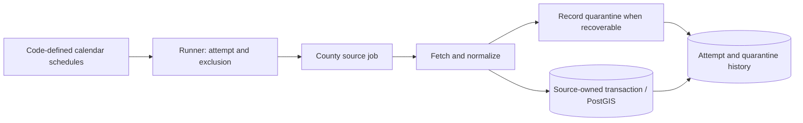

# Per-source jobs, restart-safe runner, and scheduler

## Goal and current constraints

Define jobs in Go, one county source per job with its own calendar schedule. The scheduler triggers jobs; the runner owns exclusion and attempt history; the source job owns fetching, normalization, quarantine policy, and its database transaction boundaries. An interrupted full scan starts from page one. Already committed rows, where a job commits before completion, are safely upserted again. No page cursor or mid-scan resume in v1.

This is a plan, not authorization to implement. Branch `plan/source-jobs-runner-scheduler` and PR title `[plan:source-jobs-runner-scheduler] ...` follow `AGENTS.md`.

**Present code.** `internal/connector/union/gis.go` pages Union layer 215; `internal/connector/union/translator.go` normalizes records; `internal/parcelstore/parcels.go` upserts on `(county_id, source_name, source_parcel_id)` on a caller-owned transaction. `main.go` currently streams likely-vacant parcel IDs; there is no generic runner or scheduler. `internal/connector/batch.go` has a streaming callback; `Fetch` buffers a whole source and must not be used for large imports.

**Existing plans are inputs, not replacements.** `plans/soil-layer.md` persist-1 specifies 2,000-feature Union parcel pages, `likely_vacant`, null-PID fallback to `OBJECTID`, and staging all parts in a temporary table before one final union/upsert transaction. Features with the same PID occur on different pages. Do **not** implement the previously proposed page-by-page parcel commits: they would publish incomplete multipart geometry. Its soil-2 and soil-4 steps fetch polygons from layer 197 and join them spatially to stored `parcels.id`. Soil polygons are keyed by `(county_id, source_name, object_id)`; they do not carry a parcel ID. Reuse that ingestion rather than building a second parcel importer. `plans/tax-data-ingest.md` now exists: tax-3/4/5/7 define four Union files and typed stores, while tax-6 runs them serially under one 180-day switch. Those four feeds are one logical Union tax source and **one tax job**. Preserve tax-6's order and per-file `Latest` checks inside that job; the scheduler does not treat individual files as jobs.

**Out of scope.** Implementing soil or tax adapters, court records, UI/API, deletion detection, source-to-source field merging, user-defined jobs, Go runtime plugins, distributed queues, and incremental checkpoints. Do not use `init()` registration. `docs/ARCHITECTURE.md` is partly aspirational; update affected statements when the executable path exists.

## Contracts

- **Definition:** a stable job ID, a calendar schedule with explicit timezone, and an execution function. Construct dependencies explicitly in the executable. The scheduler knows IDs and due times, not counties, HTTP, tables, or transactions. Add a manual `run <job ID>` path using the same runner. Validate duplicate IDs and malformed schedules at startup.
- **Runner:** claim one execution per job ID across processes, record start/end, outcome, processed/quarantined counts and error, invoke the job with context, release claim on error/cancellation/crash, and classify orphaned running attempts as interrupted. Other jobs can continue. A due trigger while that job runs is skipped and visible, not queued. On next due/manual invocation the job starts from the beginning. Do not persist a page number or an OID cursor in v1.
- **Transaction boundary:** the job decides. Union parcel ingest retains the soil plan's whole-scan temp-table/dissolve transaction. A future source whose records are independent may commit pages, but then its natural-key writes must be idempotent. A runner-owned `CommitBatch` interface would be wrong for Union's multipart parcels. Failure of the parcel transaction rolls back its parcel writes; a later invocation restarts its scan. Do not retain all features in a Go slice.
- **Quarantine:** distinguish one invalid source record from HTTP errors, database errors, bad schema for an entire response, or failed geometry dissolution. Persist county, source, stable raw-record key (Union `OBJECTID` when PID missing), bounded raw payload/reference, reason, attempt, first/last-seen time, occurrence count, and reprocess status; dedupe repeat failures. Quarantine writes use a separate short transaction so an ingest rollback does not erase evidence. If quarantine persistence fails, fail the run; never silently drop a record. Expose a bounded explicit reprocess operation that reuses normalization, rather than a busy background loop. A run with quarantined records is `success_with_quarantine`, not clean success; show counts and failures. Do not publish a partial parcel geometry: if one part of a known PID is bad, exclude that *entire PID* from this run's final union/upsert, including previously staged parts, or fail the import until it can be handled safely. For a multipart PID, reprocess the entire PID from its source (or wait for the next full scan), never upsert one recovered part as the complete parcel. A missing PID alone is not a bad record: the soil plan uses `OBJECTID` as its fallback.
- **Snapshot and freshness:** Union GIS currently uses count plus `resultOffset` ordered by `OBJECTID`. Live [layer 215 metadata](https://atlas.unioncountync.gov/server/rest/services/OperationalLayers/MapServer/215?f=json) says `supportsPagination: true`, `supportsOrderBy: true`, and indexes `OBJECTID` uniquely; read-only `OBJECTID > 118205` requests returned 118206–118208. Keyset paging is possible but deliberately deferred. Offset shifts during remote changes can silently miss rows even when counts match. Upserts do not prove completeness or delete absent rows. Publish run status and last *clean* success distinctly from a run with quarantines; do not claim the database is a complete current snapshot.
- **Cross-source linkage:** soil joins polygons to parcel UUIDs by geometry, not by PID. The tax plan normalizes Union parcel keys, looks up `(county_id, source_name = union_county_gis, source_parcel_id)`, and persists the resulting `parcels.id`. Delinquent and billing rows key by parcel UUID plus tax year; foreclosure cases key by case identity and join multiple parcel UUIDs; the pipeline keys by parcel UUID and replaces the current list. `source_parcel_id` is not always a county PID: Union's null-PID fallback is `OBJECTID`. County-wide facts must be explicitly county-keyed, not attached to a made-up parcel. A derived soil-overlap recomputation must follow relevant parcel and soil updates; independent source schedules alone leave joins stale when parcel geometry changes. Resolve its trigger before enabling both schedules.

## Work and verification

### 1. Lock the composition boundary against the existing plans

- [ ] Confirm whether soil persist-1 and soil-4 have landed. If not, implement the ingestion they describe first or make the runner job wrap their eventual entry point; do not duplicate their import logic. Keep 2,000-feature pages, temp-table staging, null-PID fallback, `likely_vacant`, multipart dissolve, and the one-transaction parcel commit. Read `plans/tax-data-ingest.md` before any tax wiring; keep tax-1 through tax-7's parsers/stores and their dependency on persist-1, but do not implement a new tax adapter in this PR.
- [ ] Document whether soil-overlap recomputation is a separate derived job after either relevant source succeeds or an explicit downstream call with its own status. Before scheduling soil and parcel jobs together, verify the chosen path against the soil plan's existing `soil-4` behavior. Do not make the scheduler import the soil package. For future tax scheduling, wrap tax-6's ordered four-file run as one logical Union tax job, preserving its configurable 180-day *per-file freshness check*. A file failure fails the tax job and stops later files; a manual retry invokes the whole tax run, whose `Latest` checks skip files already fresh and retry the failed one. Pick the job's trigger cadence separately; a calendar six-month cron is not exactly 180 days, and a process-relative 180-day ticker can postpone work indefinitely across restarts. Do not create four scheduler jobs or refetch fresh files solely to satisfy the generic runner. Tax HTTP 403, missing required headers, and corrupt whole-file formats fail the file job; PP/RR skips are not quarantine errors. Tax `Latest` can mark a file fresh while PINs remain unmatched because parcels were not yet ingested: either persist unmatched references for relinking after parcel import or deliberately reprocess that file after the parcel job. For the foreclosure pipeline, `SavePipeline` deletes rows absent from a complete file; never run that deletion against a partially parsed/quarantined file.
- [ ] **Verify, static:** no mandatory cursor methods on `connector.DataSource` / `BatchFetchSource`; no county-specific type in scheduler or runner; `plans/soil-layer.md` persist-1's transaction boundary remains intact.
- [ ] **Verify, unit:** `go test -race ./internal/connector/union/... ./internal/service/... -count=1` covers two features with one PID on separate pages, `OBJECTID` fallback, and cancelled fetch. Tests use a local ArcGIS `httptest` endpoint, not the county network.
- [ ] **Verify, live:** keep the read-only metadata/OID query result above as evidence of API capabilities; record current page-size behavior before an approved local import. No production database write is required.
- [ ] **Verify, perf:** run 2,000 vs. 20,000 fixture features with 2,000-feature pages; record HTTP requests, temp-table size, elapsed time, and peak Go heap. Investigate if Go heap scales with all records instead of page size; do not add an unmeasured speed target.

### 2. Runner, history, and quarantine

- [ ] Add sequential Goose migration for attempt history and quarantined records; do not edit applied migrations. A quarantine entry has an idempotent key for repeated identical failures and bounded payload. Treat raw owner/tax data as sensitive in logs and any future UI. Use a concrete store and a database-backed cross-process claim (e.g. session advisory lock with a dedicated connection); do not hold a database transaction across HTTP calls just to lock a job.
- [ ] Expose a small job execution function and explicit definition list; no generic transport registry, private-wiring public interfaces, or scheduler dependencies in the county source. Record `success`, `success_with_quarantine`, `failed`, `interrupted`, and overlap skip distinctly. Keep last clean success queryable. On restart classify abandoned runs instead of silently reporting success.
- [ ] Separate record errors from systemic errors. Quarantine record errors and continue where doing so cannot corrupt a multipart parcel; fail the run on quarantine-write errors, source HTTP failures, invalid whole-page response, transaction failures, or unresolved partial-PID safety. Reprocessing updates quarantine status; a multipart parcel is written only after all of its parts are available and dissolved through the same source-owned rules.
- [ ] **Verify, static:** `go vet ./...`; no page cursor table or runner-owned parcel transaction; one ID cannot be executing in two processes at once. Use existing lint if configured, not an invented tool dependency.
- [ ] **Verify, unit:** through the runner's public execution path, check job-ID validation, duplicate definitions, status transitions, overlapping runs, quarantine dedupe, cancellation, and bounded reprocess. A malformed record never causes a silent success.
- [ ] **Verify, integration:** with migrated local PostGIS and fixture source, quarantine an invalid part for PID A and confirm no incomplete A geometry is published while valid PID B is saved; repeated retry does not multiply quarantine entries. Simulate failure after staging a page: parcel transaction rolls back while quarantine evidence survives, and next run starts at page one. Kill a process mid-run; next process acquires the job and records interruption. On a second clean run, confirm stable parcel UUIDs and one row per source natural key.
- [ ] **Verify, perf:** measure 500 and 10,000 records, run-history and quarantine inserts, peak heap, and temp-table/dissolve time on local PostGIS. Compare normal versus a small number of bad records; quarantine must not issue a full-county re-fetch per record.

### 3. Wire one Union job and a manual entry point

- [ ] Register `union.gis.parcels` as an explicit code-defined job wrapping the existing/planned Union ingest path. Do not run the parcel-ID demo *and* the new import as separate county fetches. Keep the soil plan's `likely_vacant` derivation and multipart behavior. No soil/tax job is fabricated to make this runner look generic.
- [ ] Document DB migration/setup, `DATABASE_URL`, manual invocation, job status, meaning of clean vs quarantined completion, and the offset/deletion limitation. If replacing `main.go`'s ten-minute timeout, make the new job-specific cancellation policy explicit and test it.
- [ ] **Verify, unit:** two-page fixture with same-PID parts on both pages, a null-PID feature, a valid parcel and an invalid record; inspect normalized fields and quarantine classification through the job's public path.
- [ ] **Verify, integration:** `docker compose up -d postgis`, `make db-create`, `make migrate-up`, `go test -tags postgres -race ./... -count=1` with `DATABASE_URL`, and `go build ./...` succeed. Run twice with local HTTP fixtures; inspect counts, stable UUIDs, geometry SRID, dissolved shape, and history with SQL. `go test -race ./... -count=1` needs no live county or DB.
- [ ] **Verify, live:** only on explicit approval, import Union into a disposable local database at the configured rate; capture page count, duration, run status and sample row. Do not call the live endpoint in default tests.
- [ ] **Verify, perf:** for 2,000 and 20,000 fixture features record time, page count and heap; compare with the fetch-only results and explain temp-table/dissolve cost.

### 4. Schedule source jobs independently

- [ ] Use a maintained calendar-aware cron library and explicit timezone; verify daily and quarterly definitions with no-network stub jobs, while registering only actual sources in production. Manual and scheduled invocation use the same runner. First invocation occurs at next due time, not immediately. Missed ticks while down are not backfilled; overlapping ticks are skipped visibly.
- [ ] On shutdown cancel active contexts and let source transactions roll back or complete safely; on restart classify interruption and run from the beginning on next due/manual invocation. Update `docs/ARCHITECTURE.md` where it claims `init()` registration and a uniform bi-weekly import. Keep soil dependency/recompute behavior explicit rather than assuming independent cron times produce fresh joins.
- [ ] **Verify, static:** `go vet ./...`; scheduler has no import of `union`, `soil`, or `parcelstore`; invalid/duplicate definitions fail startup.
- [ ] **Verify, unit:** with a controllable clock, check quarter boundary, daily timezone/DST behavior, startup policy, due dispatch, skipped overlap, and missed-tick policy without sleeps.
- [ ] **Verify, integration:** local fixture DB/source: two jobs due independently, one fails while the other completes; failed job starts from first page on next invocation; shutdown/restart does not overlap runs. Confirm manual and scheduled paths share the same job ID and history.
- [ ] **Verify, live:** start with only the Union production definition and local DB, inspect next due time without waiting a quarter, then invoke manually against a local fixture. Any real county import uses the explicit approval gate in work unit 3.
- [ ] **Verify, perf:** record idle scheduler CPU/query rate, number of invocations, and request counts in a controlled interval. No busy loop or extra county fetch per invocation.

## Done

- [ ] Work units have static, unit, integration, live, and performance evidence; `go test -race ./... -count=1`, `go vet ./...`, `go build ./...`, and `make test` pass without a live county. Database-tagged tests pass against migrated local PostGIS.
- [ ] A bad record is durably quarantined and reprocessable without hiding incomplete multipart geometry. A systemic failure stops the job. The next invocation starts from page one. Jobs can run independently, but soil joins are explicitly recomputed when either relevant source changes before claiming they are current.
- [ ] Tax integration respects `plans/tax-data-ingest.md`: one `union.tax` job runs its four file feeds in tax-6 order and preserves per-file `Latest` checks; no fabricated parcel on unmatched PIN, county-scoped case identity with parcel join rows, and no source-specific branch in the scheduler. Resolve whether unmatched tax rows need durable retry after a new parcel import before treating a tax file as fully reconciled.
