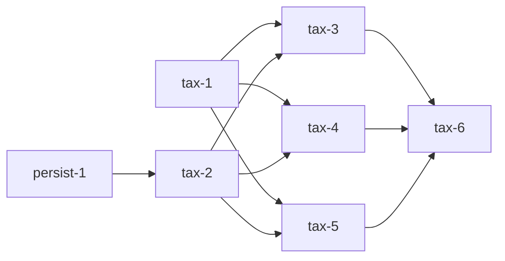

# Tax data ingest

You want the amount a likely-vacant owner owes, from public county files, so a balance can flag a likely seller. DevNet wEdge stays out. Its robots file disallows the parcel and tax pages. This is a fetch and a parse, not a scraper.

The county-neutral source reads three Union files. They are the billing file, the delinquent tax notice, and the foreclosure list. Personal-property rows are ignored. The run does not insert parcels. `parcels.likely_vacant` comes from persist-1 in `plans/soil-layer.md`. This plan does not add that column.

Run tax-1 first. Run tax-2 after persist-1. Run tax-3, tax-4, and tax-5 after tax-1 and tax-2. Run tax-6 after those three. The production run is about twice a year, and the period is config.

## How to read this

One box is one unit of work. Every box names the evidence that checks it. A nested box is a sub-step of the box above it. Check a box only when its evidence exists, a file, a log line, a screenshot, a test run, or a SHA. The body is a how-to. The appendices explain and record.

The program runs `pstack/skills/poteto-mode/playbooks/autopilot-stack.md`. The operator lands tax-1, tax-2, tax-3, tax-4, tax-5, and tax-6. This plan stops at merge-ready. Nobody merges from the checklist.

Tests alone are not sufficient verification. A PR is verified only when its unit, live, and perf boxes are all checked.

## Program checklist

### Arm the program

- [ ] State the protocol and this plan to the operator, then stop. Start execution only on the operator's explicit go.
- [ ] Read these from trunk at program start. Re-read them at every tick.
  - [ ] `git show origin/main:pstack/skills/poteto-mode/playbooks/autopilot-stack.md`
  - [ ] `git show origin/main:pstack/skills/swarm/SKILL.md`
  - [ ] `git show origin/main:pstack/skills/poteto-mode/playbooks/opening-a-pr.md`
  - [ ] `git show origin/main:pstack/skills/control-cli/SKILL.md`
  - [ ] `git show origin/main:plans/tax-data-ingest.md`
  - [ ] `git show origin/main:plans/soil-layer.md`
  - [ ] `git show origin/main:internal/county/county.go`
  - [ ] `git show origin/main:internal/parcelstore/sales.go`
  - [ ] `git show origin/main:db/migrations/000004_parcel_sales_uuid_id.sql`
- [ ] If a `git show` of `pstack/` or `control-cli` fails, read the installed skill with the same name and record the miss. Appendix C is that gap. Do not skip the live lanes.
- [ ] On the operator's go, arm the audit tick as `/loop 1h` with the tick prompt below. Never leave the cadence to memory.
- [ ] Use this tick prompt, verbatim. "Re-read the execution playbook from trunk. Audit the operation against it and fix drift in this tick. Probe every active lane and judge progress by side effects only. Stand down a stuck lane and dispatch its replacement now. Then post a short status message to the operator in chat only when the audit found a tracked change that no earlier status message reported, such as a PR opened, a code-ready head, a round launched or closed, a verdict, a merge, a stuck agent and the action taken, a blocker added or cleared, or a decision only the operator can make. Name every such change and nothing else. Do not repeat a table, the merged list, or an unchanged blocker. If the audit found none, end the turn with no reply text. Either way, log this tick's row in your decision trail. The row names the items reported, or none."
- [ ] On the operator's hold or stand-down, send every owner a zero-writes order at once.

### Spawn owners

- [ ] Spawn one owner per PR with the full lifecycle the execution playbook names.
- [ ] Follow this dependency graph. Start dependent work only after its parent is on trunk. Do not stack these PRs. tax-2, tax-3, tax-4, tax-5, and tax-6 each need a parent that is not this program's first PR.



  - [ ] tax-1 is first and branches from trunk.
  - [ ] tax-2 after persist-1 is on trunk. persist-1 is in `plans/soil-layer.md`. It adds `parcels.likely_vacant`. Do not edit that plan. Do not add the column in this program. soil-3 may add `<prefix>_soil.sql` first. tax-2 does not wait on soil-3 for behavior. It takes the next free prefix after every six-digit file present at the start of the PR, including that soil file when it is already there.
  - [ ] tax-3, tax-4, and tax-5 start after tax-1 and tax-2 are on trunk. They do not edit the same files. `county.ID` is already on trunk in `internal/county`. They do not wait on a county PR.
  - [ ] tax-6 after tax-3, tax-4, and tax-5 are on trunk.
- [ ] Hold the file boundaries. tax-1 touches only `internal/taxsource/`. tax-2 touches only the one new tax migration. tax-3 touches only `internal/connector/union/delinquent.go`, `internal/connector/union/delinquent_test.go`, `internal/connector/union/testdata/tax/delinquent.csv`, `internal/taxstore/delinquent.go`, and `internal/taxstore/delinquent_test.go`. tax-4 touches only `internal/connector/union/billing.go`, `internal/connector/union/billing_test.go`, `internal/connector/union/testdata/tax/billing.csv`, `internal/taxstore/bills.go`, and `internal/taxstore/bills_test.go`. tax-5 touches only `internal/connector/union/foreclosure.go`, `internal/connector/union/foreclosure_test.go`, `internal/connector/union/testdata/tax/foreclosure.html`, `internal/taxstore/foreclosure.go`, and `internal/taxstore/foreclosure_test.go`. tax-6 touches only `main.go` and `main_test.go`.
- [ ] Hold the review gate. No PR in this program changes an interaction. None wait for screenshots in chat before the operator decides to land them.
- [ ] Do not add a PR that requests `unionnc.devnetwedge.com`. Do not file a records request. Do not add a worker pool, a raw HTML table of DevNet pages, or a per-parcel scrape contract. Do not edit `plans/scraper-enrichment.md` or `plans/soil-layer.md`.

### PR mechanics, for every PR

- [ ] Resolve the forge once. Default to `gh`. If `command -v origin` succeeds and Origin can resolve the repository, use `origin pr` for every PR operation. Record any fallback to `gh`. Never require `gt`.
- [ ] Open the PR ready, never draft, per **Opening a PR**. Use the run's built-in PR tool when it has one, else `origin pr create --status open --base <base-branch>` or `gh pr create --base <base-branch>` according to the resolved forge. A stack child targets its parent branch. These PRs are not stacked, so every base is trunk.
- [ ] Run `gofmt`, `go vet ./...`, and `staticcheck ./...` once before the PR-facing push. Push with hooks on. This repo has no `staticcheck` Make target. Install `staticcheck` and fail the push on any finding.
- [ ] Run `/deslop` before each commit and `/no-comments` before review. If `deslop` is not installed, apply the unslop skill to the diff and record the miss.
- [ ] Triage every Bugbot and security-reviewer comment per `pstack/skills/poteto-mode/references/bugbot-triage.md`.
- [ ] Rebase onto current trunk before the code-ready report and babysit. Keep that merge base in fix rounds. Rebase again only at merge prep, on a `git merge-tree` conflict with trunk, on a CI failure that comes from a change on trunk, or when a known concurrent change to the same files lands.

### Verdict and merge, for every PR

- [ ] A full swarm runs once, at the code-ready head. Another full swarm runs only for new behavior, a redesign, or a large new diff. A rebase, a merge-conflict resolution, or a minor fix gets a single verifier at the new head, and a wording-only change gets none. Run each full swarm per `pstack/skills/swarm/SKILL.md`. One gates lane. The ten live lanes from the PR's **Verify, live** block. The perf lane from its **Verify, perf** block. Two or more audit lanes, each with its own focus, that read the diff and the receipts and distrust the PR body. The root audits the receipts in the merge-ready report before the verdict.
- [ ] Judge every finding by the execution playbook's blocking rule. The verdict is clean when none blocks. A failure on trunk behavior in a lane marked `Regression lane against trunk.` is recorded against trunk and does not block the PR. A new head gets a fresh verdict, except for results that stay valid under the patch-id rule in `playbooks/shipping.md`.
- [ ] Stop when the PR is verified and green at its current head, then hand it to the operator. Do not merge. A restack that leaves `git patch-id` unchanged keeps the verdict. After the handoff, nobody pushes without the operator's go.

### Boot recipe, for every live lane

Each live lane runs on its own cloud VM at the PR head. This repo has no browser UI for tax ingest. Drive `go test`, `curl`, and `psql`. There is no `control-cli` skill in the repo. Appendix C records that gap. The commands in the lane are the drive.

- [ ] `git fetch origin <head-branch> && git checkout <head SHA>`.
- [ ] For tax-1, run the `go test -race` command in the lane. For tax-2, tax-3, tax-4, tax-5, and tax-6, start Postgres and PostGIS the way `make migrate-up` does, apply migrations through the head, and wait until `psql` accepts a query. Parser tests that do not open a database stay on `go test` without `DATABASE_URL`.
- [ ] Deliver input only through those commands. Read-only diagnostics are the test output, the `curl` body, and the `psql` rows.
- [ ] Save every screenshot to `/tmp/swarm-<pr-id>/worker-<n>/<slug>.png` and return the paths with the report. A lane with no display saves a text render of the command output at that path.
- [ ] A lane that hits the county site does it once, with a descriptive user agent, and does not loop. Do not download the billing zip in more than one lane. Do not request a path that `robots.txt` disallows.

## Add the file GET and the source interface (tax-1)

**Depends on.** None.

**Files.**

- [ ] Create `internal/taxsource/get.go`.
- [ ] Create `internal/taxsource/get_test.go`.
- [ ] Create `internal/taxsource/source.go`.

**Build.**

- [ ] Add `Get(ctx context.Context, rawURL string, limit int64, timeout time.Duration) (io.ReadCloser, error)`. A zero limit or a zero timeout is an error. The body is capped at `limit`. One byte past the cap returns an error and closes the body.
- [ ] Retry once when the first attempt fails before any body byte is read, and the error is a transport error or an HTTP status from 500 through 599. Do not retry 404. Do not retry when the error matches `context.Canceled` or `context.DeadlineExceeded`. Do not read `Retry-After`. Do not add a rate limiter. Do not fetch `robots.txt`.
- [ ] Add `Meta` with `URL`, `Name`, `SHA256`, and `FetchedAt`. Add `Source[T any]` with `Read(ctx context.Context, yield func(T) error) (Meta, error)`. `Read` is the only method. The shared package does not name a tax column and does not import `internal/county`, `internal/soil`, `internal/connector/union`, or `internal/parcelstore`.
- [ ] Do not add `DoRetry`, a worker pool, or a per-parcel `Scrape` method. A second county implements `Source` in its own package. Union is the first implementation, and it lands in tax-3, tax-4, and tax-5.

**You see.**

- [ ] `go test -race ./internal/taxsource/ -count=1 -run TestGet` prints `PASS`.

**Verify, unit.** Tests alone are not sufficient verification. A PR is verified only when its unit, live, and perf boxes are all checked.

- [ ] Table-driven `t.Run` cases cover a 200 body, a 404 with one hit, a 500 then a 200 with two hits, a body one byte over the limit, a canceled context with zero hits, and a second attempt that is not started after a 404. Run `go test -race ./internal/taxsource/ -count=1`.
- [ ] Run `go vet ./internal/taxsource/` and `staticcheck ./internal/taxsource/`. Both print no findings.
- [ ] Run `go test -race -cover ./internal/taxsource/ -count=1`. Fail if coverage is below 90.0 percent. That floor is a chosen gate for a new package.

**Verify, live.** Tests alone are not sufficient verification. A PR is verified only when its unit, live, and perf boxes are all checked. Ten lanes on `grok-4.7-xhigh-fast` at the PR head, per the boot recipe.

- [ ] Lane 1. Regression lane against trunk. Run `go test -race ./internal/connector/shared/httpclient/ -count=1` at trunk and at head. Trunk has no `internal/taxsource`. Record that, and run `go test -race ./internal/taxsource/ -count=1` at head. Save `/tmp/swarm-tax-1/worker-1/regression.png`. Pass when trunk's httpclient tests pass and head's `TestGet` passes.
- [ ] Lane 2. Return 200 with body `ok`. Save `/tmp/swarm-tax-1/worker-2/status-200.png`. Pass when `Get` returns those bytes.
- [ ] Lane 3. Return 404. Save `/tmp/swarm-tax-1/worker-3/status-404.png`. Pass when the error is non-nil and the handler ran once.
- [ ] Lane 4. Return 500, then 200. Save `/tmp/swarm-tax-1/worker-4/retry-500.png`. Pass when the body is the 200 body and the handler ran twice.
- [ ] Lane 5. Return a body one byte over the limit. Save `/tmp/swarm-tax-1/worker-5/oversize.png`. Pass when `Get` returns an error and the body is not returned as success.
- [ ] Lane 6. Cancel the context before `Get`. Save `/tmp/swarm-tax-1/worker-6/cancel.png`. Pass when the error matches `context.Canceled` and the handler ran zero times.
- [ ] Lane 7. Return 404 on the only attempt. Save `/tmp/swarm-tax-1/worker-7/no-retry-404.png`. Pass when the handler ran once.
- [ ] Lane 8. Start the handler only after the client has given up. Use a timeout shorter than the handler delay. Save `/tmp/swarm-tax-1/worker-8/timeout.png`. Pass when the error matches `context.DeadlineExceeded` and is not retried into a success.
- [ ] Lane 9. Confirm `Source` is the only interface in the package and it has one method. Save `/tmp/swarm-tax-1/worker-9/one-method.png`. Pass when `go doc` for the package lists `Read` and does not list `Scrape`.
- [ ] Lane 10. Run `go test -race ./internal/connector/shared/httpclient/ -count=1 -run TestRateLimitedClient_Do_RateLimiting`. Save `/tmp/swarm-tax-1/worker-10/gis-limiter.png`. Pass when that existing test still requires at least 900ms for three requests at 2 per second. This PR did not change that limiter.

**Verify, perf.** Tests alone are not sufficient verification. A PR is verified only when its unit, live, and perf boxes are all checked.

- [ ] Metric. Wall time of one local 200 through `Get` of a 300,371 byte body, the measured delinquent file size. Trunk has no `Get`. The end state is a body of that length.
- [ ] Probe. At trunk, record that `internal/taxsource` does not exist. At head, time one `Get` against `httptest` serving 300,371 bytes.
- [ ] Baseline. Record trunk as no package and no elapsed time.
- [ ] Rule. Fail if that head `Get` takes 1 second or longer. Do not report a ratio against trunk. The 1 second gate is a hang check. The file is 300,371 bytes on loopback, so the limiter is the local server, not the county host.

**Review gate.** None. tax-1 is not review-gated.

**Merge.**

- [ ] Root's clean verdict at the exact head SHA.
- [ ] Bugbot triage done.
- [ ] Rebased onto current trunk after the verdict, with `git patch-id` unchanged.
- [ ] The owner does not merge. The operator lands tax-1. It does not wait on persist-1.

## Add the tax tables (tax-2)

**Depends on.** persist-1. That PR adds `parcels.likely_vacant`. This PR reads the column and does not create it.

**Files.**

- [ ] Create one new file under `db/migrations`. List `db/migrations/*.sql`, take the highest six-digit prefix, add 1, and zero-pad to six digits. Name it `db/migrations/<prefix>_tax_files.sql`. On main at `e5ac202` the files are `000001` through `000004`, so the highest prefix is `000004`. Do not assume `000005` is free. persist-1 adds `<prefix>_parcels_likely_vacant.sql`. soil-3 adds `<prefix>_soil.sql`. If either file exists, use the next integer after every six-digit file in the directory. Do not edit `000001_init_schema.sql`, `000002_parcels_storage_srid.sql`, `000003_parcels_county_check.sql`, `000004_parcel_sales_uuid_id.sql`, or a soil migration. `make migrate-create` runs `goose create` with no sequential flag, at `Makefile` lines 82 to 88, so the name it emits is a timestamp. Create this file by hand.

**Build.**

- [ ] Add `tax_delinquent_balances`. `id UUID PRIMARY KEY DEFAULT gen_random_uuid()`. `parcel_id UUID NOT NULL REFERENCES parcels(id) ON DELETE CASCADE`. `tax_year INTEGER NOT NULL`. `balance_due NUMERIC(12,2) NOT NULL`. `primary_source TEXT NOT NULL`. `source_url TEXT NOT NULL`. `file_sha256 BYTEA NOT NULL`. `fetched_at TIMESTAMPTZ NOT NULL`. Unique `(parcel_id, tax_year)`. Check `balance_due >= 0`. Check `primary_source = 'RE'`. Do not add a county parcel number column. Do not add `county_id`. The county lives on `parcels`.
- [ ] Add `tax_bills`. `id UUID PRIMARY KEY DEFAULT gen_random_uuid()`. `parcel_id UUID NOT NULL REFERENCES parcels(id) ON DELETE CASCADE`. `tax_year INTEGER NOT NULL`. `total_taxes NUMERIC(12,2) NOT NULL`. `property_address TEXT NOT NULL`. `taxpayer_name TEXT NOT NULL`. `mailing_line TEXT NOT NULL`. `mailing_city TEXT NOT NULL`. `mailing_state TEXT NOT NULL`. `mailing_postal_code TEXT NOT NULL`. `source_url TEXT NOT NULL`. `file_sha256 BYTEA NOT NULL`. `fetched_at TIMESTAMPTZ NOT NULL`. Unique `(parcel_id, tax_year)`. Check `total_taxes >= 0`. Do not add a county parcel number column.
- [ ] Add `tax_foreclosures`. `id UUID PRIMARY KEY DEFAULT gen_random_uuid()`. `parcel_id UUID NOT NULL REFERENCES parcels(id) ON DELETE CASCADE`. `case_number TEXT NOT NULL`. `owner_name TEXT NOT NULL`. `situs_line TEXT NOT NULL`. `tax_value NUMERIC(12,2)`. `opening_bid NUMERIC(12,2)`. `current_bid NUMERIC(12,2)`. `sale_on DATE`. `source_url TEXT NOT NULL`. `file_sha256 BYTEA NOT NULL`. `fetched_at TIMESTAMPTZ NOT NULL`. Unique `(parcel_id, case_number)`. Each nullable amount checks `IS NULL OR column >= 0`. Do not add a county parcel number column.
- [ ] Add view `tax_owed`. Join `tax_delinquent_balances` to `parcels` on `parcels.id = tax_delinquent_balances.parcel_id`. Keep rows where `parcels.likely_vacant` is true and `balance_due > 0`. Sum `balance_due` per `parcels.id`. This view is the likely-seller flag. A foreclosure row does not set the flag by itself. Do not add `parcels.likely_vacant`. Do not add `GEOMETRY`. Do not add a second parcel table.
- [ ] `NUMERIC(12,2)` is the money type. The source amounts are dollars and cents. Numeric is exact. 12 digits covers the largest amount in the measured delinquent file, 36800.63, which is a personal-property row this program does not store. The largest real-estate balance in that file is 14355.02. Do not store money as `float`.
- [ ] The upsert in later PRs omits `id`. On conflict on the unique key, update the amount columns, `source_url`, `file_sha256`, and `fetched_at`, and do not assign `id`. Goose `Up` creates the three tables and the view. Goose `Down` drops the view, then the tables. It does not drop `parcels`.

**You see.**

- [ ] After `make migrate-up` on a database that already has persist-1, `psql` lists `tax_delinquent_balances`, `tax_bills`, `tax_foreclosures`, and `tax_owed`. `\d tax_delinquent_balances` shows a UUID primary key and no county parcel number column.

**Verify, unit.** Tests alone are not sufficient verification. A PR is verified only when its unit, live, and perf boxes are all checked.

- [ ] `rg -n "likely_vacant_parcels|source_parcel_id|GEOMETRY" db/migrations/<prefix>_tax_files.sql` prints nothing. `rg -n "likely_vacant" db/migrations/<prefix>_tax_files.sql` matches only the view. `rg -n "tax_owed" db/migrations/<prefix>_tax_files.sql` matches the view. `rg -n "ADD COLUMN likely_vacant" db/migrations/<prefix>_tax_files.sql` prints nothing.
- [ ] Run `go test -race ./... -count=1` with no database. It still passes. `internal/parcelstore` database tests carry `//go:build postgres`, so this command does not open Postgres. Run `go vet ./...` and `staticcheck ./...`. Both print no findings.

**Verify, live.** Tests alone are not sufficient verification. A PR is verified only when its unit, live, and perf boxes are all checked. Ten lanes on `grok-4.7-xhigh-fast` at the PR head, per the boot recipe.

- [ ] Lane 1. Regression lane against trunk. At trunk and at head, run `psql` with `\dt tax_delinquent_balances`. Save `/tmp/swarm-tax-2/worker-1/regression.png`. Pass when trunk has no such table and head lists it. Trunk may already have `parcels.likely_vacant` if persist-1 has landed. Record that. This PR did not add the column.
- [ ] Lane 2. Insert one parcel with `likely_vacant` true and omit `id`. Insert one delinquent row for that `parcels.id`, year 2025, balance 10.00, and omit the tax `id`. Save `/tmp/swarm-tax-2/worker-2/insert-delinquent.png`. Pass when the select returns that balance and both ids are UUIDs.
- [ ] Lane 3. Upsert the same `(parcel_id, tax_year)` with balance 12.50 and omit `id` again. Save `/tmp/swarm-tax-2/worker-3/upsert-delinquent.png`. Pass when the count is 1, the balance is 12.50, and `id` is unchanged.
- [ ] Lane 4. Insert a delinquent row whose `parcel_id` is a UUID that is not in `parcels`. Save `/tmp/swarm-tax-2/worker-4/missing-parcel.png`. Pass when the foreign key rejects the row.
- [ ] Lane 5. Insert a negative balance. Save `/tmp/swarm-tax-2/worker-5/negative.png`. Pass when the check rejects the row. Insert `primary_source` `PP`. Pass when that check rejects the row too.
- [ ] Lane 6. Insert one bill row for the same parcel and year, omitting `id`. Save `/tmp/swarm-tax-2/worker-6/insert-bill.png`. Pass when `total_taxes` and `mailing_line` are stored and a second upsert keeps `id`.
- [ ] Lane 7. With the likely-vacant parcel and balance 10.00, select `tax_owed`. Save `/tmp/swarm-tax-2/worker-7/owed-join.png`. Pass when the view shows that `parcels.id` and the summed balance.
- [ ] Lane 8. Insert a delinquent row for a parcel whose `likely_vacant` is false. Save `/tmp/swarm-tax-2/worker-8/owed-empty.png`. Pass when the view returns no row for that parcel and the balance row is still in `tax_delinquent_balances`.
- [ ] Lane 9. Run goose down, then up. Save `/tmp/swarm-tax-2/worker-9/down-up.png`. Pass when the three tables are gone after down, `parcels` remains, and the tables are present after up.
- [ ] Lane 10. Count `parcels` before and after a delinquent insert. Show the column list. Save `/tmp/swarm-tax-2/worker-10/no-parcel-insert.png`. Pass when the `parcels` count is unchanged and the tax table has no `source_parcel_id` column.

**Verify, perf.** Tests alone are not sufficient verification. A PR is verified only when its unit, live, and perf boxes are all checked.

- [ ] Metric. Wall time of one upsert into `tax_delinquent_balances`, and the row count after a second upsert of the same key. Trunk has no table. The end state is one row with the same `id`.
- [ ] Probe. At trunk, record that `\dt tax_delinquent_balances` fails. At head, time one upsert, then a second upsert, with `psql`.
- [ ] Baseline. Record trunk as no table and no elapsed time.
- [ ] Rule. Fail if the head upsert takes 5 seconds or longer, or if the second upsert leaves a count other than 1, or if `id` changes. Do not report a ratio against trunk.

**Review gate.** None. tax-2 is not review-gated.

**Merge.**

- [ ] Root's clean verdict at the exact head SHA.
- [ ] Bugbot triage done.
- [ ] Rebased onto current trunk after the verdict, with `git patch-id` unchanged.
- [ ] The owner does not merge. The operator lands tax-2 after persist-1. It does not wait on tax-1.

## Ingest the delinquent tax notice (tax-3)

**Depends on.** tax-1 and tax-2. `county.ID` is already in `internal/county` on trunk.

**Files.**

- [ ] Create `internal/connector/union/delinquent.go`.
- [ ] Create `internal/connector/union/delinquent_test.go`.
- [ ] Create `internal/connector/union/testdata/tax/delinquent.csv`.
- [ ] Create `internal/taxstore/delinquent.go`.
- [ ] Create `internal/taxstore/delinquent_test.go`.

**Build.**

- [ ] Add `DelinquentRow` with `ParcelKey`, `Year`, `Balance`, and `PrimarySource`. The county parcel key stays on this struct until the store looks up `parcels.id`. It is not a database id. Add `DelinquentList` with `Read` so that `var _ taxsource.Source[DelinquentRow] = (*DelinquentList)(nil)` compiles in `delinquent.go`.
- [ ] Resolve the file with `GET` of `https://www.unioncountync.gov/home/showdocument?id=4792`. Do not send the `t` query parameter. Appendix A measured that this URL returns the CSV. If the first record's names do not include `Property Key`, `Year`, `Primary Source`, and `Balance Due`, return an error and yield nothing. Do not guess another document id.
- [ ] Parse with `encoding/csv`. Read columns by those names. Ignore extra empty columns. Trim the key and uppercase it. Do not remove an internal space and do not drop a suffix. `07105038A` stays `07105038A`. `02176011 60` stays `02176011 60`.
- [ ] Yield a row only when `Primary Source` is `RE`. Drop `RR`. Drop `PP`. Personal property is business equipment and vehicles taxed apart from the land. Parse `Balance Due` by removing `$` and commas. Store dollars and cents. A balance that does not parse is an error and yields nothing. Do not set a county on the row. The store uses `county.Union`.
- [ ] `SaveDelinquent` looks up `parcels.id` with `(county_id, source_name, source_parcel_id)`. `county_id` is `county.Union`. `source_name` is `union_county_gis`, the value `GISSource.Name` returns at `internal/connector/union/gis.go` line 82. `source_parcel_id` is the trimmed key. Use the same three columns as `lookupParcelSQL` in `internal/parcelstore/sales.go` lines 91 to 97. Do not edit `internal/parcelstore`. Also read `likely_vacant`. No parcel row is an unmatched skip. A parcel with `likely_vacant` false is a not-enriched skip. A true row is upserted. Do not insert a parcel.
- [ ] The upsert omits `id` and conflicts on `(parcel_id, tax_year)`. It replaces `balance_due`, `primary_source`, `source_url`, `file_sha256`, and `fetched_at`. It does not assign `id`. `file_sha256` is the SHA-256 of the file bytes. `SaveDelinquent` returns the saved count, the skipped PP count, the skipped RR count, the unmatched count, and the not-enriched count. Add `Latest(ctx) (time.Time, bool, error)` as the max `fetched_at`, with false when the table is empty. A second `Read` of the same bytes yields the same keys and balances.
- [ ] Put the database test behind `//go:build postgres`, matching `internal/parcelstore/parcels_test.go`. `go test` without that tag does not open Postgres.
- [ ] The golden file is a few RE rows, one PP row, and one RR row copied from the measured file, including one 8-digit key, one 9-character key, and one 11-character key. `-update` rewrites it and is off by default.

**You see.**

- [ ] `go test -race ./internal/connector/union/ -count=1 -run TestDelinquent` prints `PASS` and the golden RE balance matches. `go test -race -tags postgres ./internal/taxstore/ -count=1 -run TestSaveDelinquent` prints `PASS` when `DATABASE_URL` points at a migrated database.

**Verify, unit.** Tests alone are not sufficient verification. A PR is verified only when its unit, live, and perf boxes are all checked.

- [ ] Table-driven tests cover the golden RE rows, a skipped PP row, a dropped RR row, a missing `Property Key` header, a bad balance, and a canceled context that yields nothing. Run `go test -race ./internal/connector/union/ -count=1 -run TestDelinquent`.
- [ ] The postgres test covers a first save, a second save that keeps `id`, an unmatched key, and a parcel with `likely_vacant` false that writes nothing. Run `go test -race -tags postgres ./internal/taxstore/ -count=1 -run TestSaveDelinquent`.
- [ ] Run `go test -race ./internal/connector/union/ -fuzz=FuzzDelinquentMoney -fuzztime=10s` and `go test -race ./internal/connector/union/ -fuzz=FuzzParcelKey -fuzztime=10s`. Both exit 0.
- [ ] Run `go vet ./internal/connector/union/ ./internal/taxstore/` and `staticcheck ./internal/connector/union/ ./internal/taxstore/`. Both print no findings.
- [ ] Run `go test -race -cover ./internal/connector/union/ ./internal/taxstore/ -count=1`. Fail if `union` coverage is below 77.4 percent. That is the trunk measurement in Appendix A. If trunk coverage at the start of this PR is higher, fail below that higher number and record it. Fail if `taxstore` coverage, measured with `-tags postgres`, is below 90.0 percent. That floor is a chosen gate for a new package.

**Verify, live.** Tests alone are not sufficient verification. A PR is verified only when its unit, live, and perf boxes are all checked. Ten lanes on `grok-4.7-xhigh-fast` at the PR head, per the boot recipe.

- [ ] Lane 1. Regression lane against trunk. Run `go test -race ./internal/connector/union/ -count=1` at trunk and at head. Trunk has no `DelinquentList`. Record that, and gate head's new tests plus a green union package. Save `/tmp/swarm-tax-3/worker-1/regression.png`. Pass when trunk's union tests pass and head's `TestDelinquent` passes.
- [ ] Lane 2. Parse the golden file. Save `/tmp/swarm-tax-3/worker-2/golden.png`. Pass when the 8-digit key, the letter-suffix key, and the 11-character key are present and the PP and RR rows are absent.
- [ ] Lane 3. `SaveDelinquent` one golden row for a likely-vacant parcel, then save it again with the same balance. Save `/tmp/swarm-tax-3/worker-3/upsert.png`. Pass when the table has one row, `id` is unchanged, `parcel_id` equals that `parcels.id`, and `file_sha256` is 32 bytes.
- [ ] Lane 4. Change the balance on the second save. Save `/tmp/swarm-tax-3/worker-4/replace.png`. Pass when the count is still 1, `id` is unchanged, and the balance is the second value.
- [ ] Lane 5. Save a key that is not in `parcels`, and save a key whose parcel has `likely_vacant` false. Count `parcels` around the save. Save `/tmp/swarm-tax-3/worker-5/no-parcel.png`. Pass when the `parcels` count is unchanged, the tax table gains no row, and the two skip counts are 1 and 1.
- [ ] Lane 6. Fetch `https://www.unioncountync.gov/home/showdocument?id=4792` once. Save `/tmp/swarm-tax-3/worker-6/live-csv.png`. Pass when the first line contains `Property Key` and `Balance Due`. One request. Do not pass a `t` parameter.
- [ ] Lane 7. From that same saved body, count RE, PP, and RR. Save `/tmp/swarm-tax-3/worker-7/live-counts.png`. Pass when RE is 926, PP is 5013, and RR is 3, or record the new counts and stop if the header names changed.
- [ ] Lane 8. Sum RE `Balance Due` from that body. Save `/tmp/swarm-tax-3/worker-8/live-sum.png`. Pass when the sum is 232755.26, or record the new sum next to the header check from lane 7.
- [ ] Lane 9. Cancel `Read` before the request. Save `/tmp/swarm-tax-3/worker-9/cancel.png`. Pass when the error matches `context.Canceled` and no row is yielded.
- [ ] Lane 10. Run `tax_owed` after saving one RE row for a likely-vacant parcel. Save `/tmp/swarm-tax-3/worker-10/owed.png`. Pass when the view returns that `parcels.id`. A key with no likely-vacant parcel stays out of the view. The skipped PP count for the golden file is 1.

**Verify, perf.** Tests alone are not sufficient verification. A PR is verified only when its unit, live, and perf boxes are all checked.

- [ ] Metric. Wall time to parse the measured 5,942-row delinquent file from disk, and the RE yield count. Trunk has no parser. The end state is 926 RE rows.
- [ ] Probe. At trunk, record that `DelinquentList` does not exist. At head, time one parse of a local copy of the file. Do not include the county download in the timer.
- [ ] Baseline. Record trunk as no parser and no elapsed time.
- [ ] Rule. Fail if the head parse takes 1 second or longer, or if the RE yield count is not 926 for that measured file. A newer county file with a different count fails this box until Appendix A is updated with the new count. Do not report a ratio against trunk.

**Review gate.** None. tax-3 is not review-gated.

**Merge.**

- [ ] Root's clean verdict at the exact head SHA.
- [ ] Bugbot triage done.
- [ ] Rebased onto current trunk after the verdict, with `git patch-id` unchanged.
- [ ] The owner does not merge. The operator lands tax-3 after tax-1 and tax-2.

## Ingest the billing file (tax-4)

**Depends on.** tax-1 and tax-2. `county.ID` is already on trunk.

**Files.**

- [ ] Create `internal/connector/union/billing.go`.
- [ ] Create `internal/connector/union/billing_test.go`.
- [ ] Create `internal/connector/union/testdata/tax/billing.csv`.
- [ ] Create `internal/taxstore/bills.go`.
- [ ] Create `internal/taxstore/bills_test.go`.

**Build.**

- [ ] Add `BillRow` with `ParcelKey`, `Year`, `TotalTaxes`, `PropertyAddress`, and the mailing fields on `tax_bills`. Add `BillingFile` with `Read` so that `var _ taxsource.Source[BillRow] = (*BillingFile)(nil)` compiles. The parcel key is not a database id.
- [ ] Resolve the URL from the Parcels table on `https://www.unioncountync.gov/government/departments-f-p/gis-mapping/downloadable-gis-data`. Use the link whose label is `Billing Data`. Do not hardcode the numeric timestamp in the path. If that label is missing, return an error.
- [ ] `Get` the zip with a limit of 256 MiB. That cap is chosen. Appendix A says this session did not obtain a clean zip length, and the operator measured an uncompressed CSV of about 124 MB on 2026-11-08. Write the body to a temp file. Open it with `archive/zip`. A zip directory is at the end of the file, so do not parse the CSV from the socket. Stream the entry whose name contains `WKBILA` and ends in `.csv` with `encoding/csv`. Fail if the uncompressed entry exceeds 256 MiB. Delete the temp file when `Read` returns.
- [ ] Require `property_key`, `source`, `year`, `TOTAL TAXES AND CHARGES`, `PROPERTY ADDRESS`, `Taxpayer Name 1`, and `Taypayer Address 1`. The address header is spelled `Taypayer` in the operator's column list. Match that spelling. A missing required name fails the parse and yields nothing. Yield `source` `RE` only. Drop `PP` for the same reason as tax-3. `SaveBill` returns the saved count, the skipped PP count, the unmatched count, and the not-enriched count. There is no paid column and no balance column. Do not invent one. `TotalTaxes` is the billed amount, not the amount owed.
- [ ] Use the same key rule and the same lookup as tax-3. The county is `county.Union`. The source name is `union_county_gis`. `SaveBill` upserts on `(parcel_id, tax_year)` and omits `id`. Add `Latest` for `tax_bills`. The golden file is a few RE rows and one PP row. Include parcel `09336350` when a row is copied from a real file. `-update` is off by default. Database tests use `//go:build postgres`.
- [ ] Do not download the zip in `go test` unless the test points at a local file. The live sample is one lane.

**You see.**

- [ ] `go test -race ./internal/connector/union/ ./internal/taxstore/ -count=1 -run 'TestBilling|TestSaveBill'` prints `PASS` without contacting the county host. The save test is the postgres-tagged one.

**Verify, unit.** Tests alone are not sufficient verification. A PR is verified only when its unit, live, and perf boxes are all checked.

- [ ] Table-driven tests cover the golden RE row, a skipped PP row, a missing `property_key` header, a zip whose entry exceeds the cap, and a canceled context. Run `go test -race ./internal/connector/union/ -count=1 -run TestBilling`.
- [ ] Run `go test -race ./internal/connector/union/ -fuzz=FuzzBillingMoney -fuzztime=10s`. It exits 0.
- [ ] Run `go vet ./internal/connector/union/ ./internal/taxstore/` and `staticcheck ./internal/connector/union/ ./internal/taxstore/`. Both print no findings.
- [ ] Run `go test -race -cover ./internal/connector/union/ ./internal/taxstore/ -count=1`. Fail if `union` coverage is below 77.4 percent, or below a higher trunk number measured at the start of this PR. Fail if `taxstore` coverage with `-tags postgres` is below 90.0 percent.

**Verify, live.** Tests alone are not sufficient verification. A PR is verified only when its unit, live, and perf boxes are all checked. Ten lanes on `grok-4.7-xhigh-fast` at the PR head, per the boot recipe.

- [ ] Lane 1. Regression lane against trunk. Run `go test -race ./internal/connector/union/ -count=1 -run TestDelinquent` at trunk and at head. Trunk has no billing parser. Record that. Save `/tmp/swarm-tax-4/worker-1/regression.png`. Pass when head's delinquent tests still pass and `TestBilling` passes.
- [ ] Lane 2. Parse the golden CSV. Save `/tmp/swarm-tax-4/worker-2/golden.png`. Pass when parcel `09336350` yields a total and a mailing line, and the PP row is absent.
- [ ] Lane 3. `SaveBill` twice for the same likely-vacant parcel and year. Save `/tmp/swarm-tax-4/worker-3/upsert.png`. Pass when the count is 1 and `id` is unchanged.
- [ ] Lane 4. Count `parcels` around a save of an unmatched key. Save `/tmp/swarm-tax-4/worker-4/no-parcel.png`. Pass when the count is unchanged and no bill row is inserted.
- [ ] Lane 5. Open a local zip with one CSV entry and stream it. Save `/tmp/swarm-tax-4/worker-5/zip-stream.png`. Pass when the row count matches the entry and the process does not hold the entry as one string. The test compares yielded rows with a second streaming pass.
- [ ] Lane 6. Fetch the GIS download page once and print the `Billing Data` href. Save `/tmp/swarm-tax-4/worker-6/billing-href.png`. Pass when the href contains `showpublisheddocument` and does not point at `unionnc.devnetwedge.com`.
- [ ] Lane 7. Download that href once, only in this lane, and keep the raw bytes. Save `/tmp/swarm-tax-4/worker-7/billing-zip.png`. Pass when a zip reader opens the body and an entry name contains `WKBILA` and `.csv`. Record the byte count. Do not repeat this download in another lane. A fetch that replaces invalid bytes with the UTF-8 replacement character is not this pass.
- [ ] Lane 8. Read the CSV header from that zip. Save `/tmp/swarm-tax-4/worker-8/billing-header.png`. Pass when `property_key` and `TOTAL TAXES AND CHARGES` are present. If `Taypayer Address 1` is absent, fail and record the address header that is present.
- [ ] Lane 9. Count `source` values and the distinct `year` in that CSV. Save `/tmp/swarm-tax-4/worker-9/billing-counts.png`. Pass when the counts are recorded. The operator's 2026-11-08 counts were RE 116,421, PP 21,984, and year 2026 only. A difference does not fail the lane. Write the new counts in the lane report.
- [ ] Lane 10. Find `property_key` `09336350` in that CSV. Save `/tmp/swarm-tax-4/worker-10/example-parcel.png`. Pass when the row is RE, year 2026, and the address contains `CRIPPLE CREEK`, or record that the key is absent.

**Verify, perf.** Tests alone are not sufficient verification. A PR is verified only when its unit, live, and perf boxes are all checked.

- [ ] Metric. Wall time to stream-parse the golden billing CSV, and the peak row buffer. Trunk has no billing parser. The end state is the golden row count. The full county zip is not this metric.
- [ ] Probe. At trunk, record that `BillingFile` does not exist. At head, time 20 parses of the golden file.
- [ ] Baseline. Record trunk as no parser and no elapsed time. Lane 7's byte count is the download size, not this timer.
- [ ] Rule. Fail if the average of 20 head parses of the golden file is 1 second or longer. Do not fail because the real zip is large. Do not report a ratio against trunk.

**Review gate.** None. tax-4 is not review-gated.

**Merge.**

- [ ] Root's clean verdict at the exact head SHA.
- [ ] Bugbot triage done.
- [ ] Rebased onto current trunk after the verdict, with `git patch-id` unchanged.
- [ ] The owner does not merge. The operator lands tax-4 after tax-1 and tax-2.

## Ingest the foreclosure list (tax-5)

**Depends on.** tax-1 and tax-2. `county.ID` is already on trunk.

**Files.**

- [ ] Create `internal/connector/union/foreclosure.go`.
- [ ] Create `internal/connector/union/foreclosure_test.go`.
- [ ] Create `internal/connector/union/testdata/tax/foreclosure.html`.
- [ ] Create `internal/taxstore/foreclosure.go`.
- [ ] Create `internal/taxstore/foreclosure_test.go`.

**Build.**

- [ ] Add `ForeclosureRow` with `ParcelKey`, `CaseNumber`, `OwnerName`, `SitusLine`, and the nullable amounts and sale date on `tax_foreclosures`. Add `ForeclosureList` with `Read` so that `var _ taxsource.Source[ForeclosureRow] = (*ForeclosureList)(nil)` compiles.
- [ ] Resolve the file with `GET` of `https://www.unioncountync.gov/home/showdocument?id=4787`. Do not send the `t` query parameter. If the body contains zero `Parcel Identification Number` labels, return an error and yield nothing. Do not guess another document id. Do not fetch the PowerPoint named on the foreclosure page. Appendix A did not keep that href.
- [ ] A block is the text from one PIN label to the next. Delete `-` from the PIN and then trim the ends. Do not delete spaces. `09-125-043` becomes `09125043`. A block with no PIN is skipped and counted. It is not a personal-property row. This file has no source column. Do not drop a PIN because the page mentions personal property in the statute text.
- [ ] One case can name more than one PIN. Yield one row per PIN, with that case number copied onto each row. Appendix A measured case `26M000471-890` with three PINs. `TBD` is a stored case number when that is the text. An amount whose text is `TBD` or empty is NULL. A non-empty amount that is not `TBD` and does not parse as dollars and cents fails the file and yields nothing.
- [ ] `SaveForeclosure` uses the tax-3 lookup. It writes only a likely-vacant parcel. It upserts on `(parcel_id, case_number)` and omits `id`. It returns the saved count, the skipped-block count, the unmatched count, and the not-enriched count. Add `Latest` for `tax_foreclosures`. Database tests use `//go:build postgres`.
- [ ] The golden file is a short copy of the measured list. Include `09-125-043`, a two-PIN case, and one block with no PIN. `-update` is off by default.

**You see.**

- [ ] `go test -race ./internal/connector/union/ -count=1 -run TestForeclosure` prints `PASS`, and `09-125-043` yields key `09125043`.

**Verify, unit.** Tests alone are not sufficient verification. A PR is verified only when its unit, live, and perf boxes are all checked.

- [ ] Table-driven tests cover the golden PINs, a skipped block with no PIN, a missing PIN label on the whole file, a bad amount, a `TBD` bid stored as NULL, and a canceled context. Run `go test -race ./internal/connector/union/ -count=1 -run TestForeclosure`.
- [ ] The postgres test saves one likely-vacant parcel twice and keeps `id`. It skips an unmatched key. Run `go test -race -tags postgres ./internal/taxstore/ -count=1 -run TestSaveForeclosure`.
- [ ] Run `go vet ./internal/connector/union/ ./internal/taxstore/` and `staticcheck ./internal/connector/union/ ./internal/taxstore/`. Both print no findings.
- [ ] Run `go test -race -cover ./internal/connector/union/ ./internal/taxstore/ -count=1`. Fail if `union` coverage is below 77.4 percent, or below a higher trunk number measured at the start of this PR. Fail if `taxstore` coverage with `-tags postgres` is below 90.0 percent.

**Verify, live.** Tests alone are not sufficient verification. A PR is verified only when its unit, live, and perf boxes are all checked. Ten lanes on `grok-4.7-xhigh-fast` at the PR head, per the boot recipe.

- [ ] Lane 1. Regression lane against trunk. Run `go test -race ./internal/connector/union/ -count=1 -run 'TestDelinquent|TestBilling'` at trunk and at head. Trunk has no foreclosure parser. Record that. Save `/tmp/swarm-tax-5/worker-1/regression.png`. Pass when head's earlier parser tests still pass and `TestForeclosure` passes.
- [ ] Lane 2. Parse the golden file. Save `/tmp/swarm-tax-5/worker-2/golden.png`. Pass when `09-125-043` yields `09125043`, the two-PIN case yields two rows, and the block with no PIN is absent.
- [ ] Lane 3. `SaveForeclosure` twice for the same likely-vacant parcel and case. Save `/tmp/swarm-tax-5/worker-3/upsert.png`. Pass when the count is 1 and `id` is unchanged.
- [ ] Lane 4. Save a key that is not in `parcels`. Count `parcels`. Save `/tmp/swarm-tax-5/worker-4/no-parcel.png`. Pass when the count is unchanged and no foreclosure row is inserted.
- [ ] Lane 5. Parse a PIN that still contains a space after `-` is removed, using fixture text `02176011 60` with the hyphens the normalizer would see. Save `/tmp/swarm-tax-5/worker-5/keep-space.png`. Pass when the yielded key still contains the space.
- [ ] Lane 6. Fetch `https://www.unioncountync.gov/home/showdocument?id=4787` once. Save `/tmp/swarm-tax-5/worker-6/live-list.png`. Pass when the body contains `Parcel Identification Number` and does not point the parser at `unionnc.devnetwedge.com`. One request. Do not pass a `t` parameter.
- [ ] Lane 7. From that same body, list the PIN strings and the keys after deleting `-`. Save `/tmp/swarm-tax-5/worker-7/live-pins.png`. Pass when the count is recorded. Appendix A counted 9 PIN tokens in the 2026-11-10 markdown conversion, and 8 of those keys were in the delinquent RE set. A difference does not fail the lane. Write the new list in the lane report.
- [ ] Lane 8. Confirm key `09125043` from PIN `09-125-043` is in that list, or record that the PIN is absent. Save `/tmp/swarm-tax-5/worker-8/known-pin.png`. Pass when the report says present or absent. Do not fail only because the county removed that sale.
- [ ] Lane 9. Cancel `Read` before the request. Save `/tmp/swarm-tax-5/worker-9/cancel.png`. Pass when the error matches `context.Canceled` and no row is yielded.
- [ ] Lane 10. Select `tax_owed` after a foreclosure save and no delinquent row. Save `/tmp/swarm-tax-5/worker-10/owed-unchanged.png`. Pass when the view does not gain a row from the foreclosure save alone.

**Verify, perf.** Tests alone are not sufficient verification. A PR is verified only when its unit, live, and perf boxes are all checked.

- [ ] Metric. Wall time to parse the golden foreclosure file, and the yielded row count. Trunk has no parser. The end state is the golden row count.
- [ ] Probe. At trunk, record that `ForeclosureList` does not exist. At head, time 20 parses of the golden file.
- [ ] Baseline. Record trunk as no parser and no elapsed time.
- [ ] Rule. Fail if the average of 20 head parses is 1 second or longer, or if the yielded count is not the golden count. Do not report a ratio against trunk.

**Review gate.** None. tax-5 is not review-gated.

**Merge.**

- [ ] Root's clean verdict at the exact head SHA.
- [ ] Bugbot triage done.
- [ ] Rebased onto current trunk after the verdict, with `git patch-id` unchanged.
- [ ] The owner does not merge. The operator lands tax-5 after tax-1 and tax-2.

## Wire the tax run (tax-6)

**Depends on.** tax-3, tax-4, and tax-5.

**Files.**

- [ ] Edit `main.go`.
- [ ] Create `main_test.go`.

**Build.**

- [ ] Add `taxRunConfig` in `main.go` with `Enabled bool` and `Period time.Duration`. The zero value of `Enabled` is false. When it is false, `main` does what trunk does. It does not download a county file. Do not add `func init`.
- [ ] When `Enabled` is true and `Period` is zero, use 180 days. 180 days is a chosen stand-in for about twice a year. It is not a measured county cadence. The operator changes `Period` in this struct. Do not read the period from the environment. Do not add a cron entry, and do not sleep for the period. The process still exits when the run finishes.
- [ ] When `Enabled` is true, call `Latest` for the delinquent table, then the bill table, then the foreclosure table. If the returned time is inside `Period`, skip that file. Otherwise call `Read` and the matching save. One file at a time. No worker pool. A canceled context stops the next file. An error from a file is returned. Do not log it and return nil. Print the saved count and the skip counts from each save.
- [ ] Do not insert parcels. Do not call `IsLikelyVacantGISRecord` from the tax functions. Do not write `likely_vacant`. Do not import `internal/taxsource` from `main` if `main` only calls the union parsers and the taxstore functions.

**You see.**

- [ ] With the switch off, the main-package test prints parcel ids the way trunk does and does not mention `showdocument` or `showpublisheddocument`.

**Verify, unit.** Tests alone are not sufficient verification. A PR is verified only when its unit, live, and perf boxes are all checked.

- [ ] A test with `Enabled` false does not call `Read`. A test with `Enabled` true and an empty `Latest` uses local files and writes all three tables. A test with `fetched_at` inside 180 days does not call `Read`. A test with `fetched_at` older than `Period` does call `Read`. Run `go test -race . -count=1` from the module root for the main package tests, and `go test -race -tags postgres ./internal/taxstore/ -count=1`.
- [ ] Run `go vet ./...` and `staticcheck ./...`. Both print no findings.
- [ ] `rg -n "devnetwedge|func init\\(" --glob '*.go'` prints nothing.

**Verify, live.** Tests alone are not sufficient verification. A PR is verified only when its unit, live, and perf boxes are all checked. Ten lanes on `grok-4.7-xhigh-fast` at the PR head, per the boot recipe.

- [ ] Lane 1. Regression lane against trunk. Run `go test -race ./internal/service/ ./internal/connector/union/ -count=1` at trunk and at head. Save `/tmp/swarm-tax-6/worker-1/regression.png`. Pass when both pass. Trunk's `main` has no tax switch. Record that.
- [ ] Lane 2. Run the default path's unit test. Save `/tmp/swarm-tax-6/worker-2/switch-off.png`. Pass when no county file URL is requested.
- [ ] Lane 3. Run the switch-on path against local files for a likely-vacant parcel. Save `/tmp/swarm-tax-6/worker-3/switch-on.png`. Pass when one delinquent row, one bill row, and one foreclosure row are stored, and each `id` is a UUID.
- [ ] Lane 4. Select `tax_owed` after that run. Save `/tmp/swarm-tax-6/worker-4/owed.png`. Pass when the parcel id is the fixture `parcels.id` and the balance is greater than 0. The printed summary includes the skipped PP count. The foreclosure row alone did not create the view row.
- [ ] Lane 5. Repeat the switch-on run inside the period. Save `/tmp/swarm-tax-6/worker-5/second-run.png`. Pass when `Read` is not called and the three ids are unchanged.
- [ ] Lane 6. Set `fetched_at` older than `Period` and run again. Save `/tmp/swarm-tax-6/worker-6/period-elapsed.png`. Pass when `Read` runs and the three ids are still unchanged.
- [ ] Lane 7. Cancel during the first file. Save `/tmp/swarm-tax-6/worker-7/cancel.png`. Pass when the later files are not read.
- [ ] Lane 8. Count `parcels` around the run, and select `source_extras` for the fixture parcel. Save `/tmp/swarm-tax-6/worker-8/no-insert.png`. Pass when the tax run did not insert a parcel and did not change `source_extras`.
- [ ] Lane 9. Show the `main.go` call order. Save `/tmp/swarm-tax-6/worker-9/order.png`. Pass when delinquent `Read` appears before billing `Read`, billing appears before foreclosure `Read`, all three sit inside the switch, and `IsLikelyVacantGISRecord` is not called from the tax functions.
- [ ] Lane 10. Run `go test -race ./internal/connector/union/ -count=1 -run 'TestDelinquent|TestBilling|TestForeclosure'`. Save `/tmp/swarm-tax-6/worker-10/parsers.png`. Pass when all three pass.

**Verify, perf.** Tests alone are not sufficient verification. A PR is verified only when its unit, live, and perf boxes are all checked.

- [ ] Metric. Wall time of one local switch-on run over the golden files, and the row counts. Trunk has no tax switch. The end state is one delinquent row, one bill row, and one foreclosure row.
- [ ] Probe. At trunk, time `go test -race ./internal/service/ -count=1`. At head, time the local switch-on test.
- [ ] Baseline. Record the trunk service test duration. Record trunk tax run as absent.
- [ ] Rule. Fail if the head local switch-on run takes 5 seconds or longer, or if any of the three counts is not 1. Do not report a ratio against the trunk service test. That test does not write tax rows.

**Review gate.** None. tax-6 is not review-gated.

**Merge.**

- [ ] Root's clean verdict at the exact head SHA.
- [ ] Bugbot triage done.
- [ ] Rebased onto current trunk after the verdict, with `git patch-id` unchanged.
- [ ] The owner does not merge. The operator lands tax-6 after tax-3, tax-4, and tax-5.

## Close the program

- [ ] Every box above is checked with its evidence.
- [ ] Reply to the operator with the report the execution playbook names. List each PR with its verdict. Do not claim a merge.

## Appendix A. Prototype evidence

**Prototype.** None. There is no prototype branch and no prototype SHA. The rows below are the fetches and the coverage command.

**Measured.** On 2026-11-10 a fetch of `https://www.unioncountync.gov/home/showdocument?id=4792` with no `t` parameter returned the delinquent CSV. `curl` from this host to `www.unioncountync.gov` returned Akamai 403. The successful fetch was not that `curl`. The body was 300,371 bytes and 5,942 data rows. The header names were `Property Display Name`, `Property Key`, `Year`, `Primary Source`, and `Balance Due`, followed by empty columns. Those bytes and counts match the 2026-11-09 measurement. The file did not change.

**Measured.** Primary source counts were PP 5,013, RE 926, and RR 3. Years were 2017 through 2025. RE balance summed to 232755.26. The largest RE balance was 14355.02 on key `09125043` for year 2022. The largest amount in the file was 36800.63, on a PP row. Distinct RE keys were 325. RE key lengths were 8 on 629 rows, 9 on 280 rows, and 11 on 17 rows. Parcel `09336350` was not in this file.

**Measured.** Of the 280 nine-character RE rows, 278 are eight digits plus one letter, for example `07105038A`. Two rows are `U4225003F`. Distinct nine-character RE keys were 109. The 11-character keys include `07027002J80`, `07114083A02`, `02176011 60`, and `N7027327 01`. The space is inside the key. RR keys are `21` and `26`, two digits, not GIS parcel ids. RR is 3 rows and 2 keys.

**Measured.** The GIS download page still lists Billing Data updated 08/27/2026. A fetch of `https://www.unioncountync.gov/home/showpublisheddocument/6045/639234409945470000` saved 9,574,947 bytes. The saved body starts with a zip local header and the entry name `WKBILA-2026-07-22-1222.csv`. It also contains 2,189,061 UTF-8 replacement sequences, so that saved body is not a zip a parser can open. Do not treat 9,574,947 as the file length. This session did not re-count the billing rows.

**Read.** The operator measured the billing zip on 2026-11-08. One CSV, about 124 MB, 138,405 rows, RE 116,421, PP 21,984, year 2026, date due 2027-01-06. Parcel `09336350` was RE, total 2737.12, address `2915 CRIPPLE CREEK CT MONROE NC 28110`. The operator counted 320 of 325 delinquent RE keys on that billing file. This session did not repeat that match. The billing file has no paid column and no balance column.

**Measured.** On 2026-11-10 a fetch of `https://www.unioncountync.gov/home/showdocument?id=4787` with no `t` parameter returned the foreclosure sales list. The markdown conversion contained 9 PIN tokens. They were `09-273-051`, `07-129-160`, `07-129-161`, `07-129-162`, `09-231-101B`, `07-129-046`, `09-228-103`, `09-125-042`, and `09-125-043`. Deleting `-` produced keys. 8 of those 9 keys were in the delinquent RE set. `09273051` was not. `09125043` was, and its 2022 balance is 14355.02. Case `26M000471-890` names three PINs. The foreclosure page also mentions a PowerPoint. This fetch did not keep that href.

**Measured.** `https://unionnc.devnetwedge.com/robots.txt` returned 200 on 2026-11-10. `User-Agent: *` disallows `/parcel/*`, `/taxbill`, `/mobile_home/*`, `/view/*`, `/personalproperty/*`, `/scripts/*`, `/images/*`, and `/PropertyImages/*`. Last-Modified was Wed, 08 Jan 2025 16:24:02 GMT.

**Measured.** `go test -race -cover ./internal/connector/union/ -count=1` on 2026-11-10 printed coverage 77.4 percent of statements. One run. No spread was taken. The Go tree at `e5ac202` is the tree that was measured. That commit did not change Go files.

**Read.** `IsLikelyVacantGISRecord` is in `internal/connector/union/vacant_filter.go` lines 18 to 63. It returns true when `YEARBLT` or `SQFT` is numeric 0, when `FMV_IMPRV` is a zero currency string, or when `LAND_TYPE` contains `RURAL ACREAGE TRACT`. `main.go` lines 13 to 47 pass it to the GIS id stream and print ids. `main` does not call `parcelstore.SaveParcel`. `parcels` has no `likely_vacant` column on this trunk. persist-1 in `plans/soil-layer.md` adds it. The unique key is `(county_id, source_name, source_parcel_id)` at `db/migrations/000001_init_schema.sql` line 73. `parcels.id` is `UUID PRIMARY KEY DEFAULT gen_random_uuid()` at line 5.

**Read.** `internal/county/county.go` lines 15 to 18 declare `type ID string` and `Union ID = "union"`. `Parse`, `Valid`, `String`, and `All` are in that file. `db/migrations/000003_parcels_county_check.sql` checks `county_id IN ('union')`. This plan uses `county.Union`. It does not declare another county type.

**Read.** `internal/parcelstore/sales.go` lines 18 to 26 look up `parcels.id` by the natural key and omit `id` on insert. `lookupParcelSQL` is lines 91 to 97. The sale upsert conflicts on `(parcel_id, sequence)` and returns `id`, at lines 99 to 127. `SaveParcel` in `internal/parcelstore/parcels.go` omits `id` and conflicts on `(county_id, source_name, source_parcel_id)`. `db/migrations/000004_parcel_sales_uuid_id.sql` changes `parcel_sales.id` to UUID. Database tests in that package use `//go:build postgres`.

**Inferred.** Stripping `-` from a foreclosure PIN is the same key space as the delinquent `Property Key`, because 8 of the 9 fetched PINs hit that file. The one miss, `09-273-051`, does not prove a second key format. It may be absent from the delinquent extract.

The chosen signatures are the contract.

```go
package taxsource

type Meta struct {
	URL       string
	Name      string
	SHA256    [32]byte
	FetchedAt time.Time
}

type Source[T any] interface {
	Read(ctx context.Context, yield func(T) error) (Meta, error)
}
```

```go
func Get(ctx context.Context, rawURL string, limit int64, timeout time.Duration) (io.ReadCloser, error)
```

```sql
INSERT INTO tax_delinquent_balances (
    parcel_id, tax_year, balance_due, primary_source, source_url, file_sha256, fetched_at
) VALUES (
    $1, $2, $3, $4, $5, $6, $7
)
ON CONFLICT (parcel_id, tax_year) DO UPDATE
SET balance_due = EXCLUDED.balance_due,
    primary_source = EXCLUDED.primary_source,
    source_url = EXCLUDED.source_url,
    file_sha256 = EXCLUDED.file_sha256,
    fetched_at = EXCLUDED.fetched_at
RETURNING id;
```

Open questions.

1. What should happen when a required column is renamed? This plan fails the file and yields nothing. An alias list is not defined.
2. What is the billing zip length, and what are today's row counts? The operator's 2026-11-08 counts stand. This session did not open a clean zip.
3. Is the PowerPoint on the foreclosure page a second file this program should parse? The sales list at `showdocument?id=4787` is the file this plan parses. The deck's href was not captured.
4. What is the foreclosure upsert key when two blocks for one parcel both say case `TBD`? The fetched list did not contain that pair. The second save would keep one row.

## Appendix B. Alternatives rejected

`Read(ctx) ([]T, error)` loses. The billing CSV is about 124 MB and 138,405 rows on the operator's count. A slice holds every row before the first upsert. A cancel mid-file has already paid for the whole parse. The callback yields one row at a time.

A public fetch plus a public parse loses. The caller would open the body and then parse it. A zip has to be on disk before `archive/zip` can read the directory at the end. Hiding that inside `Read` keeps one call. The CSV parser stays a function over an `io.Reader` so the golden file and the fuzz target do not open a socket. That function is not the interface.

A separate `likely_vacant_parcels` table loses. persist-1 in `plans/soil-layer.md` stores `parcels.likely_vacant` on every parcel and does not insert a second identity. A tax row that stored the county parcel number as its key would ignore `parcels.id`. The sale writer already looks up that UUID and omits `id` on conflict. Tax rows do the same. This plan does not add the column and does not add the side table.

`iter.Seq2` loses as the interface return. A parse error in the middle of a range has no `error` result on the method. A `yield func(T) error` returns that error from `Read`. Go 1.25 could express an iterator. This plan does not.

A per-parcel scraper, a worker pool, `Retry-After`, and a DevNet HTML table lose. The operator rejected the devnetwedge site. The files run about twice a year. They do not need a token bucket or a pool. One retry before the first body byte is the whole retry policy.

The annual 105-369 lien advertisement loses. The operator measured it as a March snapshot with no parcel ids. The 2026 notice lists owner names and street text, not GIS keys. It is not the delinquent tax notice this program parses. That notice is the CSV at `showdocument?id=4792`.

`unionnc.devnetwedge.com` loses. `robots.txt` disallows `/parcel/*` and `/taxbill` for every user agent. This plan does not design around that. A records request loses for the same reason. The public files are the source.

Railroad rows lose. Three rows, keys `21` and `26`. Those are not GIS parcel ids. Real-estate rows stay.

A hardcoded goose prefix loses. `000004_parcel_sales_uuid_id.sql` is already on main. persist-1 and soil-3 may take the next prefixes before this program starts. The owner lists the directory and adds 1.

Putting the foreclosure row into `tax_owed` loses. The operator's flag is the amount owed on a likely-vacant parcel. A scheduled sale is stored so a later pass can use it. It does not, by itself, mark a likely seller.

## Appendix C. Risks

`curl` from this host to `www.unioncountync.gov` returned Akamai 403 on 2026-11-10. A different fetch of the same document URLs returned the CSV and the foreclosure list. Live lanes that download those files can fail on a host Akamai blocks. That failure is real. Do not treat 403 as a pass.

The billing body saved in this session was not a valid zip after byte replacement. tax-4 lane 7 is the clean byte count. Until that count exists, the 256 MiB cap is a chosen ceiling at about twice the operator's 124 MB CSV, not a measured zip length. A zip directory sits at the end of the file, so the download finishes before the CSV parse starts.

The GIS download page says the data is presented as is and that the user holds the county harmless. The operator chose these files anyway. The plan does not add a click-through.

`control-cli` is not in this repo. Live lanes drive `go test`, `curl`, and `psql`, and they save a text render at the `.png` path. This repo has no `pstack/` tree. `git show origin/main:pstack/...` fails until those files exist on trunk.

`tax_owed` is empty until persist-1 has stored likely-vacant parcels and a delinquent balance is greater than 0. The tax tables do not insert parcels. A delinquent key that is not a likely-vacant parcel stays out of the table and out of the view.

`parcels.likely_vacant` is not on main at `e5ac202`. tax-2 cannot migrate until persist-1 has added it. Starting tax-2 earlier fails in `CREATE VIEW`.

The header spelling `Taypayer Address 1` is the operator's reading of the billing file. Lane 8 records the spelling this program actually sees. A mismatch fails the parse.

The foreclosure list is prose, not a CSV. A county edit that keeps the PIN label and moves the other labels can store empty owner text and still pass the PIN check. Lane 7 records the PIN list so that drift is visible.

Two `TBD` cases for one parcel collapse to one row. Appendix A question 4 is that gap.

The 180 day period is a chosen default. A real county cadence that is not about twice a year is a config change in `taxRunConfig.Period`, not a code change in the parsers.

## Appendix D. Links and reading list

Read before editing.

- `internal/connector/union/vacant_filter.go` lines 18 to 63.
- `main.go` lines 13 to 47.
- `internal/county/county.go` for `county.ID` and `county.Union`.
- `internal/parcelstore/sales.go` lines 18 to 26 and 91 to 127, for the lookup and the upsert that omits `id`.
- `internal/parcelstore/parcels.go` for `SaveParcel`.
- `db/migrations/000001_init_schema.sql` lines 5 to 73.
- `db/migrations/000003_parcels_county_check.sql`.
- `db/migrations/000004_parcel_sales_uuid_id.sql`.
- `plans/soil-layer.md` persist-1, for `parcels.likely_vacant`. Do not edit that file.
- `plans/scraper-enrichment.md` is the per-parcel scraper plan still on main. This program does not edit it and does not implement it.
- The foreclosure page, the GIS download page, and the three document URLs named in Appendix A.
- Effective Go and Go Code Review Comments. Small interfaces, accept interfaces and return structs, `context.Context` first, and do not repeat the package name in the type.

tax-3, tax-4, and tax-5 get `pstack/skills/how/SKILL.md` before the parser is split from `Read`, because the question is which package owns the columns. The execution trail follows `pstack/skills/show-me-your-work/SKILL.md`.

## Appendix E. Decisions recorded

The operator said the devnetwedge tax site is out, and said he does not want a records request if the public files are enough. He asked whether this is still web scraping or a data fetching step. The answer he accepted is a fetch-and-parse step.

On the open questions he said, "Don't worry about the schedule yet because we are still building that should just be configurable somewhere down the line. Probably should store likely-vacant somewhere. don't think we care about the personal property not sure where that is coming from and idk about renamed columns just yet."

The schedule is config. tax-6 keeps the run off unless `Enabled` is set. The production period is about twice a year. The chosen default is 180 days, and the process does not loop. A later runner can read `Period`. This plan does not add cron.

Likely-vacant is `parcels.likely_vacant`, written by persist-1, not by this program. Tax enrichment writes only rows whose parcel is already flagged. `tax_owed` sums `balance_due` for those parcels and is the likely-seller flag. An amount owed is what flags the seller. A foreclosure listing is stored beside that flag.

Personal property is business equipment and vehicles taxed apart from the land. The delinquent file and the billing file drop those rows. The save result counts how many were skipped. The foreclosure list has no source column. Blocks without a PIN are skipped and are not called personal property.

A renamed required column still fails the file. What to do instead stays open.

`county.ID` is `internal/county` on main. This plan does not declare the type and does not edit `plans/soil-layer.md`.

Real-estate rows are stored. Railroad rows are dropped. Money is `NUMERIC(12,2)`. Every new table has a UUID primary key. The county parcel number is only the ingest lookup through `(county_id, source_name, source_parcel_id)`. The upsert omits `id`, so a rerun keeps the UUID. The tax write does not insert parcels.

The stable delinquent URL is `showdocument?id=4792` with no `t` parameter. The billing link is read from the GIS download page so a changed timestamp does not stick in code. The foreclosure list is `showdocument?id=4787` with no `t` parameter.

`plans/scraper-enrichment.md` stays as it is on main. It does not say this plan replaced it. This PR does not turn it into a pointer. The soil plan still links it.
