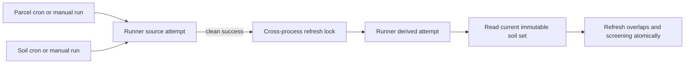

# Independent Union source schedules

## Accepted scope

This is a separate dependent change after soil-5, PR #44. Parcel and soil sources retain independent calendar schedules. The derived refresh has no calendar schedule.

## Acceptance checks

- Source imports and derived refresh use `jobs.Runner.Run` with stable IDs `union.gis.parcels`, `union.gis.soil`, and `union.soil.screening`.
- `./landman` retains the ordered parcel, soil, and screening path under one ten-minute overall deadline. `run <job ID>` supports either source and manual derived retry.
- `schedule` requires explicit `UNION_PARCELS_CRON` and `UNION_SOIL_CRON`. Both are independent five-field calendar expressions with `CRON_TZ`. Startup validates both before accessing the database. There is no default schedule or screening cron.
- The scheduler starts at the next due time, does not backfill missed ticks, and does not retry before the next due time. Shutdown cancels active work and waits for workers. Each scheduled source and its downstream refresh share a ten-minute deadline.
- Clean source success triggers a separate derived attempt. Failed, interrupted, quarantined, and overlap-skipped sources do not trigger it. Derived errors do not erase a successful source outcome. Commands fail and scheduled dispatches log errors when the refresh is incomplete.
- Parcel-only runs never fetch county soil. Soil-only runs never fetch county parcels. Derived refresh reads only immutable members of the current stored soil set. It does not call `StoreWithSet`, create a new set, or update soil fetch timestamps.
- A missing stored set produces an explicit `pending` derived outcome, not success or an invented empty fetch. Successful soil ingestion followed by screening resolves that state. An ingested empty set is distinct from an absent set.
- Successful concurrent sources wait for cross-process derived exclusion before claiming the screening job. They do not discard the derived trigger as an overlap skip. Refresh reads its set after acquiring exclusion. Existing soil-set-head validation and parcel SHARE locking remain in force through publication.
- Derived overlap writes use current set membership, not retired polygon geometry. Historical polygon and legacy overlap rows remain retained as required by soil-4. Screening never treats those historical joins as current evidence.
- Required USDA failure, database failure, or cancellation preserves the prior screening head. Updated overlaps and the new screening head commit together. Existing freshness checks expose changed inputs and refresh failures.

## Verification and live gate

Offline tests cover independent configuration, manual ordering, source-specific dispatch, downstream success and failure, pending status, cancellation, and visible overlap skips. Local HTTP fixtures are the only HTTP endpoints used by tests. Run `go test -race ./... -count=1`, `go vet ./...`, `go build ./...`, and `make test` with `DATABASE_URL` unset.

Database-tagged fixtures cover stored-set reuse, retired membership, changed parcel geometry, atomic overlap and head rollback, and concurrent refresh exclusion on a disposable migrated PostGIS database. Tests must never use an operator database. Record unrun integration checks explicitly.

This plan does not authorize live county or USDA requests, operator database access, scheduler deployment, or live imports. Live verification requires explicit operator approval and a disposable database. Keep the ten-minute limit. Full-county performance under the new independent paths remains a live release check, not an offline-test claim.

## Limits

There is no persistent dispatch queue or crash-time backfill. A crash after source commit but before derived completion requires the next source success or a manual `run union.soil.screening` retry. Source and derived attempts use separate transactions. A timeout while waiting for derived exclusion is a command error or scheduler log error, not a successful refresh. Existing offset-pagination and absent-parcel deletion limitations remain.

## Throughput checkpoint

One worktree owner changes executable composition, current-set loading, and derived publication together. No worker agents are launched. Verification proceeds through runner outcomes and CLI fixtures, offline race tests, vet, build, and diff review. The shared screening head requires serialization. Independent source ingestion remains concurrent.

## Local verification checkpoint

- Fresh offline `go test -race ./... -count=1`, `go vet ./...`, `go build ./...`, and `make test` pass with `DATABASE_URL` unset.
- A tab-separated calendar reproduced a robfig timezone-parser panic. Normalizing the validated fields fixes it. Regression tests also cover validation before database access, shared deadlines, cancellation, and scheduled error logs.
- Stored-refresh tests pass on the new disposable database `union_schedule_retry_1794703528` in the isolated fixture container. SQL Up sections for migrations 1 through 15 were applied transactionally with `psql`. Cancellation after overlap persistence preserves both prior overlaps and the published head. A successful retry publishes the changed parcel.
- Executable smoke checks reject missing schedules before database configuration, persist `pending` for an absent soil set, and exit successfully after SIGTERM with future-only calendars. These checks make no county or USDA requests.
- The full `go test -tags postgres -race ./... -count=1 -timeout 10m` run passed on the disposable database before the rebase. The repeat after the rebase exceeded the 350-second command limit. Targeted PostGIS race tests passed after the rebase. A transactional migration-15 rollback correctly refuses existing pending history and leaves its constraint and history intact.
- No live import, operator database access, commit, push, or deployment has occurred.
