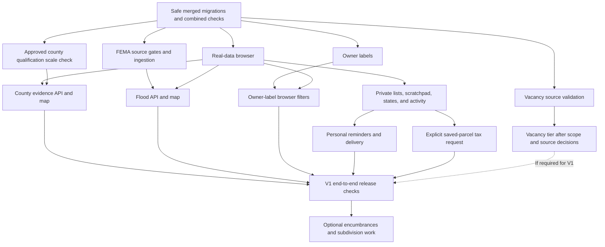

# V1 plan scope and priorities

## Authority and current state

[V1 delivery order](v1.md) remains the product and release contract. This index maps the smaller plans to that contract. It does not rewrite historical checklists, remove committed features, or authorize implementation.

The review uses merged `main` commit `3fbb8f4`. [PR 72](https://github.com/JustinMonty20/landman/pull/72) supplies the authenticated read API. [PR 73](https://github.com/JustinMonty20/landman/pull/73) supplies stored county zoning, jurisdiction, boundary, and road evidence. Both are merged. Neither PR completes the browser workflow or V1.

The browser still uses fictional discovery data. Private saved lists, scratchpad entries, lead transitions, personal activity, reminders, and the explicit saved-parcel tax request are not implemented. Owner labels, the new vacancy tier, FEMA ingestion, and encumbrance ingestion are not implemented.

Use branch `plan/v1-plan-priorities` and PR title `[plan:v1-plan-priorities] 
` for this index. Implementation units need their own matching scoped plan and branch when they are not already covered by an applicable plan.

## Immediate correctness blocker

The merged tree contains two migrations numbered 20 and two numbered 21:

- `000020_parcel_api_indexes.sql` and `000020_union_qualification.sql`.
- `000021_parcel_api_stamp.sql` and `000021_qualification_conflict_topology.sql`.

Goose migration collection reproduced a duplicate-version-20 panic before database access. The SQL-file `validate` command passed; it does not establish unique version ordering. Do not apply this merged migration set to an operator database until it is reconciled.

First inspect which migrations have been applied to each intended database. Then choose a safe version and upgrade path. Do not blindly rename applied migrations or rewrite migration history. Verify a new database and each relevant prior schema state. Preserve parcel IDs, source generations, tax evidence, authentication data, and user records. Add a duplicate-version check and run the combined database suite, not just each former branch's suite.

This blocker has higher correctness value than any new feature below.

## How priority is assessed

Return on effort means useful buyer behavior and reduced correctness risk relative to implementation cost. These are engineering estimates, not measured financial returns or delivery dates.

Prefer work that uses stored evidence, completes the buyer's manual workflow, or prevents incorrect results. Penalize unverified new sources, legal interpretation, new infrastructure, and large numerical rewrites without a demonstrated user benefit.

The ranking is not a single serial queue. Start long required source checks in parallel when their prerequisites are ready. A lower position does not make a committed V1 feature optional.

## Ranked remaining work

| Order | Scoped work | V1 attachment | Return on effort | Reason |
| --- | --- | --- | --- | --- |
| 0 | Reconcile merged migrations and verify the combined application | 1, 2, 3, 4A, 4C | Highest correctness value; small to medium scope | The merged migration set cannot be collected. All later database work depends on a safe baseline. |
| 1 | Connect the browser to real parcel, tax, and soil API reads | 4A | Highest immediate buyer value; medium scope | The read API exists, but the discovery view still shows fictional parcels. Reuse working data before adding more sources. |
| 2 | Add private saved lists, scratchpad, lead states, activity, and exclusion | 4A | Very high buyer value; medium to large scope | The buyer needs to retain decisions and manage manual owner contact. A read-only map cannot complete that workflow. |
| 3 | Implement owner and mailing labels, then expose filters | 4B | High value for relatively small scope | The needed names and mailing states are already stored. No new source fetch is needed. |
| 4 | Complete FEMA source gates, ingestion, parcel evidence, and delivery | 4C and 5 | High required value; large scope | Flood evidence is a committed V1 input with unresolved source and coverage gates. Start source checks early, alongside browser and lead work. |
| 5 | Verify county-scale qualification imports and expose zoning and roads in the API and map | 4C and 5 | High value; medium scope plus an approved live gate | Reuse the new county backend. Stored fixtures do not prove a full county scan fits the deadline or that map delivery is complete. |
| 6 | Add personal follow-up queue and reminder delivery | 4A and 5 | High recurring buyer value; medium to large scope | Complete the buyer's follow-up loop. Requires private lead records and explicit delivery/runtime decisions. |
| 7 | Add the explicit saved-parcel Request tax info action | 3 and 4A | Useful, bounded feature; medium scope | Record one dated observation when requested. It depends on saved parcels and must remain separate from four-file tax ingestion. |
| 8 | Validate structures and assessed values, then implement the vacancy tier | V1 vacancy extension; 4A and 4C | High correctness benefit; large source-dependent scope | Improve the provisional vacancy signal. Resolve coverage, identity, year, and duplicate-row questions before changing classifications. |
| 9 | Add mapped Parcel Encumbrances warnings | Later extension to 4C | Useful additional evidence; medium scope | The county layer is queryable, but legal terms, document linkage, dates, and completeness remain limited. It must not delay committed V1 work. |
| 10 | Add conceptual subdivision sketching and per-lot evidence | Later extension to 4A and 4C | Potentially useful; large scope | It depends on a working real-data map and verified evidence. It does not establish legal subdivisibility. |
| 11 | Research exact geometry and bounded measurement errors | Correctness research across spatial work | Uncertain benefit; bounded research first | Current regressions pass within declared precision. Do not replace the geometry method without measured accuracy and cost benefits. |
| Not queued | Build a generic parcel scraper or a probate/docket monitor | No approved V1 attachment | Unproven value; unresolved source and scope | The broad scraper plan predates the current runner and saved-parcel request contract. Docket monitoring adds a new product and source workflow. Neither is a substitute for personal reminders. |

The main browser, private workflow, owner-label, flood, zoning/road delivery, reminder, and explicit tax-request commitments still belong to V1. The vacancy extension is requested work with source decisions still open; the current V1 release-gate list does not explicitly say that tier replacement must precede release. Confirm that boundary before final release acceptance. Do not silently drop the extension or claim the provisional boolean is a completed vacancy tier.

## Scope and completion boundaries

### Combined baseline

Reconcile migration identities after checking applied database states. Verify a fresh migration, relevant upgrade paths, and the combined API, qualification, authentication, parcel, tax, and soil behavior. Add a version-collision guard. Do not change product features during this fix.

Completion means the combined tree has one safe migration sequence and passes its selected integrated checks. An isolated success on either former PR branch is not sufficient.

### Real-data browser

Connect lookup, stable county-wide result pages, viewport context, map matches, parcel facts, tax evidence, soil evidence, and source status to existing authenticated routes. Cancel obsolete requests and retain the approved layout. Show no matches without a filter, while lookup and neutral map context remain available.

Do not add private lead actions, owner-label rules, new source imports, tiles, or a second API in this unit. Complete it with real stored-data interaction tests and measured browser/query budgets. Unknown and stale evidence must remain visible.

### Private buyer workflow

Store private saved lists, scratchpad entries, explicit state transitions, dated activity, exclusion reasons, and do-not-contact state. Preserve prior activity when source data changes. Protect write routes and verify cross-user isolation. Handwritten notes and owner contact remain external manual actions.

Define the state transition rules and record-retention behavior before implementation. Do not add campaigns, mailing exports, or owner-facing messages. Completion means a buyer can save a real parcel, record a decision, and retrieve the same private work after sign-in.

### Owner labels

Use the stored current owner lines and current mailing state. Backfill and refresh explainable labels without another county download. Keep entity and corporation indicators distinct. Clear old labels when source facts change or become unknown.

Completion includes classifier cases, migration and backfill checks, rollback behavior, API predicates, browser filters, and sampled source comparison. A mailing address outside North Carolina is not proof of owner residence or seller motivation.

### FEMA

Apply the full flood contract in [the follow-up plan](fema-parcel-encumbrances.md#fema-completion-checks) and [the qualification plan](parcel-qualification-layers.md). Deliver catalog discovery, immutable archive evidence, validated atomic publication, versioned parcel evidence, coverage gaps, and the existing application's flood display and filters.

Start catalog, identity, attribution, and coverage checks early. Do not depend on a historical county flood copy or a live ArcGIS query for every map request. Completion requires source receipts and application evidence, not only archive parsing or fixture tests.

### County zoning and roads

Obtain approval for a full-county run in a disposable database. Check complete layer publication, repair counts, time, memory, replay, failure recovery, and the existing deadline. Confirm jurisdiction gaps and source dates rather than asserting current legal authority from a recent fetch.

Then add bounded authenticated evidence and map reads to the existing API. Deliver legends, toggles, highlights, filters, and dates in the existing browser. Do not fetch the county on map movement or infer permitted use, frontage, or legal access. Completion means displayed shapes and parcel facts use the same stored generation.

### Personal reminders

Use private saved leads and dated personal follow-ups. Add the in-app queue, snooze, reschedule, cancellation, and delivery according to the buyer's SMS/email preferences. Resolve runtime, provider, retry, and retention decisions before external delivery. Verify cancellation, duplicate prevention, failures, and user isolation.

Do not create estate alerts, owner outreach, or a new source-ingestion campaign. Completion includes the dated reminder reaching the buyer through the selected delivery path. A queue-only implementation does not meet the existing delivery commitment.

### Explicit tax request

Follow the latest saved-parcel action in [the tax plan](tax-data-ingest.md#saved-parcel-request-tax-info-action). Require an explicit action on a safely matched saved parcel. Make one bounded request and store successful displayed facts as a private dated observation.

Do not fetch on save, view, search, or map movement. Do not retry automatically or bypass denied access. The operator's scoped source-access decision remains in force; the older generic scraper plan does not widen it. Missing or failed evidence is not a zero balance or current payoff quote.

### Vacancy extension

First validate the structures source and assessed-value selection rules. Then ingest both sources, publish versioned evidence, derive the documented tier, migrate readers, and only later remove the provisional boolean. Keep tax debt out of vacancy classification.

The reported back-tax total is already exposed by the merged tax API. Reuse it in the browser instead of implementing another sum or file importer. Verify its active-source identity and unknown/not-listed meaning. Building coverage and assessed-value ambiguity remain separate unresolved work.

### Optional encumbrances, sketching, and numerical research

Keep the three units separate. Encumbrances supplies a mapped warning, not verified legal terms. Sketching supplies conceptual partitions, not subdivision approval. Geometry research compares methods and error bounds before proposing replacement code.

Use [the follow-up plan](fema-parcel-encumbrances.md) for encumbrances and numerical research. Use [the sketching plan](parcel-subdivision-sketching.md) for hypothetical lots. These units cannot replace required flood delivery, private workflow, or reminder completion.

## Every plan mapped to V1

Status below describes merged code and remaining boundaries. An unchecked historical box is not proof that code is absent. A merged backend is not proof that all original release checks passed.

| Plan | V1 attachment | Current scope and disposition |
| --- | --- | --- |
| [v1.md](v1.md) | All stages | Main product contract. Preserve the manual buyer workflow and required release inputs. |
| [soil-filter-1.md](soil-filter-1.md) | 1 | Implemented provisional numeric-zero filter. Historical unit, not a new task or proof of vacancy. |
| [soil-persist-main.md](soil-persist-main.md) | 1 | Implemented stable parcel storage and complete multipart publication. Preserve it during later work. |
| [parcel-geometry-topology.md](parcel-geometry-topology.md) | 1 | Implemented parcel ring correction. Historical fix, not a new exact-geometry research plan. |
| [source-jobs-runner-scheduler.md](source-jobs-runner-scheduler.md) | 2 | Runner, attempt history, quarantine, manual commands, and source scheduling are implemented. Preserve source-owned transactions and current operating limits. |
| [union-independent-schedules.md](union-independent-schedules.md) | 2 | Implemented independent parcel/soil scheduling and stored-soil refresh. Its older composition descriptions are historical, not permission to remove later qualification jobs. |
| [tax-data-ingest.md](tax-data-ingest.md) | 3 and 4A | Four-file local backend is implemented. Private saved-parcel requests remain. Shared cloud artifact mode needs a later platform/runtime decision; do not add an automatic tax download schedule. |
| [parcel-data-api.md](parcel-data-api.md) | 4A | Merged read-only API. Real-data browser integration, private writes, and qualification read routes remain outside that delivered subset. |
| [browser-parcel-ui.md](browser-parcel-ui.md) | 4A and 5 | Layout prototype and authentication are merged. Real discovery, private lead workflow, explicit tax requests, reminders, evidence integration, and interactive verification remain. |
| [parcel-owner-labels.md](parcel-owner-labels.md) | 4B | Planned classifier, persistence, backfill, refresh, and filters. High return because source facts are already stored. |
| [parcel-qualification-layers.md](parcel-qualification-layers.md) | 4C and 5 | Parent contract for zoning, roads, and effective flood evidence. County backend is a delivered subset; FEMA and buyer-facing integration are not complete. |
| [union-qualification-ingestion.md](union-qualification-ingestion.md) | 4C | Merged county backend for 15 layers and parcel evidence. Full-county operating verification, source authority/coverage checks, and API/map delivery remain. |
| [fema-parcel-encumbrances.md](fema-parcel-encumbrances.md) | FEMA: 4C and 5. Other sections: later extensions | Split its priorities by section. FEMA is required. Encumbrances is optional follow-up. Geometry accuracy is research, not a rewrite commitment. |
| [vacancy-building-tax-evidence.md](vacancy-building-tax-evidence.md) | Requested vacancy extension; 3, 4A, and 4C | Structures, assessed-value validation, and tier replacement remain. Back-tax read aggregation is already in the API; browser delivery remains. Confirm the tier's release boundary. |
| [soil-layer.md](soil-layer.md) | Parcel prerequisites in 1; separate soil evidence consumed by 4A | Parcel and soil backend units, including use-specific screening, are implemented. Do not restart the original multi-PR program. Map soil delivery can reuse stored assessments; soil remains separate optional enrichment under V1. |
| [soil-fetch-cancellation.md](soil-fetch-cancellation.md) | Supporting correctness for 2 and soil | Implemented cancellation fix. Preserve the regression; no new feature queue item. |
| [soil-5-perf.md](soil-5-perf.md) | Supporting soil verification | Historical measured receipt. It is not an outstanding optimization plan or a current county qualification performance result. |
| [soil-5-wss.md](soil-5-wss.md) | Supporting soil verification | Historical Web Soil Survey comparison. Preserve its source-version warnings; it is not a new implementation task. |
| [parcel-subdivision-sketching.md](parcel-subdivision-sketching.md) | Later extension to 4A and 4C | Planned conceptual lot tool with unresolved product decisions. Defer until real map and evidence work. |
| [scraper-enrichment.md](scraper-enrichment.md) | No current V1 work unit | Older generic scraper design. Source and retained fields are unresolved; its automatic GIS-hook placement does not match current saved-parcel access rules. Re-scope before any implementation. |
| [v1-plan-priorities.md](v1-plan-priorities.md) | All stages | This index. It orders work and maps scopes; it does not replace acceptance criteria in the owning plans. |

The `soil5-arena-*.log`, `soil-5-full-trace.log.gz`, and `soil-5-phased-explain.txt` files are supporting evidence, not separate plans to schedule.

Outside `plans/`, [the old scraper todo](../todo/webscraper_enrichment.md) already points to the replacement scraper plan. [The docket-monitor todo](../todo/docket_monitor_notifications.md) is a separate unimplemented probate/event-alert proposal. It has no approved V1 source or user-workflow contract. Do not treat it as the personal reminder implementation.

## Practical parallel order

Do not wait for FEMA completion to make existing real parcel and tax data useful. Do not ship V1 without its required flood evidence and personal workflow. Numerical research can proceed as a bounded independent study, but it must not silently become a blocker for unrelated delivery.

## Handoff checks

- [ ] Resolve the migration collision and verify the combined schema before another migration-bearing feature.
- [ ] Confirm source and runtime decisions for the next selected unit. Live imports require explicit approval and a disposable database.
- [ ] Create or select one scoped implementation plan with concrete completion checks. Keep unrelated source imports, private workflow changes, and research separate.
- [ ] Preserve the original V1 commitments, source-access decisions, user isolation, and no-outreach boundary.
- [ ] Use [the review verification procedure](../docs/review-verification.md). Save selected risk-based checks and declare incomplete source or performance gates.
- [ ] Before execution, refresh the plan list and merged-head status. Update this index when code or product decisions change; do not rewrite completed plans to make their old checkboxes look current.
