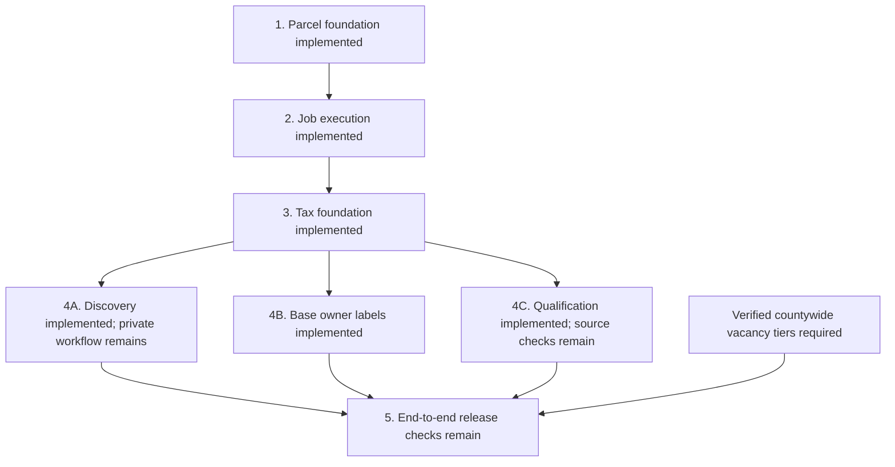

# V1 delivery order

Build parcel and tax ingestion first. Then build the UI and the remaining required data layers in parallel. The buyer writes handwritten notes outside the application. The application supplies evidence, a private scratchpad, explicit lead states, and personal follow-up reminders.

## Approved reminder scope

V1 reminders use SMS only, sent to the user's own verified US phone number. Email reminders and email reminder preferences are deferred by operator decision. The in-app task queue remains required. See [the private favorites board](parcel-favorites-board.md) for the approved message, timing, and failure rules.

## Current status — 2026-11-23

This status uses committed `main` at `1be1746`. A fetch confirmed that `origin/main` has the same commit. It excludes uncommitted changes. **Implemented** means code is present. It does not mean that current source data, countywide coverage, or all release checks have passed.

| Stage | Implemented on main | Remaining work or acceptance checks |
| --- | --- | --- |
| 1 — Parcel foundation | Stable parcel IDs, multipart geometry, provisional vacancy filtering, retained source evidence, replay, quarantine, and geometry repair paths. | Preserve full-import, identical-rerun, and atomic-publication checks. Verify deployment data after replay or repair. Merged fixes do not update an existing database. |
| 2 — Reliable refreshes | Shared job runner, attempt history, exclusion, cancellation, independent source schedules, and source status. Shared ingestion code accepts parcel, tax, and soil inputs. | Verify unattended execution, interruption recovery, source failures, and freshness in the release environment. Preserve source-specific schedules and publication rules. |
| 3 — Tax foundation | Four operator-supplied file feeds, parcel linkage, retained evidence and replay, unmatched-record review, and reported delinquent totals in the read API. | Verify active files, dates, unmatched records, and browser evidence with release data. Private saved-parcel DevNet observations are not implemented. |
| 4A — Discovery and details | Authenticated Go API and Svelte UI; lookup; all-parcel browsing; shared map/list filters; bounded outlines; selection that locates the parcel; OpenFreeMap context; stored parcel, tax, soil, zoning, road, and flood details. Individual detail-field choices persist per account. Owner-name reads are scoped to the selected parcel. | Implement private saved lists, scratchpad, lead states, dated personal activity, saved-parcel tax requests, and personal reminders. Display preferences are not saved leads. Complete user-isolation and interactive performance checks. |
| 4B — Owner labels | Mailing-state, entity-name, and corporation-name labels; stored-data classification; refresh integration; API predicates; browser filters. | Preserve missing-value and changed-owner behavior. Verify sampled source cases and explain label limits. Estate and trust extensions are not part of this committed delivery. |
| 4C — Qualification | County zoning, jurisdiction, boundary, and road ingestion; FEMA archive ingestion; stored parcel evidence; authenticated map and detail reads; named legends and parcel filters. Missing-geometry records are retained and counted without being used as mapped coverage. | Verify source authority, dates, coverage, complete county captures, replay, failure recovery, and operating limits. Code and fixture tests do not establish current countywide source completeness. |
| 5 — Integration and release | Qualification layers, legends, filters, and selected-parcel evidence are integrated into discovery. | Complete the private buyer workflow, reminder delivery, and verified countywide vacancy tiers. Verify the full workflow, source failures, cancellation, isolation, and performance. V1 is not release-complete. |

### Delivered UI milestones

- **Parcel evidence — PR #118:** Selected parcels show stored evidence. The application mounts zoning and road routes.
- **Parcel discovery — PR #119:** The browser lists all stored Union County parcels by default. Filters narrow results and map matches. Selection locates the parcel. Outlines appear at a wider zoom.
- **Flood and jurisdiction filters — PR #113:** Legend selections filter parcel discovery. Layer visibility and parcel criteria remain separate controls.
- **Basemap and detail preferences — main through PR #120:** OpenFreeMap supplies street and place context. Each account can select individual detail fields. All fields appear by default unless the account has saved a selection.

See [parcel-first discovery](parcel-first-discovery.md), [individual detail fields](parcel-detail-preferences.md), and [browser parcel UI](browser-parcel-ui.md) for the scoped contracts. Historical checklists are not a current implementation inventory.

## Delivery contract and remaining work

### 1 — Parcel foundation

Preserve stable parcel IDs and complete multipart geometry. A failed import must not publish partial parcel geometry. Verify a full import and an identical rerun. Use retained source evidence for replay and repair.

Plans: [parcel prerequisites and soil](soil-layer.md), [parcel ingestion evidence](parcel-ingestion-evidence.md), and [shared ingestion](shared-ingestion.md).

### 2 — Reliable refreshes

Use the job runner for manual and scheduled source work. Preserve exclusion, cancellation, attempt history, restart safety, and visible failures and last clean success. Keep independent source schedules. Parcel or soil changes must refresh derived soil evidence from stored inputs without forcing another county soil fetch.

Plans: [source jobs and scheduler](source-jobs-runner-scheduler.md) and [independent schedules](union-independent-schedules.md).

### 3 — Tax foundation

Keep all four local-file feeds: billing, delinquency, foreclosure sales, and foreclosure pipeline. Preserve reliable linkage, source dates, and unmatched-record review. Require operator file paths; do not claim that the application downloaded these files.

Reported back-tax aggregation is implemented and available in parcel details. It is a dated total from reported delinquent evidence, not a current payoff quote. Billed tax is not unpaid tax. Missing records do not establish zero debt. Do not add countywide payment-history ingestion for screening.

Plan: [tax data ingestion](tax-data-ingest.md).

### 4A — Application and private buyer workflow

Continue in the Svelte application in `ui/` and the Go API in `cmd/api/`. Do not create a separate qualification viewer. Use working parcel and tax data while other required inputs are verified.

- [x] Connect real parcel discovery, filters, map selection, and stored evidence.
- [x] Add account-owned individual detail-field preferences.
- [ ] Add private saved lists, scratchpad entries, explicit lead states, and dated handwritten-note and response activity. Handwritten notes and owner contact remain external manual actions.
- [ ] Add an explicit **Request tax info** action for a saved parcel. Make one bounded DevNet request per explicit action. Store successful displayed facts as private dated observations. Saving, viewing, searching, and map movement must not make this request. Respect denial and failure limits. A failure is not a zero balance.
- [ ] Add scheduled personal follow-ups, an in-app queue, SMS preferences, snooze, rescheduling, and cancellation. Select the runtime and delivery provider before implementation. Queue-only delivery does not satisfy V1.
- [ ] Verify that source refreshes preserve private records and that users cannot read or change another user's records.

No committed change removes the saved-parcel tax-request requirement. External research links and uncommitted plan edits do not satisfy it.

### 4B — Owner labels

Preserve explainable mailing-state and entity-name indicators. Recompute them when source fields change, including changes to missing values. Clear old classifications. Mailing outside North Carolina is not proof of residence or seller motivation. A name suffix is not verified corporate registration. Keep entity and corporation indicators distinct.

Plan: [parcel owner labels](parcel-owner-labels.md).

### 4C — Qualification layers

Zoning/jurisdiction, road proximity, and current effective flood evidence remain required V1 inputs. Their ingestion, parcel evidence, and UI paths are implemented. Earlier failed source probes do not describe the implemented FEMA archive request path.

- [ ] Verify source identity, authority, dates, coverage, and classification for release inputs.
- [ ] Verify complete multi-page county captures, publication, replay, failure recovery, and operating limits. A single-page diagnostic is not a countywide import.
- [ ] Verify that displayed shapes and parcel facts use the same stored generation.
- [ ] Verify spatial calculations, geometry-dependent refreshes, and visible freshness and unknown states. An empty or unvalidated flood layer does not satisfy V1.

Plans: [qualification contract](parcel-qualification-layers.md), [county ingestion](union-qualification-ingestion.md), and [FEMA ingestion](fema-source-ingest.md).

### 5 — Integration and V1 release

- [ ] Deliver verified countywide vacancy tiers. Complete the source, coverage, classification, publication, and consumer checks below before release.
- [ ] Verify discovery through saved leads, scratchpad, state changes, personal activity, tax observations, and scheduled reminders.
- [ ] Verify all three qualification groups, legends, details, summaries, and filters with release data.
- [ ] Verify source failures, unknown evidence, user isolation, reminder delivery, duplicate prevention, and cancellation.
- [ ] Measure representative county interaction budgets. Record limits, including concurrent load and populated soil-rating results when not measured.

Backend completion and a working discovery UI do not establish V1 completion. Use [review verification](../docs/review-verification.md) and the scoped plans to select checks. This status update does not supply new test receipts.

## Dependencies

This is the selected delivery order, not a claim that owner labels or qualification investigation technically depend on tax data. Continue independent work in parallel. Do not wait for every source check before using the real-data UI.

## Required vacancy tiers — implementation and open gates

Verified countywide vacancy tiers are required before V1 release. The operator confirmed this release requirement on 2026-11-23. Implemented code or unverified source captures do not satisfy it.

The requested vacancy tiers are `strong_candidate`, `review`, `conflict`, and `unknown`. Main implements structures and assessed-value capture and replay paths, tier derivation, and vacancy API reads. This is no longer only a proposed classifier.

Live coverage, assessment row selection, source identity, year, and capture gates remain open. An unverified capture must not establish a strong vacancy conclusion. Implemented tiers do not prove that the release database has a verified vacancy publication. Keep footprint/assessment disagreement visible. Keep tax debt out of vacancy rules and retain parcels in storage.

- [ ] Complete live source and coverage gates before treating the tiers as verified countywide evidence.
- [ ] Verify consumer migration and replacement of the provisional `likely_vacant` signal before any later removal.
- [ ] Verify the published tiers and their reasons in discovery filters and parcel details with release data. Preserve conflict and unknown states. Do not release V1 until the required source and consumer checks pass.

Plans: [vacancy and tax evidence](vacancy-building-tax-evidence.md) and [Union vacancy ingestion](union-vacancy-ingestion.md).

## Boundaries

- **Personal workflow only:** Do not add owner-facing messages, outreach generation, campaigns, or mailing exports. Personal notifications go to the buyer's own verified US phone number. Email reminders are deferred.
- **Tax freshness:** Approximately twice-yearly file refreshes do not support promises of timely foreclosure alerts. Saved-parcel observations remain separate from countywide tax ingestion.
- **Spatial evidence:** Mapped zoning, roads, flood, and soil evidence does not establish permitted use, legal access, survey boundaries, or site approval.
- **Optional soil work:** Soil remains optional enrichment under its separate release contract. This roadmap does not add septic machine-learning work as a V1 dependency.
- **Separate proposals:** Map caching, subdivision sketching, ordinance document ingestion, and uncommitted parcel-detail proposals do not count as delivered V1 features. They do not replace required qualification checks or the private buyer workflow.

This roadmap records delivery status and preserves existing commitments. It does not authorize new implementation or replace detailed source contracts.
