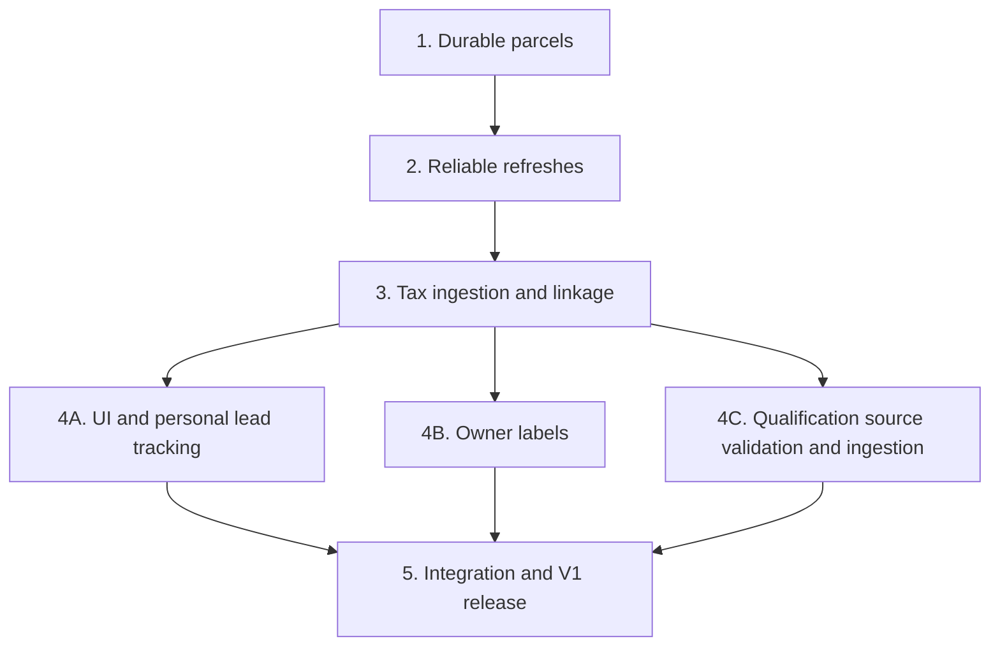

# V1 delivery order

Build parcel and tax ingestion first. Once both work, build the UI in parallel with the remaining required data layers. The buyer writes handwritten notes outside the application; the application supplies evidence, a scratchpad, lead states, and personal follow-up reminders.

## Implementation sequence

| Order | Workstream | Work | Plans | Completion checkpoint |
| --- | --- | --- | --- | --- |
| 1 | Parcel foundation | Implement the vacancy filter and durable full-county parcel import, preserving stable parcel IDs and complete multipart geometry. This is the parcel prerequisite work, not the whole soil release. | [Soil plan: filter-1 and persist-1](soil-layer.md) | Full import and identical rerun succeed; IDs remain stable; failures do not publish partial parcel geometry. |
| 2 | Reliable refreshes | Wrap the parcel importer with manual execution, scheduling, job exclusion, attempt history, cancellation, and freshness reporting. Establish the same execution path for subsequent sources. | [Source jobs and scheduler](source-jobs-runner-scheduler.md) | Imports run unattended, interrupted attempts restart safely, and failures and last clean success are visible. |
| 3 | Tax foundation | Implement tax ingestion and reliable parcel linkage, then integrate the logical tax job with the runner. Reconcile the V1 tax-evidence scope with the broader tax implementation plan before starting. | [Tax data ingest](tax-data-ingest.md), [Source jobs](source-jobs-runner-scheduler.md) | Agreed tax evidence is persisted, correctly linked, dated, and queryable; unmatched records and stale data are visible. Parcel and tax functionality unlock the parallel tracks below. |
| 4A | UI — in parallel with 4B and 4C | Establish the application/API location, authenticated application shell, and user isolation. Build parcel map/list, search, filters, and parcel details using working parcel and tax data. Add saved lists with an explicit Request tax info action for a saved parcel and dated DevNet observations, scratchpad, explicit lead states, and dated handwritten-note/response history. Build scheduled personal follow-up reminders with an in-app queue, SMS/email preferences, snooze, rescheduling, and cancellation. | This V1 plan | The buyer can discover a parcel, inspect evidence, save it, record his own activity, change status, and receive a scheduled reminder at his own phone number or email. No owner-facing message generation or delivery. |
| 4B | Owner labels — in parallel with 4A and 4C | Backfill mailing-state and entity-name indicators, then recompute them during parcel refreshes. Integrate labels into discovery filters and parcel evidence as they become available. | [Parcel owner labels](parcel-owner-labels.md) | Labels are explainable; source changes and missing values replace old classifications correctly. Labels do not assert seller motivation. |
| 4C | Qualification layers — in parallel with 4A and 4B | Validate source contracts first, especially current FEMA flood retrieval and coverage. Ingest zoning/jurisdiction, road centerlines, and effective flood zones with supporting coverage metadata. Publish validated source generations and derive parcel overlaps and road distances. | [Parcel qualification layers](parcel-qualification-layers.md), [Source jobs](source-jobs-runner-scheduler.md) | All three evidence groups have verified sources, repeatable imports, correct spatial calculations, and visible freshness/unknown states. Parcel/source changes trigger recomputation without altering private user records. |
| 5 | Integration and V1 release | Finish qualification map groups, legends, detail sections, results summaries, and filters in the same UI. Verify discovery through saved leads, scratchpad, states, and personal follow-ups end to end. | This V1 plan; [Parcel qualification layers](parcel-qualification-layers.md) | All three required qualification groups and the personal tracking workflow pass release checks, including user isolation, source failures, reminder delivery, and cancellation. Backend completion alone is not V1 completion. |

The parallel tracks may finish at different times. The UI can be exercised with parcel and tax data before labels and qualification layers land; integrate those inputs incrementally rather than waiting for every source before showing usable screens.

## Dependencies

This is the chosen delivery order, not a claim that owner labels or qualification-source investigation technically depend on tax data. The explicit start point for the UI and remaining data workstreams is working parcel and tax ingestion.

## New vacancy and back-tax planning request (2026-11-14)

The Union billing CSV and 2017–2025 delinquent list cover current-year tax billed and reported past-due `RE` balances, respectively. Add a parcel-level sum of reported back taxes across listed years. Do not confuse billed tax with unpaid tax. Do not ingest countywide payment history for this screening; show the delinquent-list date and require confirmation of the present balance. An explicit Request tax info action for a saved parcel records only displayed DevNet facts and their observation time, subject to the access and failure limits in the tax plan. The existing parcel GIS `likely_vacant` boolean is a temporary first signal. Validate the official structures and assessed-building-value GIS layers before deriving `vacancy_tier` with `strong_candidate`, `review`, `conflict`, and `unknown` values. After the new tier is backfilled and its consumers are migrated, remove the stored boolean in a later migration. A footprint and parcel fields can disagree. Keep all parcels in storage and keep debt out of the vacancy rule.

The official structures layer 171 URL and its basic fields are verified, and assessed-building-value GIS fields are observable. Structures coverage, assessment row selection and year, and tier implementation are not yet verified. Plan that extension after the parcel foundation, and integrate it into discovery after validation. Do not treat the present soil filter or tax schema as if it already provides the new tier or summed balance. Detailed gates are in [vacancy-building-tax-evidence.md](vacancy-building-tax-evidence.md) and [tax-data-ingest.md](tax-data-ingest.md#new-source-findings-and-back-tax-request-2026-11-14).

## Gates and boundaries

- **Tax scope:** the existing tax plan covers billing, delinquency, and both foreclosure sources. Keep all four feeds. The separate Request tax info action for a saved parcel belongs to the authenticated application workflow, not the countywide tax job. Its approximately twice-yearly file refresh does not support promises of timely foreclosure alerts.
- **Flood source:** the qualification plan records unsuccessful flood-zone queries during drafting. Successful current-feed retrieval, coverage assessment, and classification verification are open gates, not optional cleanup. An empty or unvalidated flood layer does not satisfy V1.
- **UI location:** no established application frontend/API is identified in the qualification plan. Resolve that at the start of the UI track and use one application stack, not a separate qualification viewer.
- **Required qualification:** zoning/jurisdiction, road proximity, and current effective flood evidence are committed V1 features. Earlier UI milestones are usable development milestones, not the completed V1 release.
- **Personal workflow only:** handwritten notes remain external manual activity. Keep scratchpad, state transitions, and scheduled notifications to the buyer; do not add mailing exports, outreach generation, campaigns, or owner-facing messaging.
- **Outside the critical path:** soil screening is separate optional enrichment under its existing release contract. This roadmap does not add septic ML work or make it a V1 dependency.

This roadmap sequences existing plans; it does not authorize implementation or replace their detailed contracts. Additional scoped implementation plans may be needed for the new application work and for any explicitly approved changes to existing plan boundaries.
